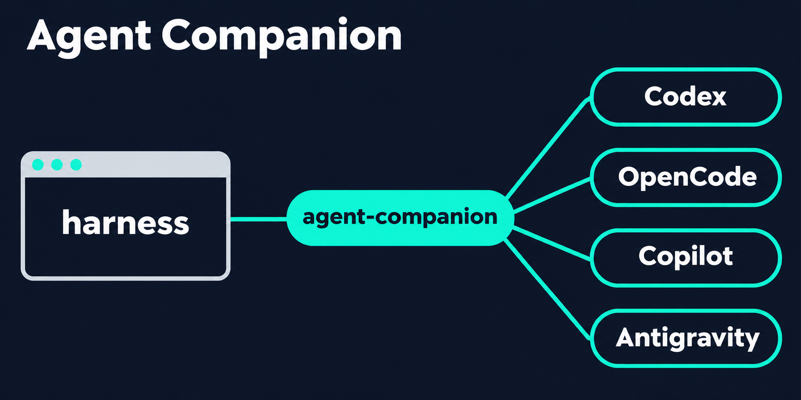
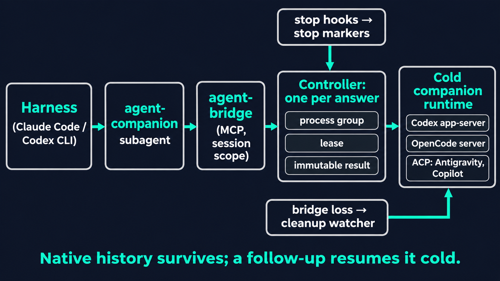
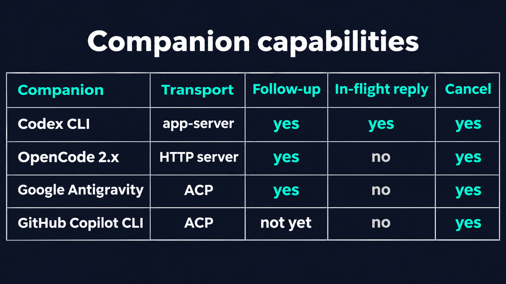

# Agent Companion



Agent Companion is a delegation plugin for coding agents built around one
public contract:

> Come with any harness and attach any companion of your choice to it.

A **harness** is the parent coding-agent surface you already work in. Supported
now: **Claude Code** and **Codex CLI**.

A **companion** is the downstream agent runtime that receives delegated work.
Supported now: **OpenCode**, **GitHub Copilot CLI**, **Codex CLI** and **Google
Antigravity** (Codex CLI can be both the harness and a downstream companion — the two roles are
independent; running Codex as a companion does not require Codex as the harness,
or vice versa).

Talk to the `agent-companion` subagent in plain language. Give it the task, the
absolute repo or worktree path, and any companion or model preference. Follow-ups
to the same subagent cold-resume saved history where supported; a new subagent starts
independent work. Run long work in the background.

The product posture is deliberately companion-neutral:

- **Bring your harness.** Install the Claude Code surface, the Codex CLI surface,
  or both.
- **Attach your companion.** Name OpenCode, Copilot, Codex or Antigravity, or let
  the subagent choose a ready companion from the catalog. Set a default if useful.
- **Keep the parent workflow clean.** Delegated work runs through the isolated
  subagent. Both hosts register the internal bridge at plugin/session scope;
  execution calls require the native child owner.
- **Discover available choices.** Ask what companions and models are available.
  The read-only catalog reports configuration, capabilities and readiness.
- **Keep failures explicit.** The subagent relays refusals and terminal failures.
  The delegated work stays with the companion; failure does not authorize the
  subagent to finish it or silently choose another companion or model.

Implementation note: today the CLI and MCP schema still use `host` for harness
selection and `target` for companion selection. Those names are stable public
flags for the MVP.

Current implementation status lives in [docs/MVP_TRACKER.md](docs/MVP_TRACKER.md).
Architecture details live in [docs/ARCHITECTURE.md](docs/ARCHITECTURE.md).
Public release gates live in [docs/RELEASE_READINESS.md](docs/RELEASE_READINESS.md).
The project is in active development. The shipped controller owns one cold
provider runtime per answer. Codex desktop and Copilot cold follow-up remain
unqualified; local tests do not replace installed-host acceptance.

## What It Does

1. The parent spawns `agent-companion` with a plain-language request and an
   absolute repo or worktree path. The subagent asks if the path is missing.
2. The subagent honours a named companion and model. When the choice is open,
   it reads the catalog once, chooses a ready companion and leaves the model
   to that companion's configuration.
3. It sends a clear message with the task, context, constraints and desired
   answer. The bridge passes that message to the companion verbatim.
4. The controller starts a provider process in its own process group, loads
   saved history when continuing, and sends the message once. It records progress
   and the result, terminates the owned tree and publishes completion.
5. The subagent waits with a bounded budget, then returns the companion's answer
   as given. It relays questions to the parent and keeps any checks of its own
   under a separate heading.

For example: "Ask Codex to review the changes in /absolute/path/to/repo. Keep it
read-only and explain any bugs with file references." Send the next message to
that same subagent to continue the review. The parent chooses what a good answer
looks like; the bridge adds no instructions or required answer format.

The catalog lists enabled companions, the default companion, per-companion model
configuration, reply/resume/cancel/model-selection capabilities, readiness and
the installed version seen at the last check. An unset model default is reported
as inheriting the companion's own configuration. A list that needs a session is
reported as "not enumerable without a session". Reading the catalog starts no
work and changes no job, ownership, lease, ledger or digest state.



The shipped flow: harness, subagent, session-scoped bridge, one controller per
answer, one cold companion runtime per answer. Details are in
[Architecture](docs/ARCHITECTURE.md#flow).

## Supported Companions



The table below is the current capability contract.

| Companion | Per-answer runtime | Follow-up by cold resume | Reply / steer | Model selection | History |
| --- | --- | --- | --- | --- | --- |
| OpenCode 2.x | Private authenticated `opencode serve` | Saved session | Unsupported | `provider/model`, optional variant | Vendor-persisted session |
| GitHub Copilot CLI | `copilot --acp` | Unsupported until qualified | Unsupported | Inherit or supported explicit model | Session id retained; cold load unqualified |
| Codex CLI | `codex app-server` | `thread/resume` | `turn/steer` while running | Inherit or explicit override | Native thread and rollouts |
| Google Antigravity | `agy_acp_server.par` over ACP | `session/load` | Unsupported | Session model after new/load | Native SQLite history |

All support send, wait, status and cancel. Every answer runs in a new process;
there is no shared provider runtime or adapter-selection setting. Copilot
follow-ups return `FOLLOWUP_UNSUPPORTED` until cold loading is qualified.
`agent_reply` returns `reply_unavailable` unless that execution supports steer.
Bridge loss stops the owned tree through the cleanup watcher and keeps native
history; in-flight work does not survive bridge replacement. The next message
to the same native child resumes cold. An unavailable history fails explicitly.

Configuration:

- `AGENT_COMPANION_OWNER_GRACE_MS` controls the owner attachment grace (default
  120000 ms). Pending send/wait/reply/cancel calls hold the lease; status and
  catalog do not. Stop hooks write owner markers. Total execution has no
  40-minute cutoff; each wait is still bounded by the host's per-call timeout.
- `AGENT_COMPANION_DEFAULT_TARGET` overrides the `default-target` file.
  `AGENT_COMPANION_CODEX_MODEL` and `AGENT_COMPANION_OPENCODE_MODEL` set model
  defaults. Per-companion default-model files are supported; an explicit request
  overrides them. With neither set, the companion inherits its own configuration.
- OpenCode requires 2.x and uses server permissions from its configuration.
  Its private loopback password is kept in memory, never in durable records.
- Codex defaults to `workspace-write` with network enabled. Use
  `AGENT_COMPANION_CODEX_NETWORK=off` or
  `AGENT_COMPANION_CODEX_SANDBOX_MODE=read-only|workspace-write|danger-full-access|bypass`.
  `bypass` maps to `danger-full-access`; approval policy stays fixed at `never`.
  `.git`/`.codex`/`.agents` remain read-only under `workspace-write`, even with
  extra writable roots. The measured approval/sandbox constraints are in
  [Architecture](docs/ARCHITECTURE.md#negative-results).
- Codex inherits configured MCP servers, whose startup can delay a turn.
  Rollouts persist under `$CODEX_HOME/sessions` (default `~/.codex/sessions`)
  without automatic cleanup. No model key is sent when inheriting its model.
- Install and sign in to Antigravity with
  `node scripts/install-antigravity-acp.mjs --login`. It verifies Google's
  signature on macOS and installs under
  `~/.local/share/agent-companion/antigravity-acp/`;
  `ANTIGRAVITY_ACP_BIN` overrides the binary. Credentials remain with the
  server under `~/.gemini/antigravity-acp/` and the login keychain.
  `AGENT_COMPANION_ANTIGRAVITY_PERMISSION=all|edit|none` controls permission
  answers (default `all`). Use the real project cwd: its sandbox resolves
  symlinks. Model selection is reapplied after each history load. The
  account/terms assessment remains [tracker item 8](docs/MVP_TRACKER.md).

See [Architecture](docs/ARCHITECTURE.md) for protocol and lifecycle details,
and [Diagnostics](#diagnostics) for installation problems.

## Requirements

- Node.js `>= 22`.
- `npm`.
- `jq` for hook delivery.
- At least one companion runtime:
  - OpenCode on `PATH`, or `OPENCODE_BIN=/absolute/path/to/opencode`.
  - GitHub Copilot CLI on `PATH`, or `COPILOT_BIN=/absolute/path/to/copilot`.
  - Google's Antigravity ACP server, installed by
    `node scripts/install-antigravity-acp.mjs` (or
    `ANTIGRAVITY_ACP_BIN=/absolute/path/to/agy_acp_server.par`) and signed in
    with `--login`.
  - Codex CLI on `PATH`, or `CODEX_BIN=/absolute/path/to/codex`, authenticated
    via `codex login` (ChatGPT plan) or an API key.
- Claude Code CLI when installing the Claude surface.
- Codex CLI when installing the Codex surface.

OpenCode authentication and provider setup stays inside OpenCode. Copilot
authentication stays inside Copilot CLI. Codex authentication stays inside
Codex CLI. Antigravity authentication stays inside Google's ACP server and
the login keychain. Agent Companion does not ask for or store provider secrets.

## Fast Path

From the repository root, preview setup or pick the harness surface you use:

```bash
# Detect installed harnesses and preview changes without installing anything.
bash setup.sh --dry-run

# Codex source-checkout install, without selecting a default target yet.
bash setup.sh --host codex --target none

# Or Claude source-checkout install, without selecting a default target yet.
bash setup.sh --host claude --target none

# See target readiness and next steps.
node scripts/onboard.mjs --list-targets

# Persist a default target for Codex state.
AGENT_COMPANION_HOST=codex node scripts/onboard.mjs --target opencode --set-default

# Or persist a default target for Claude state.
AGENT_COMPANION_HOST=claude node scripts/onboard.mjs --target opencode --set-default
```

For a narrower install:

```bash
# Codex only, OpenCode default.
bash setup.sh --host codex --target opencode

# Claude only, Copilot default.
bash setup.sh --host claude --target copilot

# Harness/plugin surface only. Keep any existing companion configuration.
bash setup.sh --host both --target none
```

Without `--host`, setup detects the installed CLI. If both are installed, it
asks which to use in a terminal; non-interactive runs must pass `--host`.
Without `--target`, existing target and model defaults are preserved.
On a clean install, the only ready companion is selected; multiple or zero ready
companions require a choice (or `--target none` to attach one later).

`setup.sh --host both --target auto` selects the only ready target for both
hosts explicitly. If multiple targets are ready, pass the target explicitly.
`--target none` leaves existing configuration untouched; it does not clear a default.

Setup checks prerequisites and companion readiness before installation and
shows the intended changes. Interactive runs confirm that plan; `--yes` skips
confirmation. Explicit flags also work without a terminal. `--dry-run` applies
nothing. No setup path runs a quota-spending companion task.

A new default is saved after installation and checks pass. A missing binary or
authentication blocks the change unless `--no-target-check` explicitly defers
readiness. An environment override that would mask the new target is explained
instead of silently replaced.

If installation stops partway, setup lists completed stages and keeps the
previous companion configuration. Fix the reported error and rerun the same
command; completed installation steps are safe to repeat. A failure while
configuring the second harness can leave the first harness configured, and the
status shows each separately. User-owned agent files are preserved and require
manual reconciliation. The final status distinguishes installation from live
delegation verification and names the required fresh session/hook approval.

## Onboarding Commands

Inspect companions with `node scripts/onboard.mjs --list-targets`;
see [Diagnostics](#diagnostics) for readiness checks. The subagent's catalog
also reports model configuration and capability limits.

For the full flag reference, run `node scripts/onboard.mjs --help`. `--plan --json` previews
selection and readiness without writes; `--smoke` explicitly opts into a real
companion task that can spend quota.

For standalone host-specific writes, set `AGENT_COMPANION_HOST=codex` or
`AGENT_COMPANION_HOST=claude` on the command. `setup.sh` does this for each
host when it delegates to onboarding.

An ordinary onboarding rerun preserves existing configuration unless `--target`
explicitly selects a change. Readiness failure leaves the default untouched;
`--no-target-check` can defer readiness, but a failed requested smoke never
persists a new default. Codex smoke requires a completed assistant response
matching `ready`, not just a successful CLI exit.

`AGENT_COMPANION_DEFAULT_TARGET` overrides the persisted `default-target`.
If `agent_send` omits `target` and no default is configured, the bridge returns
`TARGET_UNCONFIGURED`. Model defaults use `AGENT_COMPANION_CODEX_MODEL`,
`AGENT_COMPANION_OPENCODE_MODEL`, Copilot's `default-model` file and the
Antigravity descriptor default. A request can supply an explicit model override;
otherwise the companion uses its configuration. Legacy configuration migration
is described in [Architecture — State](docs/ARCHITECTURE.md#state).

## Install For Claude Code

This repo is its own marketplace. Register it once, from GitHub or from a
local checkout path, then install the plugin:

```bash
claude plugin marketplace add thangaram611/agent-companion   # or /path/to/agent-companion
claude plugin install agent-companion@agent-companion
```

For fastest source iteration:

```bash
claude --plugin-dir /path/to/agent-companion
```

Claude plugin-bundled subagents ignore `mcpServers`, `hooks`, and
`permissionMode` frontmatter for security. Agent Companion handles that by
materializing `templates/agent-companion.md` to:

```text
~/.claude/agents/agent-companion.md
```

The materialized agent references the session-scoped plugin server by name.
The installer qualifies it to `plugin:agent-companion:agent-bridge` and tool
names to `mcp__plugin_agent-companion_agent-bridge__*`.

For MCP timeout configuration and the host idle watchdog, see
[docs/ARCHITECTURE.md](docs/ARCHITECTURE.md), "Host budgets".

### Claude Permissions

The subagent needs permission to call the split MCP tools. Source checkout setup
does this idempotently:

```bash
node scripts/install-permissions.mjs --host claude --yes
```

Marketplace installs can also approve the first prompt with "Yes, don't ask
again". The permission installer owns the allow-list.

Use `.claude/settings.local.json` if you want these permissions scoped to one
repository.

### One agent-companion, one companion conversation

Each spawned `agent-companion` is one conversation with the companion. To
continue it — a follow-up, or the answer to a question the companion asked —
main sends the same agent-companion a message (`SendMessage` on Claude Code,
`followup_task` on Codex); to start fresh, it spawns a new one. Neither main nor
the subagent carries a thread: the host names it after the calling agent.
Claude Code shows a subagent's `agent_id` only to hooks, so the plugin's
`PreToolUse` hook (`hooks/name-thread.sh`) overwrites `thread` on
send/wait/reply/cancel; Codex sends the caller's own thread id in MCP `_meta`, which the
bridge reads. A send that reaches the bridge with neither is refused. Measured
on [Claude Code 2.1.318](probes/host-qualification/claude/REPORT-2026-11-05.md)
and [codex-cli 0.166.0](probes/host-qualification/codex/REPORT-2026-11-05.md):
separate children have separate owners and same-child resume preserves identity.
The earlier Claude 2.1.310 measurement required no experimental SendMessage flag.

## Install For Codex CLI

The one-step source install is recommended:

```bash
bash setup.sh --host codex
```

It builds the local marketplace, registers it, atomically refreshes the
installed plugin even at the same version, verifies the effective MCP registry,
and eagerly materializes the custom agent before reporting success. Start a
fresh Codex session after it finishes.

For package/release debugging, the underlying marketplace commands are:

```bash
node scripts/build-codex-marketplace.mjs --out dist/codex-marketplace
codex plugin marketplace add ./dist/codex-marketplace
codex plugin add agent-companion@agent-companion --json
```

On a completely clean manual install, the first new session loads the plugin
and its SessionStart hook materializes the custom agent after role discovery;
open one further session before delegating. `setup.sh` avoids that two-session
bootstrap by materializing the role eagerly.

Validate the package end to end in an isolated `CODEX_HOME`:

```bash
node scripts/validate-codex-release.mjs
```

The generated package registers `agent-bridge` and the lifecycle hooks at
Codex plugin scope. Its `/bin/bash` launcher resolves Node and installs bridge
dependencies without relying on the GUI process's `PATH`. It has no root
`.mcp.json`, so the Codex registration is not discovered by Claude.

Codex normalizes the raw server id for its model-visible tool namespace:
`agent-bridge` becomes `mcp__agent_bridge__agent_*`. The Codex role uses that
underscore form through Codex's `functions.exec` deferred-tool wrapper; Claude
uses installed `mcp__plugin_agent-companion_agent-bridge__agent_*` names.
The plugin declares its internal bridge tools pre-approved so they remain
usable in headless `codex exec` sessions whose approval policy is `never`.
A user or managed plugin policy can still tighten that approval mode.

Current Codex intentionally prevents an agent role from adding MCP authority.
The custom TOML role therefore contains behavior only; it inherits the bridge
registered by `.codex-plugin/plugin.json`. That registration is technically
visible to main Codex as well as the child. Delegated work goes through the
`agent-companion` subagent. The ownerless catalog can be read for discovery.

The materialized role lives at:

```text
~/.codex/agents/agent-companion.toml
```

It uses plugin-scoped hooks. If an older source install left managed entries in
`$CODEX_HOME/hooks.json` (default `~/.codex/hooks.json`), setup removes only
entries carrying `_managed_by: "agent-companion"` so events are not delivered
twice. The cleanup can also be run directly with:

```bash
node scripts/install-codex-hooks.mjs --plugin-root "$(pwd)" --uninstall --yes
```

Codex V1 `multi_agent` surfaces the terminal subagent message on the next parent
turn. If a job has finished and main Codex has not resumed, send a short prompt
such as `any updates?`.

## Internal MCP Surface

The parent talks to the subagent in plain language. These tools are its private
transport; the parent needs no dispatch schema. The catalog is ownerless and
read-only. Execution and continuation belong to the subagent.

| Tool | Arguments | Purpose |
| --- | --- | --- |
| `agent_catalog` | none | Enabled companions, default, model configuration, capabilities, readiness and last checked version. No job hydration, state writes or session creation. |
| `agent_send` | `task`, `cwd`; optional `target`, `model`, `max_wait_sec` | Send the child's exact message to one companion. |
| `agent_wait` | `job_id`, `max_wait_sec` | Wait for the job within the same budget. |
| `agent_status` | optional `job_id`, `verbose`, `diagnostics` | Observe global or per-job records; diagnostics includes cached target checks. |
| `agent_reply` | `job_id`, `message` | Reply only when that job reports `reply_available: true`. |
| `agent_cancel` | `job_id` | Cancel the named job. |

Every send requires an absolute existing repo/worktree `cwd`. The host supplies
conversation identity as described in
[One agent-companion, one companion conversation](#one-agent-companion-one-companion-conversation).
Omitting `target` uses the configured default. Omitting `model` uses the
companion's configuration. Refusals are `TARGET_UNCONFIGURED`,
`TARGET_UNSUPPORTED`, `CAPABILITY_UNAVAILABLE` and `MODEL_NOT_ALLOWED`; the
subagent relays them and stops instead of changing the request to get around them.

`agent_send` returns `still_running` immediately with a `job_id`. An identical
retry on the same in-flight job reattaches to its delivery acknowledgement.
The controller compares text/model after checking provider and canonical cwd. A different task or
model on a busy conversation returns `thread_busy`; target and cwd conflicts
have their own mismatch errors. Wait, cancel, or use `agent_reply` when that
job's `reply_available` is true. `agent_wait` defaults to 480 seconds and is
capped at 1200 seconds per call. The subagent reuses the chosen budget; new
parent messages are visible between waits.

Terminal envelope statuses are `completed`, `failed` and `cancelled`; durable
results distinguish `completed`, `failed`, `interrupted`, `stopped` and
`delivery_unknown`. Metadata includes cause, native references and stop evidence.
A missing delivery acknowledgement is never retried automatically. Read the
actual result; protocol completion alone does not prove a requested test ran.

## Usage

Metered jobs carry `usage` on terminal metadata, wait/status responses, the
ledger and digests. Missing counters are `null`; a job with no reported usage
has no `usage` key. Transport readers and the shared shape are defined in
`lib/usage.mjs`.

Codex app-server follow-ups report the current turn's usage, not the thread's
cumulative total. Bridge loss ends that execution; a replacement never resumes
an in-flight turn. Missing native counters remain absent.
Copilot uses native prompt counters when available and falls back to OTEL;
`usage_update` measures context occupancy, not turn tokens. Antigravity's ACP
surface reports no usage (measured on 1.1.1). OpenCode reports tokens and cost
from its native events.

## Runtime State And Digests

Per-host state lives under:

```text
~/.claude/agent-companion/
~/.codex/agent-companion/
```

`AGENT_COMPANION_HOME` overrides the state home; `CODEX_HOME` relocates Codex.
`conversations/`, `executions/`, `leases/` and immutable `results/` hold ownership,
history references, progress and verified cleanup evidence. `stops/` carries
advisory owner-stop markers; `completions/` holds per-execution publication
receipts. The hook queue is `runtime/completions.jsonl`. Legacy history/configuration
is migrated once, preserving native ids and refusing ambiguous mappings.

Logs and digests live under `runtime/`; the structured event log retains the
historical filename `daemon.log` at the state root. It does not imply a running
service. See [State](docs/ARCHITECTURE.md#state) for record and recovery rules.

The bridge surfaces progress as `agent-digest://<executionId>`. Digests contain
the request, status, final or partial assistant output and reported usage. They
are projections of controller records, not a complete workspace-change ledger.
The MCP resource is the normal link for inspecting progress. Status reads never
refresh a digest or renew the owner's lease.

## Diagnostics

```bash
node scripts/doctor.mjs
node scripts/doctor.mjs --json
```

Doctor checks common prerequisites, target readiness and the selected Codex
executable/helper installation, including quarantine evidence. It does not start
model work or remove quarantine. There is no persistent provider process to
compare against the selected installation.

Catalog's Codex entry and `agent_status` expose the advisory contract status as
`contractStatus: match|drift|unverified` (the shipped field name). The adapter
checks the schema once per bridge when Codex starts; catalog/status do not run
that probe. Diagnostics on status reads cached target checks. Execution status
includes lease, last native activity, active command, retry state, partial text,
selected/effective model, native refs and stop evidence.

Install markers:

```bash
cat ~/.claude/agent-companion/.host
cat ~/.codex/agent-companion/.host
```

Bridge startup events are JSONL:

```bash
grep '"event":"bridge.startup"' ~/.claude/agent-companion/daemon.log
grep '"event":"bridge.startup"' ~/.codex/agent-companion/daemon.log
```

## Development

Run the project checks locally:

```bash
bash -n setup.sh hooks/*.sh
find . -name '*.mjs' -not -path './bridge-server/node_modules/*' -print0 | xargs -0 -n1 node --check
find . -name '*.test.mjs' -not -path './bridge-server/node_modules/*' -print0 | xargs -0 node --test --experimental-test-coverage
```

These are the shell-syntax, JavaScript-syntax and test steps
`.github/workflows/ci.yml` runs; CI additionally runs `npm ci` and
`npm audit --omit=dev --audit-level=moderate` in `bridge-server/`. Discovery is anchored at
the repo root rather than an allow-list of directories, because an allow-list
omitting `test/` skips cross-cutting checks such as the sync-exec timeout guard
and the runtime sandbox guard.

README images are generated bitmaps. Their specifications live in
[assets/readme/PROMPTS.md](assets/readme/PROMPTS.md); regenerate from those
prompts (Codex's `imagegen` skill produced the current set) and check every
label before committing. CI checks only that the files exist.

Validate Claude packaging with `claude plugin validate .`; Codex packaging and
isolated validation commands are in [Install For Codex CLI](#install-for-codex-cli).

Current live probes are listed in [probes/README.md](probes/README.md):
`smoke.mjs`, `orphan.mjs`, `acp-antigravity.mjs`, and the two host-qualification
harnesses. Live probes spend quota and are separate from the root test suite.

## Design Invariants

- The parent delegates in plain language to a native `agent-companion` child.
  The companion does the work; the child relays answers and actual failures.
- Both hosts register the bridge at plugin/session scope. Execution calls require
  the host-supplied native child owner; catalog and status are ownerless reads.
- One controller owns each execution and one cold provider process group per
  answer. Provider processes and protocol connections are never shared by children.
- Pending owner calls hold a lease; gaps consume configurable grace. Stop markers
  and attributed cancellation close the owner. Observers cannot renew its lease.
- Bridge loss hands recorded trees to the cleanup watcher. It terminates and
  verifies them, keeps native history and writes a fenced immutable result.
  A replacement never adopts live work; subsequent answers cold-resume history.
- Delivery is acknowledged once and is never automatically resent after an
  ambiguous failure. Busy matching sends reattach; different work is refused.
- Results are immutable and generation-fenced. Completion publication is keyed
  by execution id, and hooks drain the session-tagged queue. Every wait is bounded.
- Companion/model choices are honoured and text is delivered verbatim. Missing
  history and unsupported follow-up fail explicitly, with no silent substitute.
- Node dependencies persist under plugin data. Claude reaches them through a
  `bridge-server/node_modules` link; Codex's launcher resolves them from plugin
  data because its plugin bundles cannot contain symlinks.

## License

MIT. See [LICENSE](LICENSE).
