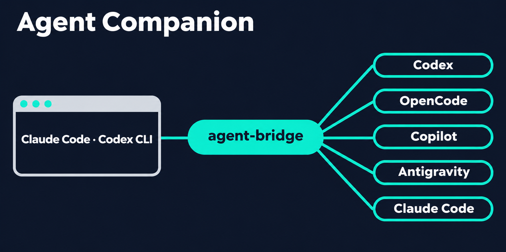
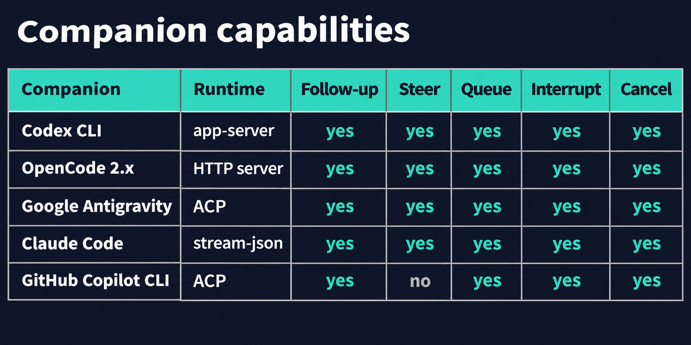

# Agent Companion



Ask a companion to work in a repo or worktree from your own conversation.
The companion gets your task word for word and returns its answer to you.
You can keep working, then follow up on the same thread.

- **Host** — Claude Code, Codex CLI, OpenCode or GitHub Copilot CLI.
- **Lead** — your conversation in the host.
- **Companion** — OpenCode, GitHub Copilot CLI, Codex CLI, Google Antigravity or Claude Code.
- **Thread** — one ongoing conversation with one companion in one directory, owned by one lead. Its id looks like `th-0123456789`.
- **Job** — one run on a thread, identified by `job_id`.

## Quick start

You need Node.js `>= 26`, npm, your host CLI and a companion ready to use.
Source setup also needs jq. Sign in through the companion's own CLI, which handles your credentials.

**Claude Code** — add the marketplace and install the plugin, then open a fresh session.

```bash
claude plugin marketplace add thangaram611/agent-companion
claude plugin install agent-companion@agent-companion
```

**Codex CLI** — run setup from the root of this checkout.

```bash
bash setup.sh --host codex
```

Open a fresh Codex session and approve the plugin hooks.

From your lead, try “Ask Codex to review the staged changes in /abs/path.”
Use the absolute path to your repo. The send returns a thread id and job id as soon as the companion accepts.
The answer comes later by hook or `companion_wait`. A wake can bring the lead back for it.

## Using it

**Start a thread.** Give the lead the task, an existing absolute directory and any
constraints the companion needs. Name the companion or use your default. You can ask
for a model, an effort level or a thread title. The first line of the task supplies
the title if you omit it. Start a new thread for a different directory or companion.

**Follow up.** Ask “On that same thread, which test would catch the bug?”
The lead reuses the thread id. A follow-up after completion starts a new job with saved history
where supported. It keeps the model and effort unless you change them. A refused effort preserves the old choice.

**Change running work.** Send new text (up to 8,000 characters) on the thread.
Steer joins the current turn. Queue holds the message for the next turn. Interrupt stops the turn and sends the new text.
Omit the mode to use the companion's default. Status shows which modes work now.
An unavailable mode returns `intervention_unavailable`. Changing model or effort
mid-job returns `thread_busy`. Repeating the original send returns the existing job.

**Get the answer.** End your turn or ask the lead to wait. The hook checks at session
start, at your next prompt and after a tool call. A wake sends a short notice to the
main conversation and triggers its hook. The send tells you which wake is available. Claude inbox wakes
need Claude Code 2.1.228 or later. A relocated `CODEX_HOME` prevents the Codex wake from reaching the lead.
A lead inside a native subagent also uses wait. Each wait defaults to 480 seconds
and allows up to 1,200. If a message from the live view returns `user_intervened`,
wait again for the answer.

**Read or stop.** A hook includes up to 4,000 characters per answer, or a reference
when several finish together. A tool returns up to 8,000. Ask the lead to read the
rest with `companion_read` and follow the next call in each page footer. You can reread delivered answers.
If you asked for tests, check the commands and exit codes. Ask the lead to cancel a job to stop it.

| Tool | What it does |
| --- | --- |
| `companion_catalog` | Show companions, capabilities, defaults, last-checked readiness and installed versions. Some model lists need a live session. |
| `companion_send` | Start a thread, follow up or send new text to running work. |
| `companion_status` | List this lead's threads and unread counts, or inspect one thread or job. Request diagnostics for cached companion checks. |
| `companion_wait` | Wait on a thread or job until an answer, a user message or the time limit. |
| `companion_read` | Read a thread in order, in pages of 8,000 characters by default (up to 40,000). |
| `companion_cancel` | Stop the job by thread or job id. |

| Event | What happens to the job |
| --- | --- |
| End your turn | Work continues. A wake can bring the answer back. |
| Press Esc or stop a foreground or background wait | The wait ends. The job keeps running. |
| Compaction | The lead keeps its identity and can list its threads again. |
| Claude Code `/clear` | Old jobs keep running and remain in the terminal live view. The new lead sees only its own threads and wakes. |
| Codex `/new` or `/quit` | Codex keeps the old conversation loaded until idle for `thread_unload_delay_secs` (default 60 seconds). A wake can reach it unseen and restart the delay. Unloading stops any job still running. Resume the old conversation for unread results at the first prompt. Its threads stay in the live view. |
| Host exits and its bridge closes | The cleanup watcher stops the companion processes and records the outcome. |
| You or the lead cancel | The job stops. Its thread remains available for supported follow-ups. |

<details>
<summary>Earlier subagent design (recording)</summary>


</details>

## Companions



| Companion | Per-job runtime | Follow-up by cold resume | In-flight messages (default first) | Model selection | History |
| --- | --- | --- | --- | --- | --- |
| OpenCode 2.x | Private authenticated `opencode serve` | Saved session | Steer, queue, interrupt | `provider/model`, optional variant | Vendor-persisted session |
| GitHub Copilot CLI | `copilot --acp` | `session/load` with history replay | Queue, interrupt | Inherit or select an advertised session model | Native session under `$COPILOT_HOME` |
| Codex CLI | `codex app-server` | `thread/resume` | Steer, queue, interrupt | Inherit or explicit override | Native thread and rollouts |
| Google Antigravity | `agy acp` over stdio | `session/load` with history replay | Steer, queue, interrupt | Session model and thought level after new/load | Native SQLite history |
| Claude Code | `claude -p` | `--resume` saved session | Steer, queue, interrupt | Inherit or explicit override | Native transcripts |

**OpenCode.** Run `opencode` and use `/connect` to choose a provider. OpenCode 2.x
supplies its own server permissions. Inherit its model or request a `provider/model`
with an optional variant. An explicit effort selects an advertised variant and takes
precedence over the variant in the model string.

**GitHub Copilot CLI.** Run `copilot login` with an account that can use Copilot CLI.
Inherit the session model or pick one it offers. Effort must match that model's
thought levels. The bundled reviewer inherits the session model. Measured on 1.0.114 with local Ollama on
2026-11-23, a fresh process replayed the saved session and recalled a code word.
The bridge reapplies the model override after load. Empty replay fails the job
with `history_unavailable`. Queue is the default. Steer is unavailable because a
second prompt cancels the running turn. Interrupt cancels, then sends the new text.

**Codex CLI.** Use `codex login` or configure API-key login. Inherit the configured
model or request one explicitly. Codex checks effort for listed models. For an
unlisted model, the backend can refuse the level after saving it on resume.
Configured MCP servers can delay startup. Rollouts stay under `$CODEX_HOME/sessions`
until you remove them.

**Google Antigravity.** Install with `brew install --cask antigravity-cli`, then run
`agy acp --login` or sign in through `agy`. Use the model ids and thought levels your session offers. The bridge reapplies both on follow-up. Google's FAQ names Claude
Code in its consumer-login restrictions. The account holder risks suspension or termination. [Account terms, item 8](docs/MVP_TRACKER.md)

**Claude Code.** The companion runs your own unmodified `claude -p` with your login
or `ANTHROPIC_API_KEY`. Billing follows your plan or API setup. Inherit your model
or name an id or alias. Effort accepts `low`, `medium`, `high`, `xhigh` or `max`.
Even from a Claude host, the child denies the bridge's tools to itself and disables
background tasks. Your settings, hooks, plugins and CLAUDE.md still load. Installed runs used 2.1.319.
Measured on 2.1.330 on 2026-11-23, steer (the default) joined the turn at its
next tool boundary. Queue waited for the next turn.
Older versions are unverified. The `--permission-prompts` flag needs 2.1.259 or later. [Compatibility and release gates](docs/RELEASE_READINESS.md)

## Hosts

**Claude Code.** The plugin registers the bridge for the session. For a local checkout,
pass its path to the marketplace command or run `claude --plugin-dir /path/to/agent-companion`.
Approve the bridge tools at the first prompt with “Yes, don't ask again”, or run
`node scripts/install-permissions.mjs --host claude --yes` from the checkout to add them
to your user allow-list. For repo-only approval use `.claude/settings.local.json`. Restart
sessions after updates to load the new tools.

**Codex CLI.** Setup builds the marketplace, refreshes the installed plugin even at
the same version and checks bridge registration. Re-trust the hooks in a fresh
session after each update. Codex desktop qualification remains open.

Codex requires `agent-bridge` before its first turn. If Codex reports “required MCP
servers failed to initialize”, rerun the [Codex setup command](#quick-start). To open
Codex with the plugin disabled, set `enabled = false` under
`[plugins."agent-companion@agent-companion"]` in `~/.codex/config.toml`.

Use `--codex-unload-delay` to change how long jobs can run after you leave a Codex
conversation. A shorter delay reduces unseen wakes and stops unfinished jobs sooner.
A longer delay gives them more time. Codex writes the setting to its config file
and preserves comments. Restart Codex to apply it, or run `codex app-server daemon restart`.
Restarting the daemon stops running Codex work.

**OpenCode.** Install with `setup.sh --host opencode`, then run
`opencode service restart` to load the plugin. When the lead is idle, jobs
that outlive the directory's idle timeout stop with `bridge_loss`. To allow
longer jobs, pass `--opencode-idle-timeout "8 hours"` during setup. OpenCode's
default is 60 minutes. With `false`, every opened directory keeps its MCP and
language servers loaded until the service stops. Use `default` to remove the
global override. For a timeout change alone, run `opencode reload` after
running jobs finish. It rebuilds open directories and restarts their MCP servers.

**GitHub Copilot CLI.** Run `setup.sh --host copilot` from the checkout. Setup enables experimental mode for the whole Copilot profile so the notice extension can join your session. Approve the bridge when prompted or launch with `--allow-tool=agent-bridge`. A root gets a completion message in its own session. Subagents and sessions without a live extension use `companion_wait`. Doctor reports the profile setting and live registrations.

**Google Antigravity** hosting is planned with a permitted wake command and wait as the fallback. [Host plan](docs/THREAD_PLAN.md#hosts-built-later-1)

## Live view

`agent-companion ui` lists jobs from all installed hosts, running first, then the last 24 hours.
Setup installs the launcher in `~/.local/bin`. If that directory is off your PATH,
run `~/.local/bin/agent-companion ui` or `bash hooks/launch-ui.sh ui` from the checkout.

Each card shows the title, companion and project. Open it for the host and lead session,
model, effort, branch and live transcript. Command output folds to its first and last lines.
A finished job shows its answer, edits, errors and reported tokens. [How usage is counted](docs/ARCHITECTURE.md#job-usage)

In the transcript,
`task` is the original request, `lead` marks follow-ups and `you` marks your messages.
Below 110 columns the list and transcript share one pane. Opening a running job focuses
its message box. Drafts stay in memory. A sent message shows its state until it appears
in the transcript. A refusal shows the reason and restores the text if the box is empty.

| Where | Keys | Action |
| --- | --- | --- |
| List or transcript | ↑ ↓ or `j` `k`, Enter, Tab, Esc | Select, open, switch pane or return to the list. |
| Transcript | PgUp, PgDn or Space, `g`, `G` | Page up or down, go to the top, or go to the end and follow. |
| Transcript | `e` / `E`, `p`, `f` | Fold one item or all items, toggle the preamble or toggle follow. |
| List | `/`, `o`, `d` | Filter (Enter keeps, Esc clears), include older jobs, or edit defaults. |
| List or transcript | `?`, `q` or Ctrl+C | Show keys, or quit. |
| Message box | Enter, Shift+Tab, Ctrl+J | Send, change mode, or add a line. Shift+Enter or Alt+Enter also adds a line where supported. |
| Message box | ↑ ↓, PgUp, PgDn, Ctrl+O | Scroll or fold all outputs. Scrolling to the end resumes follow. |
| Message box | Ctrl+X, Esc, Ctrl+C | Confirm cancel with `y` or decline with `n`. Esc keeps the draft. Ctrl+C clears it, or quits if empty. |

In Claude Code, a band above the prompt shows each running thread's title, companion, model, activity and elapsed time. Open `/companion` for this session's threads.
Select a card to open its latest job. Use the box to send, change mode or confirm
cancel. Select `← jobs` to return to the cards. Press Ctrl+X then Tab to focus the pane. Tab and arrows move focus, Enter
selects, `1`–`9` open cards, `b` returns to the cards and Esc returns to the chat.

## Configuration

All hosts share `${XDG_CONFIG_HOME:-$HOME/.config}/agent-companion/settings.json`.
`agent-companion defaults` shows saved choices, their sources and what each companion
inherits. Codex and OpenCode read native defaults for the current directory. The others
show the last reported value and its age. Conflicting older defaults show both files
and the command to resolve them.

```bash
agent-companion defaults
agent-companion defaults companion=codex
agent-companion defaults codex --json
agent-companion defaults codex model=gpt-6.2-astra effort=high
agent-companion defaults codex effort=inherit
```

Every form accepts `--json`. Set either field or both. Use `model=inherit`,
`effort=inherit` or `companion=inherit` to clear a choice. In the live view's `d`
panel, Enter edits and saves. An empty field clears it. A new thread uses your
explicit choice, then the environment override, then the saved default, then the
companion's own model or effort. Codex hosts do not forward shell model overrides
to the bridge. Use saved defaults or name the model in your request.

| Setup flag | Effect |
| --- | --- |
| `--host` | Install for `claude`, `codex`, `opencode`, `copilot` or `all`. `both` selects Claude Code and Codex. Setup detects a sole host. With multiple hosts present, choose at the prompt or pass the flag for unattended setup. |
| `--companion` | Choose `opencode`, `copilot`, `codex`, `antigravity` or `claude`. Omit to preserve existing defaults. On a clean install, setup selects the only ready companion or asks you to choose. `auto` selects the only ready one. `none` installs the host and preserves defaults. |
| `--model` | Save a model for an explicitly named companion. Use `inherit` to clear it. |
| `--codex-unload-delay` | For `codex`, `both` or `all`, set idle seconds (zero allowed). `default` removes the setting. |
| `--opencode-idle-timeout` | For `opencode`, `copilot` or `all`, set a global idle duration such as `"90 minutes"`. `false` disables idle unloading. `default` removes the setting. Omit to keep the current value. |
| `--no-companion-check` | Allow an explicit selection despite a readiness failure. |
| `--skip-tests` | Skip setup's unit tests. |
| `--yes`, `-y` | Apply without the interactive confirmation. |
| `--dry-run` | Preview installation and configuration changes. |
| `--help`, `-h` | Show setup options. |

Setup checks readiness without a paid turn and saves new defaults after installation
and checks. If it stops partway, fix the reported stage and rerun. A completed host
install can remain in place. Setup reports when an environment override masks a choice.

For onboarding without installation, run `node scripts/onboard.mjs --list-companions`.
It accepts the same host, companion, model, readiness, confirmation and help flags.
Use `--plan --json` to preview, `--doctor` for diagnostics or `--set-default` to save
a selection. `--smoke` requests a live check and can spend quota. The companion must
finish with “ready” for the check to pass. A failed check blocks the save. Run it separately from preview.

| Environment variable | Effect where the process receives it |
| --- | --- |
| `AGENT_COMPANION_DEFAULT_COMPANION` | Override the saved default companion. |
| `AGENT_COMPANION_CODEX_MODEL`, `AGENT_COMPANION_OPENCODE_MODEL`, `AGENT_COMPANION_CLAUDE_MODEL` | Override that companion's saved model. |
| `OPENCODE_BIN`, `COPILOT_BIN`, `CODEX_BIN`, `ANTIGRAVITY_BIN`, `CLAUDE_BIN` | Choose a CLI executable. The usual names are `opencode`, `copilot`, `codex`, `agy` and `claude`. |
| `AGENT_COMPANION_CODEX_SANDBOX_MODE` | `workspace-write` (default), `read-only`, `danger-full-access` or `bypass`. Both unrestricted settings use full access. Approval stays at `never`. Under workspace-write, `.git`, `.codex` and `.agents` stay read-only even with extra writable roots. |
| `AGENT_COMPANION_CODEX_NETWORK` | Set to `off` to disable network in workspace-write. Default is on. |
| `AGENT_COMPANION_CODEX_STEER_CONFIRM_MS` | Time to observe steer confirmation. Default 5,000 ms, maximum 120,000 ms. |
| `AGENT_COMPANION_CLAUDE_PERMISSION` | `default`, `acceptEdits`, `plan`, `auto`, `dontAsk` or `bypassPermissions`, case-insensitive. Unset or unknown uses `bypassPermissions`, which skips checks. All modes disable prompts. |
| `AGENT_COMPANION_ANTIGRAVITY_PERMISSION` | `all` (default) skips permission checks. With `edit` or `none`, a child tool can wait indefinitely for approval. Diagnostics flag both for unattended use. |
| `XDG_CONFIG_HOME`, `AGENT_COMPANION_HOME` | The first selects the shared config root (default `~/.config`). The second overrides the record directory and places `settings.json` directly inside it. |
| `CODEX_HOME`, `CLAUDE_CONFIG_DIR`, `COPILOT_HOME`, `GEMINI_HOME` | Locate native histories. Defaults are `~/.codex`, `~/.claude`, `~/.copilot` and `~/.gemini`. |
| `OPENCODE_DB`, `XDG_DATA_HOME` | Set the OpenCode transcript database or its data root. |
| `AGENT_RUNTIME_DIR`, `AGENT_BRIDGE_LOG_FILE`, `AGENT_PROMPT_JSONL_DIR` | Override the runtime directory, log file or prompt directory reported by doctor. |
| `AGENT_COMPANION_NODE`, `AGENT_COMPANION_NPM` | Select Node and npm executables for the hooks. |
| `AGENT_COMPANION_HOST`, `CLAUDE_PLUGIN_DATA`, `PLUGIN_DATA` | The registration selects the host descriptor. The data variables locate installed dependencies. |
| `CLAUDE_PLUGIN_ROOT`, `PLUGIN_ROOT` | Locate the plugin for the dependency installer. The host or bridge launcher supplies the path. |
| `AGENT_COMPANION_LOCK_WAIT_SEC`, `AGENT_COMPANION_REQUIRE_DEPS` | Dependency installation waits 45 seconds for the lock by default (override 1–54). The bridge launcher sets the second to `1` to retry on contention. |

## Troubleshooting

Run `node scripts/doctor.mjs` from the checkout. Add `--json` for machine-readable
output. Doctor checks prerequisites, readiness and the Codex executable/helper pair,
including quarantine evidence. It starts no model work. Ask for job status to see the
companion's own error text. Catalog and status report the last Codex schema check as `match`, `drift` or `unverified`.

- Claude Code keeps records in `~/.claude/agent-companion/`.
- Codex CLI uses `$CODEX_HOME/agent-companion/` (default `~/.codex/agent-companion/`).
- Copilot CLI uses `$COPILOT_HOME/agent-companion/` (default `~/.copilot/agent-companion/`).
- In each home, `.host` marks a source install. Look for `bridge.startup` in `runtime/agent-bridge.log`. [State paths, overrides and recovery](docs/ARCHITECTURE.md#state)

| Refusal | What to do |
| --- | --- |
| `COMPANION_UNCONFIGURED` | Name a companion in the request or set a default. |
| `MODEL_NOT_ALLOWED` / `EFFORT_NOT_ALLOWED` | Use an offered id or level, or omit the choice to inherit. `CAPABILITY_UNAVAILABLE` can mean the companion could not confirm the selection. |
| `AUTH_REQUIRED` | Follow the companion's sign-in instructions, then send again. |
| `THREAD_NOT_YOURS` | Follow up from the lead that owns the thread, or start a new thread here. |
| `history_create_failed` | The companion could not create a new session. Read its explanation and check account access. |
| `history_unavailable` | The companion could not open saved history. Check the native history before deciding to start over. |
| `delivery_unknown` | Check the native history before sending again. The bridge never retries an ambiguous delivery automatically. |

## Development

Run the CI checks from the repository root. [CI workflow](.github/workflows/ci.yml)

```bash
(cd bridge-server && npm ci --silent --no-audit --no-fund)
bash -n setup.sh hooks/*.sh
find . -name '*.mjs' -not -path './bridge-server/node_modules/*' -print0 | xargs -0 -n1 node --check
find . -name '*.test.mjs' -not -path './bridge-server/node_modules/*' -print0 | xargs -0 node --test --experimental-test-coverage
(cd bridge-server && npm audit --omit=dev --audit-level=moderate)
```

Validate the Claude plugin with `claude plugin validate .` and its pane with
`claude plugin test .`. To inspect the generated Codex package, run the first
three commands below. The last validates a release in an isolated Codex home.

```bash
node scripts/build-codex-marketplace.mjs --out dist/codex-marketplace
codex plugin marketplace add ./dist/codex-marketplace
codex plugin add agent-companion@agent-companion --json
node scripts/validate-codex-release.mjs
```

Live probes can spend quota. Recheck lead identity, delivery and wakes after host
upgrades. [Probe index](probes/README.md) · [Direct-lead probes](probes/direct-lead/README.md)

Choose the semantic version for the change. Complete the release gates, make a version
commit and tag it. Wait for CI on the tag, then publish notes with the changes, tested
versions and open limits. [Release readiness](docs/RELEASE_READINESS.md)

Use the image specifications when regenerating README bitmaps. Review the labels
visually. CI checks that the files exist. [Image prompts](assets/readme/PROMPTS.md)

## License

MIT. [License text](LICENSE)
