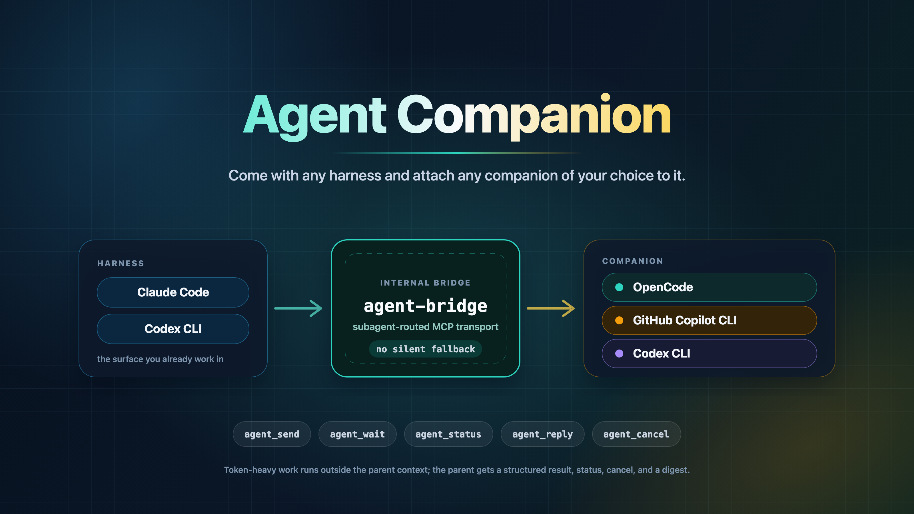
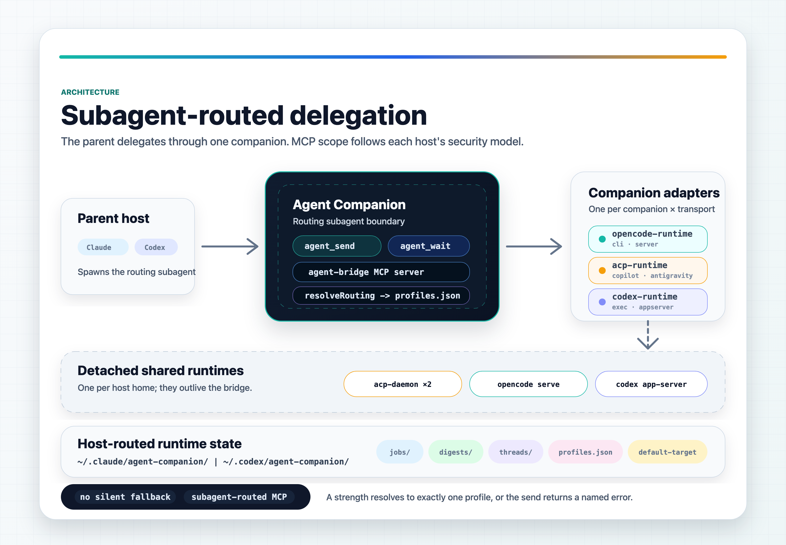
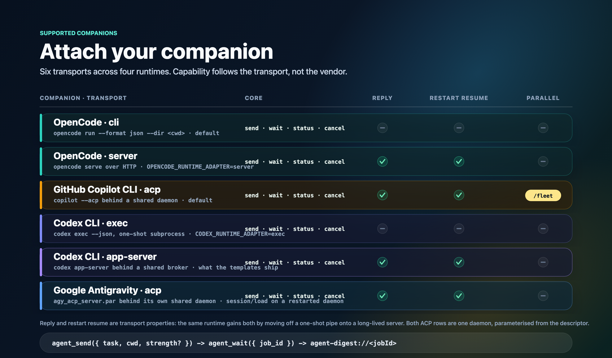

# Agent Companion



Agent Companion is a delegation plugin for coding agents built around one
public contract:

> Come with any harness and attach any companion of your choice to it.

A **harness** is the parent coding-agent surface you already work in. Supported
now: **Claude Code** and **Codex CLI**.

A **companion** is the downstream agent runtime that receives delegated work.
Supported now: **OpenCode**, **GitHub Copilot CLI**, **Codex CLI** and **Google
Antigravity** (Codex CLI can be both the harness and a downstream companion — the two roles are
independent; running Codex as a companion does not require Codex as the harness,
or vice versa).

Routing is one-to-many: connect multiple companion profiles at once, give each
profile strengths, and let the harness ask for a strength instead of a concrete
runtime. A send may name a strength, a configured profile, or a bare companion;
the bridge resolves it to exactly one companion profile.

The product posture is deliberately companion-neutral:

- **Bring your harness.** Install the Claude Code surface, the Codex CLI surface,
  or both.
- **Attach your companion.** Choose `opencode`, `copilot`, `codex` or `antigravity` on each
  send, route by strength or profile, or persist one bridge default.
- **Keep the parent workflow clean.** Delegated work runs through the isolated
  subagent. Claude scopes the bridge to that agent; Codex must register the
  internal bridge at plugin/session scope so the role can inherit it, but the
  subagent remains its only supported caller.
- **Use one public surface.** The subagent owns the generic `agent_*` tools:
  `agent_send`, `agent_wait`, `agent_status`, `agent_reply`, and
  `agent_cancel`.
- **Avoid silent behavior.** If a send selects nothing and nothing is
  configured, `agent_send` returns `TARGET_UNCONFIGURED` with onboarding
  guidance; an unresolvable profile or strength gets its own named error.
- **Route by strengths.** Companion profiles advertise strengths such as
  `reviewer` or `web_researcher`; harnesses request the strength and never
  hard-code a vendor/runtime choice.

Implementation note: today the CLI and MCP schema still use `host` for harness
selection and `target` for companion selection. Those names are stable public
flags for the MVP.

Current implementation status lives in [docs/MVP_TRACKER.md](docs/MVP_TRACKER.md).
Architecture details live in [docs/ARCHITECTURE.md](docs/ARCHITECTURE.md).
Public release gates live in [docs/RELEASE_READINESS.md](docs/RELEASE_READINESS.md).
The project is in maintenance; new companions, profiles or transports require
a recurring unmet workflow.

## What It Does

Agent Companion turns a natural-language delegation request into a background
job owned by an isolated subagent:

1. The parent harness decides to spawn the `agent-companion` subagent.
2. The subagent calls the internal `agent-bridge` MCP server (agent-local on
   Claude, inherited from the installed plugin on Codex).
3. The bridge resolves the selected companion, creates a job, and returns
   quickly.
4. The companion runtime runs the work in the requested `cwd`.
5. The bridge writes progress digests and emits one terminal completion event.
6. The subagent reports the result back to the harness.

That means token-heavy work can happen outside the parent's main context while
still giving the parent a structured result, status checks, cancellation, and
digest links.



## Supported Companions



| Companion | Runtime | Send | Wait | Status | Cancel | Reply | Restart resume |
| --- | --- | --- | --- | --- | --- | --- | --- |
| OpenCode (cli, default) | `opencode run --format json` in the requested cwd (1.x and 2.x) | yes | yes | yes | yes | no | no |
| OpenCode (server, 1.x and 2.x) | `opencode serve` over HTTP | yes | yes | yes | yes | yes | yes |
| GitHub Copilot CLI | `copilot --acp` behind the shared ACP daemon | yes | yes | yes | yes | yes (cancel + re-prompt) | yes, with ACP |
| Codex CLI (exec) | `codex exec --json` (one-shot subprocess) | yes | yes | yes | yes | no | no |
| Codex CLI (app-server, what the templates ship) | `codex app-server` behind a shared broker | yes | yes | yes | yes | yes | yes |
| Google Antigravity | `agy_acp_server.par` (Google's ACP-registry server) behind the shared ACP daemon | yes | yes | yes | yes | yes (cancel + re-prompt) | yes, with ACP and `session/load` |

Notes:

- OpenCode defaults to `OPENCODE_RUNTIME_ADAPTER=cli`; select `server` for
  in-flight reply and restart resume. Server mode binds `127.0.0.1`; 2.x uses
  a private password, while 1.x is unsecured. Server permissions follow
  OpenCode's config; `AGENT_COMPANION_OPENCODE_PERMISSION_MODE=skip` applies
  only to CLI mode. `AGENT_COMPANION_OPENCODE_MODEL=provider/model` supplies
  the default model; a profile's model wins. Job timeout defaults to 40 minutes,
  configurable with `AGENT_COMPANION_OPENCODE_TIMEOUT_MS`.
- Copilot and Antigravity use detached ACP daemons. Their reply operation
  cancels the running turn and re-prompts the same session; it is not mid-turn
  steering. Copilot can use `/fleet` for broad tasks.
- Install and sign in to Google's Antigravity ACP server with
  `node scripts/install-antigravity-acp.mjs --login`. It verifies Google's
  signature on macOS and installs under
  `~/.local/share/agent-companion/antigravity-acp/`; `ANTIGRAVITY_ACP_BIN`
  overrides the binary path. Credentials belong to the server under
  `~/.gemini/antigravity-acp/` and the login keychain.
  `AGENT_COMPANION_ANTIGRAVITY_PERMISSION=all|edit|none` controls permission
  answers (default `all`). Use the real project directory as `cwd`: its
  sandbox resolves symlinks. A profile can pin a model; unset uses the account
  default. The account/terms assessment is in
  [docs/MVP_TRACKER.md](docs/MVP_TRACKER.md), item 8.
- Installed Codex surfaces set `CODEX_RUNTIME_ADAPTER=appserver`. The broker
  survives bridge restarts, supports live steering and cancellation, and
  continues the recorded Codex conversation on a follow-up send. If the broker
  itself dies, the transcript survives on disk but its in-flight turn is lost.
  A recorded thread that cannot resume fails explicitly. `CODEX_RUNTIME_ADAPTER=exec`
  selects the one-shot transport, which cannot reply or resume after a bridge
  restart. A bare bridge without the installed configuration defaults to `exec`.
- Codex defaults to `workspace-write` with network access enabled. Set
  `AGENT_COMPANION_CODEX_NETWORK=off` to disable network access, or
  `AGENT_COMPANION_CODEX_SANDBOX_MODE=read-only|workspace-write|danger-full-access|bypass`
  to choose the sandbox mode. `.git`/`.codex`/`.agents` remain read-only under
  `workspace-write`, even with extra writable roots. `danger-full-access`
  permits unrestricted filesystem access; `bypass` also bypasses approvals on
  exec and maps to `danger-full-access` on app-server. The app-server approval
  policy is fixed at `never`: accepting an approval was measured to permit a
  write outside a read-only sandbox.
- Codex inherits the user's configuration, including enabled MCP servers;
  their startup timeouts can delay the first turn. Rollouts persist under
  `$CODEX_HOME/sessions` (default `~/.codex/sessions`) without automatic cleanup.
  `AGENT_COMPANION_CODEX_MODEL` supplies the default profile's model; a profile's
  own model wins. Job timeout defaults to 40 minutes, configurable with
  `AGENT_COMPANION_CODEX_TIMEOUT_MS`.

Transport internals and measured constraints live in
[docs/ARCHITECTURE.md](docs/ARCHITECTURE.md). For Codex installation or broker
problems, see [Diagnostics](#diagnostics).

## Strength Routing

Unresolvable requests return named errors with the configured targets and
profiles, plus candidate ids when available. Routing never falls back silently.

One `agent_send` resolves to exactly one companion profile. A send may carry:

| Field | Meaning |
| --- | --- |
| `strength` | Preferred. Route to the configured profile that declares this label. |
| `profile` | A specific configured profile id. Mutually exclusive with `strength`. |
| `target` | A bare companion: `opencode`, `copilot`, `codex`, or `antigravity`. |
| *(none)* | The configured default profile wins — see [Onboarding Commands](#onboarding-commands) for precedence. |

Passing both `strength` and `profile` is `ROUTING_CONFLICT`. A `target` passed
*alongside* one of them is read as an assertion, not a selector: if it disagrees
with the resolved profile's companion, that is `ROUTING_CONFLICT` too.

A profile pins one companion, optionally a model, and declares
strengths drawn from a closed vocabulary: `reviewer`, `web_researcher`,
`planner`, `fast_executor`. Profiles inherit capabilities from their companion
and never re-declare them. Author them with onboarding:

```bash
AGENT_COMPANION_HOST=claude node scripts/onboard.mjs --define-profile code_reviewer \
  --companion codex --strength reviewer
AGENT_COMPANION_HOST=claude node scripts/onboard.mjs --set-default-profile code_reviewer
```

Ambiguity is an error rather than a coin flip. When several profiles declare the
same strength — or several target the same bare companion — the configured
`defaultProfile` breaks the tie only when it is itself one of the candidates —
it has to declare that strength, or target that companion. Otherwise the send
fails `STRENGTH_AMBIGUOUS` or `PROFILE_AMBIGUOUS`. With no `profiles.json` at all the
bridge synthesizes a single profile from `default-target`.

A profile's `adapter` field declares capabilities; it does not select the
transport. Set `OPENCODE_RUNTIME_ADAPTER` / `CODEX_RUNTIME_ADAPTER` on the bridge
to choose the transport. OpenCode and Codex jobs retain their starting adapter.

## Requirements

- Node.js `>= 22`.
- `npm`.
- `jq` for hook delivery.
- At least one companion runtime:
  - OpenCode on `PATH`, or `OPENCODE_BIN=/absolute/path/to/opencode`.
  - GitHub Copilot CLI on `PATH`, or `COPILOT_BIN=/absolute/path/to/copilot`.
  - Google's Antigravity ACP server, installed by
    `node scripts/install-antigravity-acp.mjs` (or
    `ANTIGRAVITY_ACP_BIN=/absolute/path/to/agy_acp_server.par`) and signed in
    with `--login`.
  - Codex CLI on `PATH`, or `CODEX_BIN=/absolute/path/to/codex`, authenticated
    via `codex login` (ChatGPT plan) or an API key.
- Claude Code CLI when installing the Claude surface.
- Codex CLI when installing the Codex surface.

OpenCode authentication and provider setup stays inside OpenCode. Copilot
authentication stays inside Copilot CLI. Codex authentication stays inside
Codex CLI. Antigravity authentication stays inside Google's ACP server and
the login keychain. Agent Companion does not ask for or store provider secrets.

## Fast Path

From the repository root, preview setup or pick the harness surface you use:

```bash
# Detect installed harnesses and preview changes without installing anything.
bash setup.sh --dry-run

# Codex source-checkout install, without selecting a default target yet.
bash setup.sh --host codex --target none

# Or Claude source-checkout install, without selecting a default target yet.
bash setup.sh --host claude --target none

# See target readiness and next steps.
node scripts/onboard.mjs --list-targets

# Persist a default target for Codex state.
AGENT_COMPANION_HOST=codex node scripts/onboard.mjs --target opencode --set-default

# Or persist a default target for Claude state.
AGENT_COMPANION_HOST=claude node scripts/onboard.mjs --target opencode --set-default
```

For a narrower install:

```bash
# Codex only, OpenCode default.
bash setup.sh --host codex --target opencode

# Claude only, Copilot default.
bash setup.sh --host claude --target copilot

# Harness/plugin surface only. Keep any existing companion configuration.
bash setup.sh --host both --target none
```

Without `--host`, setup detects the installed CLI. If both are installed, it
asks which to use in a terminal; non-interactive runs must pass `--host`.
Without `--target`, existing defaults, profiles and model settings are preserved.
On a clean install, the only ready companion is selected; multiple or zero ready
companions require a choice (or `--target none` to attach one later).

`setup.sh --host both --target auto` selects the only ready target for both
hosts explicitly. If multiple targets are ready, pass the target explicitly.
`--target none` leaves existing configuration untouched; it does not clear a default.

Setup checks prerequisites and companion readiness before installation and
shows the intended changes. Interactive runs confirm that plan; `--yes` skips
confirmation. Explicit flags also work without a terminal. `--dry-run` applies
nothing. No setup path runs a quota-spending companion task.

A new default is saved after installation and checks pass. A missing binary or
authentication blocks the change unless `--no-target-check` explicitly defers
readiness. An existing default profile or environment override that would mask
the new target is explained instead of silently replaced. Use onboarding's
`--set-default-profile` to change a profile default.

If installation stops partway, setup lists completed stages and keeps the
previous companion configuration. Fix the reported error and rerun the same
command; completed installation steps are safe to repeat. A failure while
configuring the second harness can leave the first harness configured, and the
status shows each separately. User-owned agent files are preserved and require
manual reconciliation. The final status distinguishes installation from live
delegation verification and names the required fresh session/hook approval.

## Onboarding Commands

Inspect configured profiles with `node scripts/onboard.mjs --list-profiles`;
see [Diagnostics](#diagnostics) for readiness checks.

Profile setup is covered in [Strength Routing](#strength-routing). For the full
flag reference, run `node scripts/onboard.mjs --help`. `--plan --json` previews
selection and readiness without writes; `--smoke` explicitly opts into a real
companion task that can spend quota.

For standalone host-specific writes, set `AGENT_COMPANION_HOST=codex` or
`AGENT_COMPANION_HOST=claude` on the command. `setup.sh` does this for each
host when it delegates to onboarding.

An ordinary onboarding rerun preserves existing configuration unless `--target`
explicitly selects a change. Readiness failure leaves the default untouched;
`--no-target-check` can defer readiness, but a failed requested smoke never
persists a new default. Codex smoke requires a completed assistant response
matching `ready`, not just a successful CLI exit.

`AGENT_COMPANION_DEFAULT_PROFILE` overrides the persisted `defaultProfile`, and
`AGENT_COMPANION_DEFAULT_TARGET` overrides the persisted `default-target`. The
default profile is consulted first; an unknown default profile fails with
`PROFILE_UNKNOWN`. `default-target` answers only when no default profile is
configured. With nothing configured at all and `agent_send`
omitting `target`, the bridge refuses the send instead of guessing.

## Install For Claude Code

This repo is its own local marketplace. Register it once, then install the
plugin:

```bash
claude plugin marketplace add /path/to/agent-companion
claude plugin install agent-companion@agent-companion
```

For fastest source iteration:

```bash
claude --plugin-dir /path/to/agent-companion
```

Claude plugin-bundled subagents ignore `mcpServers`, `hooks`, and
`permissionMode` frontmatter for security. Agent Companion handles that by
materializing `templates/agent-companion.md` to:

```text
~/.claude/agents/agent-companion.md
```

The standalone materialized Claude agent owns its private MCP bridge.

For MCP timeout configuration and the host idle watchdog, see
[docs/ARCHITECTURE.md](docs/ARCHITECTURE.md), "Host budgets and observability".

### Claude Permissions

The subagent needs permission to call the split MCP tools. Source checkout setup
does this idempotently:

```bash
node scripts/install-permissions.mjs --host claude --yes
```

Marketplace installs can also approve the first prompt with "Yes, don't ask
again". The permission installer owns the allow-list.

Use `.claude/settings.local.json` if you want these permissions scoped to one
repository.

### One agent-companion, one companion conversation

Each spawned `agent-companion` is one conversation with the companion. To
continue it — a follow-up, or the answer to a question the companion asked —
main sends the same agent-companion a message (`SendMessage` on Claude Code,
`followup_task` on Codex); to start fresh, it spawns a new one. Neither main nor
the subagent carries a thread: the host names it after the calling agent.
Claude Code shows a subagent's `agent_id` only to hooks, so the plugin's
`PreToolUse` hook (`hooks/name-thread.sh`) writes it into `agent_send`'s
`thread`; Codex sends the caller's own thread id in MCP `_meta`, which the
bridge reads. A send that reaches the bridge with neither is refused. Measured
on Claude Code 2.1.310 and codex-cli 0.164.0: two spawns get two ids, a resume
keeps its id, and `SendMessage` needs no experimental flag.

## Install For Codex CLI

The one-step source install is recommended:

```bash
bash setup.sh --host codex
```

It builds the local marketplace, registers it, atomically refreshes the
installed plugin even at the same version, verifies the effective MCP registry,
and eagerly materializes the custom agent before reporting success. Start a
fresh Codex session after it finishes.

For package/release debugging, the underlying marketplace commands are:

```bash
node scripts/build-codex-marketplace.mjs --out dist/codex-marketplace
codex plugin marketplace add ./dist/codex-marketplace
codex plugin add agent-companion@agent-companion --json
```

On a completely clean manual install, the first new session loads the plugin
and its SessionStart hook materializes the custom agent after role discovery;
open one further session before delegating. `setup.sh` avoids that two-session
bootstrap by materializing the role eagerly.

Validate the package end to end in an isolated `CODEX_HOME`:

```bash
node scripts/validate-codex-release.mjs
```

The generated package registers `agent-bridge` and the lifecycle hooks at
Codex plugin scope. Its `/bin/bash` launcher resolves Node and installs bridge
dependencies without relying on the GUI process's `PATH`. It has no root
`.mcp.json`, so the Codex registration is not discovered by Claude.

Codex normalizes the raw server id for its model-visible tool namespace:
`agent-bridge` becomes `mcp__agent_bridge__agent_*`. The Codex role uses that
underscore form through Codex's `functions.exec` deferred-tool wrapper; Claude
keeps its native `mcp__agent-bridge__agent_*` names.
The plugin declares its internal bridge tools pre-approved so they remain
usable in headless `codex exec` sessions whose approval policy is `never`.
A user or managed plugin policy can still tighten that approval mode.

Current Codex intentionally prevents an agent role from adding MCP authority.
The custom TOML role therefore contains behavior only; it inherits the bridge
registered by `.codex-plugin/plugin.json`. That registration is technically
visible to main Codex as well as the child. Direct parent calls remain
unsupported—the prescribed path is to spawn the `agent-companion` subagent.

The materialized role lives at:

```text
~/.codex/agents/agent-companion.toml
```

It uses plugin-scoped hooks. If an older source install left managed entries in
`$CODEX_HOME/hooks.json` (default `~/.codex/hooks.json`), setup removes only
entries carrying `_managed_by: "agent-companion"` so events are not delivered
twice. The cleanup can also be run directly with:

```bash
node scripts/install-codex-hooks.mjs --plugin-root "$(pwd)" --uninstall --yes
```

Codex V1 `multi_agent` surfaces the terminal subagent message on the next parent
turn. If a job has finished and main Codex has not resumed, send a short prompt
such as `any updates?`.

## Internal MCP Surface

You normally do not call these tools yourself. The host reads the subagent
description and spawns it when you ask for delegation, status, reply, or cancel.

Every send requires an absolute target repo/worktree `cwd`. The host supplies
conversation identity as described in
[One agent-companion, one companion conversation](#one-agent-companion-one-companion-conversation).
Tool fields are defined in `bridge-server/server.mjs`; routing choices are
covered in [Strength Routing](#strength-routing).

`agent_send` returns `still_running` immediately with a `job_id`. An identical
retry on the same in-flight job reattaches and waits up to `max_wait_sec`.
A different task, mode, template or template arguments on that busy conversation
returns `thread_busy`; changes to target, profile or cwd have their own mismatch
errors. Wait, cancel, or use `agent_reply` when the job's `reply_available` is true.
`agent_wait` defaults to 480 seconds and is capped at 1200 seconds per call.

Terminal statuses are `completed`, `failed`, `cancelled`, `stuck`, `timeout`,
and `unreachable`. An unreachable job includes a machine-readable
`failure_class`. For `codex_code_mode_host_unavailable`, the assistant text is
partial runtime evidence, not a review/build/test verdict: repair the command
runner and resend. See [Diagnostics](#diagnostics).

## Templates, Modes, And Parallelism

Templates:

| Template | Purpose |
| --- | --- |
| `general` | Default implementation, review, and analysis work. |
| `research` | Multi-source research. |
| `plan_review` | Plan verification with a required `plan_path`. |
| `review` | Read-only review of the task as its subject, ending in a parsed `VERDICT: agree|disagree` line. |

### Review loop

`review` is the template for a review loop: the parent
asks a companion to judge a change, a claim, a plan or a diff, acts on the
findings, and asks again. The task is the subject under review; the prompt is
read-only whatever `mode` says, never auto-fleets on Copilot (one reviewer,
one verdict), and requires the reply to end with one line:

```text
VERDICT: agree — <why the subject holds as stated>
VERDICT: disagree — <the finding that must be addressed first>
```

The bridge parses that line so the parent can branch without reading prose.
Terminal `meta.verdict` is `"agree"`, `"disagree"`, or `null` with
`meta.verdict_reason` set to `missing`, `malformed` (a value the contract
does not define, such as `approve`) or `conflicting` (two lines that
disagree). A null verdict is never guessed and never remaps the job: the turn
`completed`; the review did not conclude. The same verdict lands in the digest
header (`**Verdict:**`) and as a footer on the terminal body.

For Codex app-server and the ACP companions, send the follow-up to the same
agent-companion to continue the conversation: "finding 1 is addressed;
re-verdict" can rely on round one's context. Record your own verdict before
reading the companion's to avoid anchoring; the bridge does not enforce this.

### Usage

Metered jobs carry `usage` on terminal metadata, wait/status responses, the
ledger and digests. Missing counters are `null`; a job with no reported usage
has no `usage` key. Transport readers and the shared shape are defined in
`lib/usage.mjs`.

Codex app-server follow-ups report the current turn's usage, not the thread's
cumulative total. A fresh bridge resuming mid-turn reports only the model calls
it observed, flagged `partial: true`; transcript-only salvage carries no usage.
Copilot uses native prompt counters when available and falls back to OTEL;
`usage_update` measures context occupancy, not turn tokens. Antigravity's ACP
surface reports no usage (measured on 1.1.1). OpenCode reports tokens and cost
from its native events.

### Output wrapper

Copilot-target output for the `general` and `research` templates carries a
native critic request and a server-appended footer. A reported `clean` or
`revised` verdict gets a success footer only when a completed native
`rubber-duck` call was recorded. A substitute reviewer cannot satisfy this
check. Copilot reports `unavailable` when it cannot run the critic; a claimed
success without recorded native evidence is shown as `unverified`.
This verifies the invocation, not the critique's quality or model choice.
The wrapper is not configurable and there is no payload field controlling it. `plan_review` and
`review` have their own critique built in and skip the wrapper, and OpenCode,
Codex and Antigravity output is relay-only so it never carries one.

General modes:

| Mode | Purpose |
| --- | --- |
| `EXECUTE` | Implement or carry out the requested task. |
| `PLAN` | Produce a plan without changing code. |
| `ANALYZE` | Diagnose or review without implementation. |

`parallel: "auto"` is the default and can use Copilot `/fleet` for broad tasks.
Use `always` to request `/fleet` or `never` for a single Copilot agent. Other
companions do not use `/fleet`.

## Runtime State And Digests

Per-host state lives under:

```text
~/.claude/agent-companion/
~/.codex/agent-companion/
```

Configuration, the job ledger and the structured `daemon.log` live at the state
root. Runtime logs and digests live under `runtime/`. The full layout and
recovery rules are in [docs/ARCHITECTURE.md](docs/ARCHITECTURE.md), "State".

The bridge surfaces progress as:

```text
agent-digest://<jobId>
```

Digests include the task, final or partial assistant output, target output,
tool-call summaries, files touched, and latest todo snapshots when available.
The MCP resource is the canonical way for the parent to inspect progress
without another raw filesystem read.

## Diagnostics

```bash
node scripts/doctor.mjs
node scripts/doctor.mjs --json
```

With `CODEX_RUNTIME_ADAPTER=appserver`, doctor reports the configured and
selected Codex version/path, helper path, selection source and tri-state
quarantine verdict (present, absent, or indeterminate),
then compares them with the running broker/app-server PIDs, path, version and
file identity. A stale or uninspectable broker makes doctor require attention;
a broker that is simply not running is healthy when the selected installation
pair is ready, because the next send starts it lazily. Doctor is read-only and
never removes quarantine or creates a helper link.
`agent_status` keeps fixture-provenance version skew
(`contract_version_skew`) separate from selected-versus-running version skew
(`upgrade_version_skew`).

Install markers:

```bash
cat ~/.claude/agent-companion/.host
cat ~/.codex/agent-companion/.host
```

Bridge startup events are JSONL:

```bash
grep '"event":"bridge.startup"' ~/.claude/agent-companion/daemon.log
grep '"event":"bridge.startup"' ~/.codex/agent-companion/daemon.log
```

## Development

Run the project checks locally:

```bash
bash -n setup.sh hooks/*.sh
find . -name '*.mjs' -not -path './bridge-server/node_modules/*' -print0 | xargs -0 -n1 node --check
find . -name '*.test.mjs' -not -path './bridge-server/node_modules/*' -print0 | xargs -0 node --test --experimental-test-coverage
```

These are the shell-syntax, JavaScript-syntax and test steps
`.github/workflows/ci.yml` runs; CI additionally runs `npm ci` and
`npm audit --omit=dev --audit-level=moderate` in `bridge-server/`. Discovery is anchored at
the repo root rather than an allow-list of directories, because an allow-list
omitting `test/` skips the three cross-cutting guard suites — the `profiles.json`
single-reader guard, the sync-exec timeout guard, and the runtime sandbox guard.

README diagram assets (the PNGs are build output; the SVGs are the source).
Re-render after SVG edits: CI does not check that the PNGs match.

```bash
bash scripts/render-readme-assets.sh              # all three
bash scripts/render-readme-assets.sh architecture # or one, by basename
```

Validate Claude packaging with `claude plugin validate .`; Codex packaging and
isolated validation commands are in [Install For Codex CLI](#install-for-codex-cli).

## Design Invariants

- The `agent-companion` subagent is the supported bridge caller on both hosts.
- Claude enforces agent-local MCP visibility. Codex registers the bridge at
  plugin/session scope because roles may inherit MCP authority but may not add
  it; main Codex can see the schemas but must delegate through the subagent.
- Bridge process lifetime belongs to the host; detached companion runtimes own
  any state that must survive a bridge replacement.
- Sends are non-blocking — the one exception is a retried send reattaching to
  its in-flight job, which blocks like a wait — and every wait is bounded.
- Orphan completions are stored in `completions.jsonl` and drained by hooks.
- Model choice is configuration, not a public tool parameter.
- Node dependencies persist under plugin data; bundled source updates with the
  plugin package. Claude Code's bridge reaches them through a
  `bridge-server/node_modules` link; Codex's launcher resolves them from plugin
  data, because Codex refuses a plugin bundle that contains a symlink.

## License

MIT. See [LICENSE](LICENSE).
