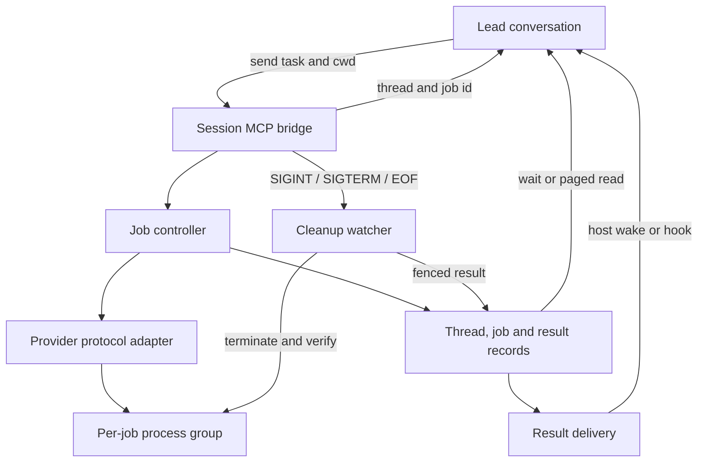

# Agent Companion Architecture

Last updated: 2026-11-23

## Goal

The lead in Claude Code or Codex CLI calls the session's bridge directly. The
companion receives the lead's task verbatim in the requested directory. The
bridge keeps the thread, runs each job and returns the answer to the conversation
that started it. The lead can work on something else or end its turn.

## Product Vocabulary

| Product term | Current implementation term | Meaning |
| --- | --- | --- |
| Host | `host` | The app the user talks to, currently Claude Code or Codex CLI. |
| Lead | `lead` | Calling host conversation, identified by the host on each call. |
| Thread | `thread` | Bridge-issued id for a linear conversation with one companion in one directory. |
| Companion | `companion` | The runtime that does the work, currently OpenCode, GitHub Copilot CLI, Codex CLI, Google Antigravity, or Claude Code. |
| Job | `job_id` | One run on a thread, from send to result. |
| Model preference | optional `companion_send` `model` | An explicit choice for this thread; a new thread uses configured defaults when omitted. |
| Catalog | `companion_catalog` | Read-only companion/model configuration, capabilities and readiness. |

`setup.sh --host claude|codex|both` selects the host, and
`companion_send({ companion })` names a companion runtime directly (see Private MCP Surface).

## Flow

A job runs native turns on its own companion process while accepted input remains.
A later send to the thread starts a new process and loads its saved history
where supported. Each job has its own process group and protocol connection.

### MCP registration boundary

Both plugin manifests register `agent-bridge` at session scope. Their launcher
selects the host and resolves Node and the bridge dependencies. Claude sets
`timeout: 1320000` in milliseconds. Codex sets `tool_timeout_sec: 1320` and
pre-approves the tools for headless sessions, subject to user and managed policy.

`lib/hosts/` derives the lead identity for every call that needs it. On Claude,
PreToolUse replaces any supplied `lead` with the hook's `session_id` and optional
`agent_id`. It matches bare and plugin-qualified bridge tool names and uses
`onFailure: "block"`. On Codex the lead comes from
`_meta["x-codex-turn-metadata"]`: the root uses `session_id`. A
`thread_source` of `subagent` also binds the caller's `thread_id`. Missing
lead identity gives `LEAD_REQUIRED`. Only the catalog is exempt.

A native subagent can own threads and use `companion_wait` for results. Wakes target
the main conversation only. Before starting work, the bridge checks recorded
native companion sessions across both state homes. A matching caller gets
`RECURSION_REFUSED`.

SIGINT, SIGTERM and stdin EOF share one awaited `onBridgeLoss()` hook, guarded
against duplicate or racing loss events before exit. The registered controller calls `bridgeLost()`, hands each recorded tree to
the cleanup watcher and stops its own writers. The watcher terminates and verifies
that tree, writes its immutable result, then exits; it owns no provider protocol.
Uncatchable bridge SIGKILL cannot run this handoff. A new bridge never adopts
a live job and cannot claim cleanup until absence is verified.

## Private MCP Surface

The lead uses the six tools defined in `bridge-server/tools.mjs`.

- `companion_send` starts a thread, follows up or intervenes in a running job.
- `companion_wait` takes a thread or job id and an optional wait budget. A result,
  a user intervention or the budget ending returns control to the lead.
- `companion_read` takes a thread and optional `after` (job id), character `offset`
  and `limit`. It reads posts in generation order. The default page is 8,000
  characters and the maximum is 40,000. Continue with the footer's exact
  `after` and `offset`, even when an earlier page advanced the read cursor.
- `companion_status` with no arguments lists the caller's threads, one short
  row each: thread, title, companion, state, latest job and unread count, plus
  `default_companion`. A thread or job id selects one job. With
  `diagnostics: true` it adds `companions`, every companion's fixed details
  (about 15 KB, which is why they are not in the default answer), and
  `diagnostics.companions`, the cached readiness checks.
- `companion_cancel` takes a thread or job id and stops the job. The thread remains
  available for a supported follow-up.

`companion_catalog` takes no arguments. It returns `default_companion` with its source. Each entry in
`companions` includes model configuration, effort selection and levels,
`permission: { mode, source, risk }` (null without a permission descriptor),
intervention/resume/cancel/model/effort-selection capabilities, readiness and the installed version seen at the last check.
Both `model` and `effort` include `saved` from `settings.json` and `last_run` from the
newest job across both hosts that reported that field. Either can be null.
`last_run` contains `{ value, at, age_ms, host }`, with an ISO start time.
`model.model` and `model.source` account for the environment override.
Catalog requires no lead identity, starts no process and writes no state. If model enumeration needs a
session, it reports "not enumerable without a session". A missing catalog entry
alone does not prove an explicitly requested model invalid.

`companion_send` requires `task` and an absolute existing `cwd` to start a thread.
Optional fields are `companion`, `model`, `effort` and `title`. Pass the returned
`thread` to continue. A send with new text to a running thread can also specify
`mode`. The companion sees the exact task text.
The bridge adds no task instructions or required answer format. On a new thread,
omitted `companion` uses `AGENT_COMPANION_DEFAULT_COMPANION`, then the shared settings file. If neither
exists, the send returns `COMPANION_UNCONFIGURED`. An explicit `model` overrides
per-companion configuration; with no override or configured default, the native
configuration is inherited. Codex receives no model key in that case.

`effort` is a thread override like `model`, stored as `effortOverride` on
thread and job records. A new thread uses the requested effort,
then the companion's saved default, then native configuration. Follow-ups retain
the override when effort is omitted. Both `start` and `openHistory` omit the key
when inherited. Registry `capabilities.effortSelection`
is true for all five companions. Claude has `capabilities.effortLevels` of `low`,
`medium`, `high`, `xhigh`, `max`; its adapter passes `--effort`. Codex has null
static levels: its adapter calls `model/list` with `includeHidden: true`, following
`nextCursor` on the job's connection only when an effort override exists.
Before `thread/resume`, it validates levels against the explicit model override,
or the saved `thread.model` from a non-loading `thread/read`. Resume persists
config even without a turn, so a refused level must never reach it. Fresh
`thread/start` validates levels against the response model; refused new threads
are never saved on the thread. Both paths send `config.model_reasoning_effort`
and check the response's reported `reasoningEffort`.
Invalid levels for listed models refuse `EFFORT_NOT_ALLOWED` with a level hint;
a reported effort mismatch refuses `CAPABILITY_UNAVAILABLE`.
These checks precede `turn/start` and saving the new history id.
Levels are unverified for models outside Codex's catalog. For an unlisted model,
start/resume passes the effort and still requires matching `reasoningEffort`.
Resume without an explicit model override still reads the saved model first;
an explicit override is checked directly. With no catalog entry, there is no
pre-write vocabulary check: resume can persist the selection before a backend
rejects it during `turn/start`/observation. That failure carries the backend message.

OpenCode has null static levels. It uses the model selected by routing,
then the saved session model or native default. With an effort override, it reads
`/api/model?directory=<cwd>` and validates the level against that model's variants
**before** POSTing `/api/session/{id}/model`. Effort chooses the variant even when
the model string carries a different `#variant`; selected and effective model
fields make the result visible. The reported variant confirms the selection and
its advertised `settings.reasoningEffort` supplies effective effort. Without an
effort override, `/model` is not queried and effective effort stays null.
Only `ModelSelectionUnacknowledged` and `ModelSelectionMismatch` become
`CAPABILITY_UNAVAILABLE` for effort selection; HTTP, transport and session errors
remain `HistoryUnavailable`.

Copilot and Antigravity select the session's `model` option and check its
`currentValue`. A refused or unconfirmed model returns `MODEL_NOT_ALLOWED`.
Both have null static effort levels. The adapter reads the selected model's
`thought_level` option, validates the requested level against its offered values,
then writes it with `session/set_config_option`. A missing option or a
`currentValue` mismatch returns `CAPABILITY_UNAVAILABLE`. Inherited effort also
comes from `currentValue`. ACP preserves -32000 as `AUTH_REQUIRED` and reports
transport failures during session setup as `HistoryUnavailable`.

Antigravity's model list depends on the account. Measured 2026-11-22 on agy
1.5.13, macOS, this account offered `gemini-3.8-flash`, `claude-sonnet-4-6`,
`claude-opus-4-6-thinking` and `gpt-oss-120b-medium` in the `model` option.
The separate `models.availableModels` list still had suffixed Gemini ids.
The adapter uses the session options. Gemini 3.8 Flash offered `low`, `medium`
and `high` as thought levels. A reload reset effort to the default, so the
adapter reapplies both overrides after each load.
Copilot receives no spawn effort flag. Its cold follow-up remains unsupported.
Claude rejects off-enum effort before spawn. Its CLI selection persistence
was not measured here.

`records.begin` records the attempted effort on the job and retains the
thread's previous effort. The controller saves the new override only after
`openHistory` succeeds. A refused send therefore leaves omitted follow-ups on the
previous override or inheritance. While validation is pending, duplicate sends
compare against the active job's effort. Refusals use the existing terminal
result: the code is `detail`, the explanation is `text`, projected as send/wait
`meta.detail` and the answer text block, or status `detail` and `partial_text`. A send that fails
before acknowledgement returns that terminal envelope immediately.

Provider failures use the same text path. The controller appends the provider's
explanation after a blank line when partial assistant text exists; an identical
explanation is not repeated. Wrapped runtime/history/delivery errors contribute
their innermost nonempty `message` string; `AUTH_REQUIRED` carries no cause, its
message is the native one followed by the descriptor's `auth.nextSteps`. Native explanations collapse whitespace to one
line and are capped at 500 characters, including a trailing ellipsis when truncated.
An ACP `MODEL_NOT_ALLOWED` with advertised model choices carries the bridge's
full list in the reply and retains the provider error as its cause. Only message
strings are copied, never error data, headers or response bodies.
OpenCode supplies the failed turn's idle error, falling back to its assistant
error, and retains that turn's latest nonempty assistant text. Codex supplies
turn/error notification messages; ACP supplies prompt errors.
Claude supplies `result.result` and `errors[]`, including failures before init.

The send acknowledgement includes `thread`, `job_id`, `delivery`, `companion`, `selected_model`, `selected_effort`,
`effective_model`, `effective_effort` and `permission_mode`. The controller resolves
these from records and history/delivery metadata, including Claude's init model;
the server does not inspect adapters. Overrides are distinct from provider reports:
Claude's effective effort stays null; Copilot reports its session thought level. Results publish `selected_effort` alongside
`effective_effort`; status also carries `selected_effort` and `permission_mode`.
The pure exported `probePermission(descriptor, env)` is shared with diagnostics,
catalog and the job's permission snapshot; changing env later cannot change
an existing job's reported permission mode.

Status adds `activity`. Claude reports `thinking` for thinking deltas/counters,
`responding` for text, `running <command>` for an active Bash tool and `retrying`
during a retry. Thinking content is never retained. Other adapters may omit
activity; the server falls back to active command, then partial text, then null.
An explicit native null is preserved, and terminal activity is null. Digest and
progress publication are unchanged.

New text on a running thread accepts `mode: steer|queue|interrupt`, defaulting to the job's
saved `interventionModes.default`. Unavailable modes return `intervention_unavailable` with reason
`state` or `capability`, never a substitute mode. Status projects `interventions:
{ default, steer, queue, interrupt }`: the saved default and three booleans for
modes usable now. All booleans are false after closure or when the bridge does
not own the live job. Catalog reports the registry's
`capabilities.interventions`: supported modes, with queue `false`, `bridge` or
`native`. Job status reports whether those modes are usable now.

### Turn loop, interventions and user inbox

`intervene({ jobId, from: 'caller'|'user', mode, text })` records the sender,
mode, text, acceptance time and delivery state before reaching the adapter.
Record mutations take the thread lock; native writes are serialized on
the job's input chain. The tool checks the caller's lead identity. The live view uses the job inbox. Unsupported modes and unavailable
states are refused before recording input.

After each native result, the controller settles accepted writes and continues
while the adapter has pending input or the bridge holds messages. Native queued
input stays with Claude, which decides whether it joins the current turn or
starts another. Bridge-held queues start the next turn on the same session.
Interrupt ends the active turn natively, then sends only the new text, ahead
of held queues. Failure ends the job; outstanding messages become `not_delivered`.
The result lists each turn's answer once, labelled with the message(s) it answers,
and sums per-turn usage. The terminal envelope's optional `meta.interventions`
contains `{ from, mode, state, first_line }` for each message; the first line is
capped at 80 characters.

The user writes an atomic mode-0600 request to the owning host's state directory:
`inbox/<jobId>/<requestId>.json`, containing
`{ requestId, jobId, mode, text, at }`. Mode is steer, queue, interrupt or
cancel; cancel omits text. On each live job's tick, the controller processes its inbox. It reads regular
files only, without following symlinks, bounded to 64 KiB of JSON and 8000 text
characters. Request identity, mode and timestamp are checked. Bad input returns
a reason such as `invalid_file`, `invalid_request`, `request_too_large` or
`text_too_long`; unavailable modes return `capability`, unavailable jobs
return `state`. The controller applies valid messages as `from: 'user'` and
cancels with cause `user_cancel`. Acceptance time comes from the controller clock.

The outcome is an atomic mode-0600 `<requestId>.outcome.json` containing
`{ requestId, ok, status, reason?, interventionId? }`; success is `accepted`
(cancel: `cancelling`). The controller removes the request after writing the
outcome. The view deletes read outcomes. Saving a terminal result removes the job's
whole inbox, including requests left behind, in normal close, recovery and watcher
cleanup. Late native acknowledgements do not recreate it. Each job saves
its adapter's `interventions` as `interventionModes` at creation.

An accepted user message resolves a pending wait with `status: user_intervened`
and `intervention: { from, mode, text, at }`, without `content` or terminal `meta`.
Acceptance is recorded before native acknowledgement, so this is a notice of
input, not delivery or an answer. If no wait is pending, the next wait returns
the notice first, even if the job has since closed. Under the thread lock,
`intervention-notices/<jobId>.json` records reported ids before returning
them, independently of the runtime's writer fence and immutable result. Concurrent
waits claim each notice once; status never consumes it. Cancel itself generates no such notice;
its normal terminal result carries `user_cancel`, including a native completion
that races the cancellation.

## Companion Matrix

All five companions support send, bounded wait, observational status and cancel.
Each job owns a new process, including the HTTP and ACP providers.

| Companion | Per-job runtime | Follow-up by cold resume | In-flight messages (default first) | Model selection | Native history |
| --- | --- | --- | --- | --- | --- |
| Codex CLI | `codex app-server` over stdio | `thread/resume` | Steer, queue, interrupt; steer accepted and confirmed are separate | Explicit override, otherwise inherited; effective model/effort recorded | Saved thread id and vendor rollouts |
| OpenCode 2.x only | Private `opencode serve` on loopback | Saved session id | Steer, queue, interrupt | `provider/model`, optional variant; resolved model verified | Vendor-persisted session |
| GitHub Copilot CLI | `copilot --acp` | `FOLLOWUP_UNSUPPORTED` until cold load is qualified | Unsupported | Inherit or select an advertised session model | Session id retained; cross-process load unqualified |
| Google Antigravity | `agy acp` over stdio | `session/load` with history replay | Steer (default), queue, interrupt | `model` and `thought_level` after new and load | SQLite under `~/.gemini/antigravity-cli/conversations/` |
| Claude Code | `claude -p` stream-json over stdio | `--resume` saved session id | Queue, interrupt (`send_now`) | Explicit override, otherwise inherited | Native session id and transcripts |

OpenCode validates the 2.x authenticated `/api` contract and runtime pid. Its
bootstrap password stays only in adapter memory. The OS cwd and `PWD` both match
the canonical requested directory; the historical 2.0.25 tool-runtime cwd issue
is why both are set. Events are filtered by session id; terminal transcript
projection is bounded by this job's admitted user message and idle outcome.
OpenCode 1.x is dropped. Permissions follow OpenCode's own server configuration.

Codex selects an executable/helper pair before each runtime starts, using
`lib/codex-install.mjs`. The configured `CODEX_BIN` or PATH anchors the version;
the resolver retains invoked and canonical identity and may select a complete,
same-version pair under `$CODEX_HOME/plugins/.plugin-appserver/`. It does not
change Homebrew links or quarantine attributes. `approvalPolicy: never` is fixed;
the default sandbox is `workspace-write` with network enabled. A busy native
history is refused before `turn/start`. The advisory schema probe runs once per
bridge; catalog's Codex entry and status expose `contractStatus` as
`match|drift|unverified`. A version-only change is not schema drift.

ACP pins protocol v1. The descriptor supplies argv, permissions, usage and model
rules. The adapter handles `session/request_permission` itself. Copilot cold
follow-up remains refused pending account resolution and qualification.

Antigravity steers with a second `session/prompt` on the running session. The CLI
answers the first prompt with `end_turn` at once and continues the work under the
new prompt. The bridge sums usage from both responses into the same turn. Queue
waits for the turn to finish. Interrupt sends `session/cancel`, then the bridge
prompts with the new text. All three were measured 2026-11-22 on agy 1.5.13,
macOS. A fixed-choice question arrives as plain reply text and ends the turn.
The parent answers with a follow-up.

Claude Code pins a UUID with `--session-id` for fresh history and uses `--resume`
for saved history. Each user message also has a UUID, returned as `nativeTurnId`
once `system/init` confirms the expected session id after the write. The replayed
user message is not the acknowledgement. Results are filtered by session id;
`is_error: true` fails even with `subtype: success`. A result ends observation,
not necessarily the process; the controller owns close and termination.
Interruption sends a stdin `control_request` with subtype `interrupt`; after an
adapter-requested interrupt, `aborted_streaming` and `aborted_tools` map to
`interrupted`. There is no steer support. Queued input is written immediately;
native UUID lifecycle events identify joined messages and pending turns.

The Claude companion denies
`mcp__plugin_agent-companion_agent-bridge__*` and `mcp__agent-bridge__*` through
`--disallowedTools`. User/project settings, hooks, plugins and CLAUDE.md remain
loaded; `--bare` is never used. The adapter strips inherited `CLAUDECODE`,
`CLAUDE_PID`, `CLAUDE_EFFORT` and `CLAUDE_CODE_*`, then sets
`CLAUDE_CODE_DISABLE_BACKGROUND_TASKS=1` and `PWD` to the requested cwd.
`--permission-prompts none` disables prompts; the registry resolves
`AGENT_COMPANION_CLAUDE_PERMISSION`, defaulting to `bypassPermissions`.
Tokens come from per-turn `result.usage`; cumulative `modelUsage` is not used.
`total_cost_usd` is included only for fresh history, never for resumed jobs.

## Routing Contract

The bridge mints a thread id on the first send. Its thread record binds
the id to the host, session and optional native subagent id. Every tool that takes a thread
or job id checks that binding. A different lead gets `THREAD_NOT_YOURS`.

The first send fixes the companion and canonical directory. Follow-ups retain
both. A conflicting companion or cwd returns `companion_mismatch` or `cwd_mismatch`
with the bound route. Omit the thread to start independent work. Model and
effort defaults apply on creation. An explicit selection can change for a
later job on that thread.

On a running thread, repeating the task with the same selections returns the
existing acknowledgement. New text (up to 8,000 characters) uses the job's
default intervention mode or the requested mode. An unavailable mode is refused.
An attempt to change model or effort while the job runs returns `thread_busy`.

Companion/model refusals include `COMPANION_UNCONFIGURED`, `COMPANION_UNSUPPORTED`,
`CAPABILITY_UNAVAILABLE`, `MODEL_NOT_ALLOWED` and `EFFORT_NOT_ALLOWED`. The bridge returns the refusal to the lead.
ACP authentication refusals use `AUTH_REQUIRED`: relay them as setup problems
with the sign-in steps; do not retry or switch companion.
See historical substitution failure [F5](RELIABILITY_REMEDIATION.md#1-incident-and-exec-evidence).
Missing history fails as `history_unavailable`; unsupported cold follow-up fails
as `FOLLOWUP_UNSUPPORTED`.
A missing delivery acknowledgement produces `delivery_unknown`, terminates the
runtime and is never automatically resent.

## Companion Adapter Contract

The controller owns processes, records and results. Adapters implement
only the provider protocol; they never write durable job state or kill
processes. The provider factories create an adapter with this interface:

| Method / property | Contract |
| --- | --- |
| `start({ cwd, env, model, effort, supervisor, historyId })` | Spawn via `supervisor.spawn(argv, opts)`; return `{ runtime }`. Startup failure becomes `failed: runtime_unavailable`. |
| `openHistory({ historyId, model, effort })` | Null id creates history; a saved id must load unchanged or throw `HistoryUnavailable`. ACP -32000 from new/load or subsequent model/effort selection throws `AUTH_REQUIRED`: the native message and the descriptor's sign-in steps. Apply model/effort rules and return `{ historyId, effectiveModel }`, plus effective effort and `nativeRefs` where reported (Codex supplies `transcriptPath` from both start and resume). |
| `deliver({ text, messageId })` | Send verbatim once; return `{ nativeTurnId, acknowledged?, nativeRefs?, effectiveModel?, effectiveEffort? }` on native acknowledgement; a native turn id implies acknowledgement, otherwise `acknowledged: true` and `nativeTurnId: null` are required, carrying newly reported launch metadata. Ambiguous failure throws `DeliveryUnknown`; never retry delivery. |
| `observe({ next, onProgress, onInput })` | Resolve one native outcome (`completed`, `failed`, `interrupted`) with text, usage, native refs and cause. `next` observes an already queued native turn; `onInput` reports message lifecycle. Progress carries `lastActivityAt`, `activeCommand`, `retry`, `partialText` and optional `activity` (string or null). Transport loss throws `ProviderLost`. |
| `interrupt({ drain } = {})` | Request native turn interruption; `drain: true` waits for the turn boundary before another prompt. Stop-time interruption acknowledges promptly. Never signal a process. |
| `close()` | Close protocol channels; process termination belongs to the supervisor. |
| `capabilities` | `{ followUp, modelSelection, loadsHistory, interventions }`; `interventions` references the companion registry's `{ default, steer, queue, interrupt }`, with queue `false`, `bridge` or `native`. Unsupported history load refuses follow-up. |
| `steer({ text, id })` | Supported by Codex, OpenCode and Antigravity. Codex reports acceptance separately from observed confirmation. |
| `intervene(input)`, `hasPendingInput()` | Native queue/interrupt delivery and pending-turn observation, used for Claude. Other supported queues are held by the controller. |

The one startup exception is Claude: `start` receives the saved `historyId` so it
can choose `--session-id` versus `--resume` at spawn. Other adapters ignore that
argument. Claude's `openHistory` checks that a saved transcript exists; delivery
then checks the session id from init. Init cannot be awaited before sending input.

Copilot can acknowledge ACP delivery with a session update or permission request.
For Antigravity the adapter writes a receipt request immediately after each
prompt. The response proves the CLI read past the prompt. ACP has no native turn id:
its JSON-RPC prompt id is retained as `nativeRefs.promptRequestId`. Retryable provider
errors remain progress. Usage uses `lib/usage.mjs`'s shared counters and optional
model/cost fields; absent usage is never invented as zero.

Each job gets its own supervisor: `spawn`, `recordDescendant`, `census`,
`terminate` and `verifyGone`. It records pid/pgid, samples descendants every 2 s,
and includes protocol-reported command pids, adopting one only when the process
it names is not older than the root (a reported pid is evidence, not identity).
A `ps` that fails or exceeds its 1 s cap while recording a reported pid is noted
as `censusError`, as the periodic census notes its own, and never ends the job.
Codex retries that pid on its next report. Before 2026-11-18 such a failure
failed three healthy Codex jobs as `ProviderLost`.
A previous job still running elsewhere or never verified gone refuses the next send
with `previous_job_unverified`. Closure attempts native interrupt
and protocol close with bounded waits, then SIGTERM to the group and recorded
pids, SIGKILL to survivors after 2 s, and absence verification by pid plus birth
identity. The cleanup target is at most 5 s on an awake machine after the close
decision. A signal acknowledgement
alone is never proof of exit.

## State

Both hosts share `${XDG_CONFIG_HOME:-$HOME/.config}/agent-companion/settings.json`,
or `$AGENT_COMPANION_HOME/settings.json` with the override set. `lib/state.mjs`
stores the companion and per-companion model and effort there. Environment overrides
apply to companion and model. The first bridge, onboarding run or
`agent-companion defaults` command moves the former `target` settings key to `companion` and renames the host readiness cache to `companion-checks.json`. It also migrates `default-target` and `default-model*`. A value found on one host
or agreed by both moves into the store. A disagreement leaves the setting unset
and preserves both files. `launch-ui.sh defaults` lists the competing values
and paths. Setting or clearing that default resolves the conflict. Setup previews this migration read-only.
Settings writes atomically replace the private file. Unreadable or invalid settings
produce a warning and block updates.

`AGENT_COMPANION_HOME` overrides the state home; otherwise Claude uses
`~/.claude/agent-companion/` and Codex uses `$CODEX_HOME/agent-companion/`
(default `~/.codex/agent-companion/`).

| Path | Meaning |
| --- | --- |
| `companion-checks.json` | Last explicit readiness evidence; catalog/status read it without probing. |
| `threads/<thread>.json` | `thread`, `companion`, latest `jobId`, lead (`host`, `session`, optional agent id), title, canonical cwd, model/effort overrides, native history and generation. The title defaults to the first task line. |
| `jobs/<id>.json` | `thread`, `jobId`, `companion`, task, interventions, turns, native references, snapshots, process identities, progress and writer authority. |
| `results/<id>.json` | `thread`, `jobId`, `companion`, immutable answer, outcome, usage, work summary and cleanup evidence. |
| `reads/<thread>.json` | Last fully read job id and generation. A separate cursor under the thread lock survives controller rewrites of the thread record. |
| `locks/<thread>.lock` | Exclusive lock for thread mutations. A stale lock fails closed with `RECORD_BUSY`. |
| `inbox/<id>/<requestId>.json`, `<requestId>.outcome.json` | User input and its outcome. Closing the job removes its inbox. |
| `intervention-notices/<id>.json` | User intervention ids already reported by waits. |
| `results/<id>.json.delivery` | Exclusive receipt containing `tool` or `hook`, installed by the first claimant. |
| `runtime/news/<session>` | Empty marker that prompts the hook to check for results. Unsafe session names are encoded. |
| `runtime/sessions/<socket-hash>.json` | Claude's current socket path, session id and registration time. The token stays in the environment. |
| `runtime/agent-bridge.log` | Bridge log, including each `bridge.startup`. |

When a job finishes, `delivery.mjs` marks its lead's session as having news.
Unless a live wait already covers that job, the finishing bridge attempts a
wake. Claude writes to its current session's inbox socket. Codex runs
`codex queue --thread <id> --message <notice>` for a root conversation. The
notice gives the thread, job, companion, status and read reference. Sending it
does not claim delivery. The send acknowledgement's `delivery` field describes
the available adapter and names `companion_wait` as fallback.

Both hosts call `hooks/hook.sh` on SessionStart, UserPromptSubmit and PostToolUse.
On ordinary prompt and post-tool events with a recognizable session id and no
news marker, the shell exits without starting a process. Otherwise
`hooks/hook.mjs` checks the lead's unclaimed results. The wake itself fires
UserPromptSubmit, so the hook can deliver the answer in that turn. It includes
up to 4,000 characters per result and reserves room for references in a batch.

The hook and a terminal send, wait or cancel race for one receipt. A hook win
makes later terminal calls return a read reference and `meta.delivered_by` of
`hook`. A tool win suppresses the hook, and repeat calls can still read the
answer. An aborted tool call leaves the receipt available. Terminal tools
return two text blocks: the answer (up to 8,000 characters) or reference, then
JSON metadata. Status observes. Only `companion_read` advances the paging cursor
used for the thread listing's unread count.

`onboard.mjs --companion <companion> --model <id|inherit> --set-default` saves or
clears that companion's model default after the companion passes readiness/smoke
checks. `--plan` and omission of `--set-default` leave defaults untouched.
`setup.sh --model` passes the choice through for each selected host. Codex does
not forward shell model env knobs to the bridge; pin its model with a saved default.

Record writes are atomic and private, with thread-generation and writer
fences. A native terminal outcome is persisted before cleanup; the final immutable
result includes cleanup evidence. Startup reconciliation reads watcher results
or verifies process absence. It never adopts old live work; until absence is
proven, state stays `unknown` and a new job is refused. Status does not
reconcile or publish a completion. The watcher writes only its
fenced result; the startup scan restores pending news from stored results.

`job-digest://<jobId>` is rendered on demand by `lib/digest.mjs` from
job/result records and the companion's own transcript. Resource listing
uses job records; no digest file is written. The renderer uses the same
turn selection as the work summary, collapses preamble to a count, and caps each
item's output at about 2 KB with a truncation marker and the native path for more.
It presents task and job metadata, final/partial answer, work summary and
ordered transcript items; running reads add the in-flight progress line. Missing
or unrecognized transcripts are explicit. Terminal metadata includes `work_summary` and `digest_uri`.

`agent-companion ui` reads both hosts' job records and follows the selected
job's native transcript. The job title comes from the thread. The view writes
user messages and cancels to the inbox and saves defaults through
`bridge-server/ui/defaults.mjs`. In Claude Code, `hooks/mod.ts` lists running
threads above the prompt. `/companion` opens the session's cards. Selecting a
card opens that thread's newest job in the pane.

The controller starts a bounded, asynchronous worktree snapshot alongside runtime
startup and awaits it before delivery. Each snapshot copies the worktree index to
a temporary file, stages there and writes a tree; it never changes the real index,
HEAD, refs or working files. Loose objects remain for git gc. After terminating the
provider tree, the controller takes the end snapshot and reads the native transcript.
It records a locator after acknowledgement, retrying at terminal if none was found.
Terminal envelopes expose the immutable result's `workSummary` as `meta.work_summary`,
including after hook delivery. Commands (20), deduplicated
edits (50), errors (20) and diff files (50) have omitted counts. Binary diff entries
have `binary: true` and null line counts. The diff includes changes by any writer
between snapshots and excludes ignored files. Read/snapshot failures produce
unavailable sections. Unverified cleanup produces no end snapshot. The bridge-loss
watcher does not compute a summary.

Codex, Claude and OpenCode items are selected by the acknowledged native turn id;
Copilot uses the whole job-private session. Antigravity uses item creation
times at or after job start. Its live view, work summary and digest read
`~/.gemini/antigravity-cli/conversations/<sessionId>.db`, a SQLite database
keyed by `cascade_id` with protobuf step payloads. Step 14 is user input, 15 a
planner response, 132 any tool, 17 an error and 101 a system message. Status 2
means running, 3 done, 6 cancelled, 7 failed, 8 generating and 9 waiting for
approval. A subagent's commands and edits live in its own conversation. The
parent job's work summary reads only the parent's transcript for those items.

For any companion, a native error marked as ending the turn changes a completed
outcome to `failed` with cause `companion_error` and the native error type and
message. On agy a corrupt image returned `end_turn` with
`INVALID_ARGUMENT (code 400)` as reply text and a final error step. An error
retried before an answer stays in the work summary and the turn stays completed.

Claude keeps its own transcripts under `~/.claude/projects` (or
`CLAUDE_CONFIG_DIR/projects`). The bridge stores only the native session id as
`historyId`, not a copy of the transcript; it does not remove native transcripts.

On first open per process, `Records` archives coexisting 0.x state under `legacy/`,
moves 1.0.0 records into `threads/` and `jobs/`, and updates result fields in place.
Existing destination records win. Delivery receipts keep their names and contents.

Threads consist of jobs in
generation order with their results and interventions. There is no second event log.

## Host budgets

The [Claude 2.1.318 report](../probes/host-qualification/claude/REPORT-2026-11-05.md)
and [Codex 0.166.0 report](../probes/host-qualification/codex/REPORT-2026-11-05.md)
measure a **1320.0 s hard per-call wall on both hosts**, silent or with progress
every 10 s (Claude 132 frames; Codex 131). Claude requested 1980 s and Codex
1800 s. Progress does not extend that wall. The installed settings are Claude
`timeout: 1320000` and Codex `tool_timeout_sec: 1320`; wait defaults to 480 s
and caps at 1200 s, leaving 120 s below the configured wall.

Esc, a cancelled wait or a stopped background wait ends the wait alone. The job
continues until its native work ends, a lead or user cancels it, or the bridge
is lost. The lead can end its turn while work runs.

## Negative Results

Things that are **not** true, that a reader of this repo would reasonably assume are.
The measured evidence is in [`RELIABILITY_REMEDIATION.md`](RELIABILITY_REMEDIATION.md)
and the harnesses are in [`probes/`](../probes/README.md). They are listed as negatives
because the cost of re-deriving them is a day each.

The `plan_path`, profile-selection, exec, broker and daemon measurements below
are historical evidence for designs retired on 2026-11-05. They are not current
components or survival guarantees. Implementation-specific entries are labelled;
full measurements remain in [RELIABILITY_REMEDIATION.md](RELIABILITY_REMEDIATION.md).

**Direct lead calls and delivery** ([evidence and versions](THREAD_PLAN.md#evidence))

- **The main conversation can call the bridge itself (2026-11-22).** Claude
  Code 2.1.330 supplied a session id without an agent id. A 150-second OpenCode
  job returned to that lead and all owned processes exited. On Codex CLI
  0.171.0 the root supplied equal thread and session ids with source `user`.
- **A plain socket line cannot start a Claude turn (2026-11-22).** The bridge
  inherits the session's socket and token. After a line of JSON containing
  `type: "auth"` and the token, only the JSON user line
  `{"type":"user","message":{"role":"user","content":"…"}}` woke the idle
  lead. Plain text started no turn, with or without authentication.
- **The socket sender matters (2026-11-22).** In bypass-permissions mode a
  post from the session's MCP child arrived. An unrelated process with the
  same token was held for approval. The bridge posts from its own process.
- **A wake can arrive while Claude is busy (2026-11-22).** A socket post was
  delivered inside the current turn 0.2 s after a 25 s tool call returned.
  Two back-to-back posts produced two turns. A wake attempt cannot serve as
  proof the answer was read.
- **A Claude socket survives `/clear` (2026-11-22).** SessionEnd and
  SessionStart changed the session id but kept the socket and bridge process.
  An unchecked post landed in the new conversation. The adapter checks the
  current registration again after connecting. Old jobs continue and remain
  on the companion page, outside the new lead's listing.
- **Compaction preserves identity (2026-11-22).** Claude fired SessionStart
  with source `compact` and the same session id. The lead can list its threads
  again without rebinding them.
- **The wake runs the result hook (2026-11-22).** Both Claude's socket user
  message and Codex's queued user message fired UserPromptSubmit. A short
  notice can therefore bring the stored answer into the same turn.
- **Cancelling a wait is a tool cancellation (2026-11-22).** Claude sent
  `notifications/cancelled` for Esc during a foreground wait and for TaskStop
  on a background wait. Cancelling either wait must leave the job running.
- **Hook and tool output have different budgets (2026-11-22).** Claude showed
  30.9k characters inline. It saved 71.8k and 307k to files with matching
  checksums. Its documented hook context limit was 10,000 characters. Hook
  excerpts use 4,000 per answer and share a bounded batch.
- **A mod matcher can keep a Claude wait in the foreground.** The 2026-11-22
  probe saw a direct wait move to the background at 120 s and wake the idle
  lead at completion. Claude's mod API types specify that any tool a mod hook
  can match loses that behavior. The mod matches only `companion_send`.
- **Codex needs an explicit wake (2026-11-22).** A root tool call blocked the
  turn and a background shell exit started no turn. `codex queue` woke an idle
  root at once, or started a new turn after a busy one. Two queues gave two
  turns. The adapter addresses the lead's thread id.
- **Codex can silently cut tool output (2026-11-22).** Of 71.8k characters,
  a model unknown to Codex saw about 12k, with the middle replaced and no
  recovery file. A tool output limit of 40,000 tokens delivered the whole
  sample. The default `companion_read` page is 8,000 characters.
- **Adding `structuredContent` hides the answer.** The Codex source read
  recorded on 2026-11-22 showed that `structuredContent` replaces the text
  the model reads. Terminal results use text blocks only, including metadata.
- **The lead can end its turn (2026-11-22).** A Stop hook could hold the turn
  for 12 minutes and continue it. The direct wake probes also reached idle
  leads after 65 minutes. Keep the Stop hook out of delivery and let the user
  and lead continue while the job runs.
- **A Codex window does not own the bridge (2026-11-23).** By default a
  managed daemon per Codex home runs conversations. Each conversation has its
  own bridge. Multiple windows use the same daemon. Codex's MCP environment
  also omitted the host's relocated `CODEX_HOME` on 0.171.0, so the queue
  command cannot wake a lead in that home.
- **Leaving Codex does not unload the conversation immediately (2026-11-23).**
  After `/new` or `/quit`, queueing to the old conversation started a turn
  unseen, including its prompt hook. Once idle without subscribers for
  `thread_unload_delay_secs` (default 60), Codex closed its bridge. A
  still-running job ended in bridge loss 62 s after `/new`. Leaving did not
  stop a running turn, and a wake restarted the delay (quit at 0 s, wake at
  53 s, unload at 113 s). The old threads remain on the companion page.
- **The wake into a left Codex conversation has no gate (2026-11-23).**
  Status, read state, `canAcceptDirectInput`, the loaded list, files, locks
  and the daemon log were the same for a watched and a left conversation, and
  Codex has no subscriber API. A blocking prompt hook works but loses the wake
  for a watching user too. `setup.sh --codex-unload-delay` changes the window
  instead. The daemon reads the key at start; an override on `thread/resume`
  of a loaded conversation was ignored. At 0 the conversation unloaded 1.3 s
  after `/new` and its job stopped at 1.8 s.
- **The Codex bridge is a required MCP server (2026-11-23).** As an optional
  server, a prompt given at launch on a cold daemon, or in an in-process
  window, reached the model without the bridge's tools: Codex logged "omitting
  pending optional MCP server" and the bridge answered 145 ms later. A warm
  daemon reused its cached tool catalog. With `required: true` the first
  request carried all six tools. A bridge that cannot start then fails
  `thread/start`, so Codex does not open; `-c` cannot disable a plugin, but
  `enabled = false` in `config.toml` can.
- **Codex subagents skip SessionStart (2026-11-23).** Each had its own MCP
  server. Its hooks carried the root session id and its own thread id as
  `agent_id`. Subagent leads own separate threads and use `companion_wait`.

**Antigravity ACP (measured 2026-11-22 on agy 1.5.13, macOS)**

- **Answering permission requests cannot keep a run unattended.** In the
  default session mode a subagent waited for tool approval, but its
  `session/request_permission` never reached the client. The bridge's default
  policy, `all`, launches `agy acp --dangerously-skip-permissions`. With `edit`
  or `none`, the bridge answers the parent's requests with `allow` or `deny`.
  A denied call ends the turn with no reply text. Diagnostics mark both
  policies unready for unattended work because a child can wait indefinitely.
- **`end_turn` can arrive while work is running.** A command that outlasted
  its model-chosen `WaitMsBeforeAsync` (3–10 s) went to the background. A
  subagent launch did the same. The prompt returned a placeholder, then the
  real answer streamed later with no prompt open and no response frame.
  The model can instead poll the command inside the prompt and end normally
  with full usage (measured at the default thinking level).
  At `end_turn`, check for a command still running, a background task still
  running, or a subagent that has not reported back. If any remain, keep the
  turn open. Otherwise end normally.
  A non-daemon `execute` call stays open until completed, failed or cancelled.
  A native subagent stays open until its report appears in the parent's
  messages directory or its record is marked killed. A child can still be
  `ALIVE` after reporting. Neither an `IsDaemon` command nor a pending
  `ask_question` holds the turn. Once nothing is open, a `usage_update` with
  no subsequent tool call ends the turn after 3 s of quiet. A reply that ends
  as text with no usage update, as an upstream error does, ends the turn after
  120 s of quiet. Silence with no reply text never ends it: the companion may be
  retrying upstream. Interrupt sends `session/cancel` and ends the turn. The
  CLI killed the command without a reply.
- **A successful `session/load` can open an empty session.** A fresh process
  replayed known history before answering the load. An unknown id also
  succeeded, with zero replayed updates. The adapter requires at least one
  update for the requested id before the response or returns `HistoryUnavailable`.
  `session/resume` worked but replayed nothing. The bridge uses `session/load`.
- **The first session update cannot prove prompt delivery.** Setup updates can
  cross the prompt write. The wire then stayed silent until first model output,
  normally 2–4 s, or 70 s while Google retried "No capacity available". After
  each prompt the adapter writes `_agent_companion/received`. The CLI answered
  "Method not found" immediately while the prompt ran, proving it read past
  the prompt. The adapter can still acknowledge earlier on a same-session update.

**Historical measurements of caller silence (2026-11-19, Claude Code 2.1.328, codex-cli 0.170.0)**

- **A quiet owner is not a gone owner.** The retired 120 s timer closed a
  job whose subagent made no bridge call for 120 s. With
  `CLAUDE_CODE_RETRY_WATCHDOG=1`, a Claude subagent waiting out a network outage
  stays alive for hours with no call open. Through an outage proxy the default
  gave up after ~3 min (10 retries, backoff capped near 35 s) with
  `ERR_PROXY_TUNNEL`; the watchdog survived 8 min and answered 23 s after the
  network returned. Live gaps between bridge calls were median 2.2 s, p99
  14.2 s, max 14 s (448 gaps), with no `owner_lease_expired` in 300 executions,
  so the timer could only misfire on a healthy owner or catch a stop no host
  signalled. A gap between calls cannot establish that work stopped.
- **Transcript growth is not a cross-host liveness signal.** A Claude subagent
  writes an `api-request` record per retry attempt to its own transcript, but a
  Codex rollout stayed silent for a whole 7.7 min outage (`codex exec`), so
  renewing on growth would protect one host only.

**Codex effort selection (2026-11-12, codex-cli 0.167.1)**

- **`model/list` is not the custom provider's catalog.** With local Ollama 0.40.16
  and `gpt-oss:20b`, app-server reported `modelProvider: ollama-proxy` and confirmed
  requested effort, but `model/list` contained only OpenAI models. Rejecting every
  unlisted model blocks valid custom providers. The bridge retains catalog checks
  where available; levels are unverified for models outside Codex's catalog.
  A recording proxy measured `reasoning.effort: low` on `/v1/responses`.

- **Accepted effort does not mean valid effort.** Codex accepted both `bogus` and
  a level unsupported by the selected model. The bridge checks the model that
  will run against the paginated `model/list`; `isDefault` is the catalog default,
  not the user's configured or remembered model.
- **Resume config persists without a turn.** On 0.167.1, `thread/resume` with
  `config.model_reasoning_effort: 'high'`, followed by close without a turn, made
  a new app-server's plain resume report `high`. Deferring the bridge's stored
  override cannot undo that provider write. Before sending resume config, the
  bridge validates effort for the explicit model override, or reads the saved
  model with `thread/read { threadId }`. That read returns `thread.model` and
  `thread.reasoningEffort` with status `notLoaded` without loading or changing
  the thread. Unsupported effort on listed models is refused before `thread/resume`;
  unlisted models rely on confirmation and later backend validation.
- **`turn/start effort` has no response confirmation.** It changes the turn and
  subsequent turns, but the earlier thread response still reports its old value.
  `config.model_reasoning_effort` on `thread/start` and `thread/resume` both applies
  the override and reports it as `reasoningEffort`. The bridge uses that path and
  checks the reported value before delivery. This catches an ignored or renamed
  key that the free-form config schema cannot pin. Inheritance sends no config key.

**Other companion effort findings (2026-11-12, zero-token measurements)**

- **OpenCode 2.2.7 effort is a model variant.** `/api/model?directory=<cwd>`
  advertised variants for 23 of 38 models; their level sets differ. Variant ids
  equalled `settings.reasoningEffort` in this measurement, but the bridge also
  handles aliases. Select the advertised variant and verify the session's report.
  Pre-turn persistence was not measured; validate before the session model POST.
- **Antigravity 1.1.1 effort lives in the model id.** The model option advertises
  `gemini-3.8-flash-high`, `-medium` and `-low`, with no separate effort option.
  `session/load` forgets the selected model. Reapply after load, validating the
  family and level before any config-option write. Pre-turn durability was not
  measured; the ordering protects native history if the write persists.
  **Superseded 2026-11-22:** agy 1.5.13 offers a separate `thought_level`
  option. The adapter no longer derives effort from a model id suffix.
- **Copilot's CLI enum is not its model's effort support (1.0.109, 2026-11-12).**
  Local Ollama BYOK bypassed the account's GitHub-hosted `session/new` 403. The
  session advertised thought levels `low|medium|high|xhigh|max`. Both spawn
  `--reasoning-effort none` and `session/set_config_option` with `none` silently
  reported `medium`; neither returned an error. The bridge now validates offered
  values before writing and confirms `currentValue`. The proxy measured
  `reasoning_effort: low` on `/v1/chat/completions`. GitHub-hosted qualification
  remains blocked by 403; BYOK evidence does not qualify that backend.

**Claude companion findings (2026-11-09, Claude Code 2.1.319)**

These operator-run protocol measurements do not qualify installed delegation
on either host. Step 4 will publish the companion qualification report.

- **Init-before-input does not exist.** A fresh process held silent for eight
  seconds until the first user line. The following `system/init` confirms
  identity and delivery; the replayed user message arrives with the first model
  response and can be delayed by the API. Init may repeat each turn.
- **`--bare` is not the right headless flag here.** It skips OAuth/keychain.
  The adapter leaves it out to preserve the user's own login and configuration.
- **An empty `permission_denials` does not prove the recursion guard missed.**
  `Agent(agent-companion)` was refused in the tool result while that field stayed
  empty; the agent also remained listed in init. Verify the tool result.
- **Resumed `total_cost_usd` is not this turn's cost.** It includes the restored
  conversation, as does `modelUsage`. Use per-turn `result.usage` tokens and
  report cost only for fresh history.
- **A terminal result is not process exit or necessarily success.** Background
  work kept the measured process alive after a result, and a logged-out result
  had `subtype: success` with `is_error: true`. Disable background tasks, honor
  the error flag, and still close and verify the process tree.

**Codex host environment (2026-11-09)**

- Codex does not pass the parent shell environment to the bridge it launches. In
  the installed-plugin run, `AGENT_COMPANION_CLAUDE_MODEL=haiku` and a relocated
  `CODEX_HOME` were both invisible to the bridge: the companion ran on the account's
  default model and the controller records landed in the real `~/.codex/agent-companion`.
  Only the plugin manifest's own `env` block and the saved state reach the bridge
  on that host.

**Provider-reported pids (2026-11-09)**

- A pid reported by the provider is not proof of a descendant. Codex's
  `commandExecution` item carried `process_id` 1129 for a `node --test` command
  right after the machine's pids wrapped past 99164; pid 1129 was a macOS
  CryptoTokenKit daemon born eleven days earlier. The supervisor adopted it,
  SIGTERM/SIGKILL returned EPERM, cleanup was `cleanup_unverified`, and the
  conversation refused every follow-up as `unknown_job`. The guard is birth
  order (nothing we spawned predates the root); the refusal now has its own
  code, `previous_job_unverified`.

**Historical Phase 2 host findings (2026-11-05)**

The [Claude report](../probes/host-qualification/claude/REPORT-2026-11-05.md) and
[Codex report](../probes/host-qualification/codex/REPORT-2026-11-05.md) establish:

- A stop during a pending request is attributable; a stop between dispatch and
  wait or between waits gives no cancellation signal. Normal completion gives
  SubagentStop only. Those measurements informed the retired child lifecycle.
- Neither host terminates provider descendants. Claude graceful exit gives
  SIGINT (~235 ms before exit); Codex gives SIGTERM. Parent SIGKILL gives EOF
  without SessionEnd. A surviving sibling connection remains usable.
- Progress does not extend the 1320 s per-call wall; see [Host budgets](#host-budgets).
- `/clear` on Claude 2.1.318 is not a bridge-loss trigger: session id changed
  after 0.5 s, the servers and pending child continued, and inherited session
  environment became stale. Addressability of the old child was not established.
- A headless Claude parent has no TaskOutput. Background-only work was cut off
  when the parent exited about ten minutes later; foreground children were used
  for long-call measurements.
- Same-child resume after stop works. Claude completed-child resume requires
  session persistence. Busy-child messages are queued until wait returns
  (Claude measured 39.6 s and 40.1 s delays for 40 s waits).
- In the retired design, gaps between Claude calls were typically 1.5–7 s to first wait and 2–6 s
  between waits, with maxima of 18.5 s and 20 s respectively; 119–126 s gaps
  were deliberately held. Compaction/suspend and remaining TUI cases require
  operator qualification; the unattended `/compact` command was not evidenced.

These passive fixtures establish host signals, not the shipped cleanup implementation.

- **Historical test timing is not current runtime qualification.** The former
  fake-OpenCode-CLI test in `bridge-server/server.test.mjs` had a 5 s poll budget;
  it failed under full-suite concurrency and passed in about 0.6 s alone. The
  CLI runtime has been retired; preserve that observation as test history.

**Transport and process lifetime**

- **Historical (retired design): Exec's resume limit is not a Codex limit.** App-server `thread/resume` rejoins
  a running turn across bridge death. See
  [`RELIABILITY_REMEDIATION.md` §2](RELIABILITY_REMEDIATION.md#running-thread-recovery--measured-2026-08-10).
- **`detached: true` is not what makes a child survive.** File-backed stdout is;
  the measured 2×2 matrix is
  [`RELIABILITY_REMEDIATION.md` S3](RELIABILITY_REMEDIATION.md#0-host-and-process-constraints).
- **Historical (retired design): No signal reaches a codex child when its bridge dies.** It dies at its next
  stdout write, so pid liveness does not prove recoverability. See
  [`RELIABILITY_REMEDIATION.md` F1](RELIABILITY_REMEDIATION.md#1-incident-and-exec-evidence).
- **Historical (retired design): `codex app-server` over stdio buys no survival by itself.** The detached broker
  owns that lifetime. Both durability tiers are measured in
  [`RELIABILITY_REMEDIATION.md` §2](RELIABILITY_REMEDIATION.md#broker-lifetime-and-routing).
- **Historical (retired design): A present socket is not a live broker.** Only a definitive absent verdict
  authorises unlink; an indeterminate probe must refuse. The measured stale-socket
  case and error classes are in
  [`RELIABILITY_REMEDIATION.md` §2](RELIABILITY_REMEDIATION.md#broker-lifetime-and-routing).
- **`thread not found` does not mean the thread is gone.** Resume before steering
  or interrupting a thread this connection did not start; see
  [`RELIABILITY_REMEDIATION.md` Error taxonomy](RELIABILITY_REMEDIATION.md#error-taxonomy).
- **`turn/start` on a busy thread does not reject.** It can double-dispatch work;
  the adapter checks activity first. See
  [`RELIABILITY_REMEDIATION.md` §2](RELIABILITY_REMEDIATION.md#error-taxonomy).
- **Historical (retired design): A thread being loaded does not mean it is active.** Both reapers need positive
  idle/terminal evidence, not list length. See
  [`RELIABILITY_REMEDIATION.md` §2](RELIABILITY_REMEDIATION.md#broker-lifetime-and-routing).
- **Historical (retired design): An alive broker is not necessarily the installed broker.** A detached
  app-server can keep a deleted Homebrew Caskroom image mapped across
  `brew upgrade codex`. Socket readiness therefore proves transport liveness,
  not executable freshness; version, canonical path and stat identity are
  compared separately before a send.
- **`--code-mode-host` is not a local helper-path override.** In Codex 0.152.x it
  selects a remote HTTP(S)/gRPC endpoint ([source](https://github.com/openai/codex/blob/rust-v0.152.0/codex-rs/app-server/src/code_mode_host.rs#L8-L78)).
  No supported key in the [Codex configuration reference](https://developers.openai.com/codex/config-reference)
  or environment variable redirects a local helper. The
  [local resolver](https://github.com/openai/codex/blob/rust-v0.152.0/codex-rs/install-context/src/lib.rs#L172-L202)
  checks packaged
  resources, the canonical package `bin` directory, then the invoked executable
  directory; selecting a colocated complete Codex/helper pair is the supported
  local mechanism.

**Host budgets and observability**

- **An idle budget is not the only limit.** The older measured stdio default
  was 1800 s; the configured per-call wall now controls the 1200 s wait cap.
  See [Host budgets](#host-budgets) for the newer measurements.
- **Historical documentation snapshot: two Claude Code budget variables** (docs read 2026-09-11; both names are
  present in the 2.1.268 binary; neither has been set or measured on this host).
  `CLAUDE_CODE_MCP_TOOL_IDLE_TIMEOUT` (v2.1.187+, stdio servers included from v2.1.203) is
  the idle window above, in ms: default 1,800,000 for stdio, 300,000 for HTTP/SSE/WebSocket,
  `0` disables the check. It is a host-shell variable, read where `claude` is launched; an
  `env:` entry on the server reaches only the bridge child, like `MCP_TOOL_TIMEOUT`. The
  default is the measured value, so nothing sets it. The documented interaction that does
  matter: from v2.1.203 a per-server `timeout` of at least 1000 ms also floors the idle
  window for that server, so the per-server `timeout: 1320000` is now carried by the
  Claude plugin manifest (Codex: `tool_timeout_sec = 1320`). `CLAUDE_CODE_MCP_AUTO_BACKGROUND_MS`
  (v2.1.212+): an MCP call in the **main conversation** still running after 120,000 ms
  becomes a background task and the model receives a task id instead of the result; `0`
  turns it off. The direct wait measurement above confirmed this on 2.1.330.
- **`env: { MCP_TOOL_TIMEOUT }` in agent frontmatter is inert.** The variable reaches the
  bridge child; the host ignores it. The fields that work are a sibling `timeout` (Claude,
  milliseconds) and `tool_timeout_sec` in the Codex plugin manifest (seconds).
- **MCP progress notifications are not a model channel.** The older idle-watchdog measurement showed
  them reaching the spinner; they do not extend the measured per-call wall. The silent/progress control is in
  [`RELIABILITY_REMEDIATION.md` §0](RELIABILITY_REMEDIATION.md#0-host-and-process-constraints).
- **Historical (retired design): A digest is not a salvage artefact on the exec transport.** The answer arrives
  atomically at turn end. App-server `thread/read` salvages messages, not a measured
  tool-activity history. See
  [`RELIABILITY_REMEDIATION.md` F7 and evidence limits](RELIABILITY_REMEDIATION.md#1-incident-and-exec-evidence).
- **Historical (retired design): Protocol completion is not always a task verdict.** Codex can emit
  `turn/completed` after its subordinate command runner failed before any command
  executed. Conversely, many valid conversational turns use zero tools and
  restart recovery has no tool history. The bridge therefore requires a live
  `turn/completed`, zero observed tool calls, and a universal pre-execution
  command blocker; for recovered `thread/read`, it requires an explicit
  named-runner-unavailable message instead. Prose merely quoting such an error
  is not enough.
- **Historical (retired design): `--output-last-message` is not a salvage channel.** Neither it nor the exec
  event stream reliably records an aborted turn; see
  [`RELIABILITY_REMEDIATION.md` F7](RELIABILITY_REMEDIATION.md#1-incident-and-exec-evidence).
- **`setTimeout` counts suspend on macOS, but not Linux.** The measured wake timing
  and libuv clock difference are in
  [`RELIABILITY_REMEDIATION.md` S5 / F9](RELIABILITY_REMEDIATION.md#0-host-and-process-constraints).
- **The host session id does not identify the caller.** It names the *main* session, which
  every subagent in it shares. Companion continuity keyed on it put four reviewers and an
  author, each spawned separately in one Claude session, on a single codex thread; one job
  carried 2.1M input tokens. Measured 2026-10-26:
  - Claude Code 2.1.310 shows the bridge only main's `CLAUDE_CODE_SESSION_ID` in its env, and
    `claudecode/toolUseId` and `progressToken` in `_meta`.
  - Claude Code exposed a subagent's `agent_id` to hooks. It differed per spawn
    and stayed the same across `SendMessage`.
  - On codex-cli 0.164.0 the session id was also shared. Turn metadata's
    `thread_id` distinguished the caller. The bridge now keeps the host's lead
    identity separate from the id it issues for a companion thread.

**Blast radius**

- **A worktree diff does not attribute edits to the companion.** Snapshots use
  git with a temporary index and write loose objects, never the real index, refs
  or working files. Changes from any writer are included. An index hash alone
  does not identify its mutator; see the incident's git-command and stat-cache
  evidence in [`RELIABILITY_REMEDIATION.md` F4](RELIABILITY_REMEDIATION.md#1-incident-and-exec-evidence).
- **Status only observes.** Reading records does not write a result, claim
  delivery or spawn a provider.
  Cleanup signals only recorded process identities for one execution; siblings
  of the same provider have independent process groups and connections.
- **Historical (retired design): "No thread id" does not mean "broadcast".** Read against
  the codex source (rust-v0.150.1, 2026-08-28): codex has three delivery paths, not two — thread
  subscribers, **one connection** (`send_server_notification_to_connection`), and broadcast —
  and five pinned notifications take the middle one: `mcpServer/event/stream/notification`
  (`subscriptionId`), `command/exec/outputDelta` (`processId`), `process/outputDelta` /
  `process/exited` (`processHandle`), `fs/changed` (`watchId`). Through a broker that owns the
  single connection they are addressed to nobody, and "global" would have handed one job's
  process output or hosted-app events to every other job. They have a third routing class,
  `connection`: declined at the handshake via `capabilities.optOutNotificationMethods` (honoured
  per connection; unknown capability fields are ignored — both measured) and dropped with a WARN
  if one arrives anyway. Dormant today — `mcpServer/event/stream/*` is `#[experimental]` and the
  broker never opts in; nothing here calls `command/exec`, `process/*` or `fs/watch` — but the
  owner-key rule is a table (`subscriptionId`, `processId`, `processHandle`, `watchId`), not a
  shape heuristic: `sessionId`, `loginId` and `importId` look identical and codex genuinely
  broadcasts those.
- **Historical (retired design): A superseded broker that never retires is not a reaper bug.** The idle reaper held a
  pre-upgrade broker alive for hours on the machine that ran the test suite, because
  a hook test wrote fixture-session heartbeats into the operator's
  real runtime directory. The reaper counted them as live hosts for 30 minutes
  (2026-08-28). The real-home guard remains in `lib/hosts/` and the hook stub.
- **Auto-accepting an approval defeats the sandbox.** The adapter pins `never`;
  the read-only write experiment is in
  [`RELIABILITY_REMEDIATION.md` §2](RELIABILITY_REMEDIATION.md#sandbox-and-configuration).
- **Historical (retired design): Confining `plan_path` to the plans dir is not a boundary.** The path only reaches the
  companion *inside a prompt*, and every shipped companion reads the whole filesystem on its
  own (Copilot runs `--allow-all-paths`; codex `workspace-write` confines writes, not reads;
  OpenCode is unsandboxed) — and the caller is the subagent, which has `Bash` and copies the
  file in anyway. Measured 2026-08-28: the check cost one bounced dispatch per scratchpad plan
  plus a duplicate under `~/.claude/plans` that the host then edited out of sync with the
  copy the companion reviewed. An explicit `plan_path` is accepted anywhere (still
  absolute, existing, a file, and realpath-canonicalised); the plans dir remains only the
  lookup scope for `plan_path: "latest"`.
- **A codex version bump is not a wire-contract change.** Measured 2026-08-28:
  0.147.0 → 0.150.1 added nine notifications, widened enums and added one required
  `Thread` field without moving routing. The schema, not the version string,
  identifies what changed; the version is provenance only. The current fixture and
  drift policy are in
  [`RELIABILITY_REMEDIATION.md` §2](RELIABILITY_REMEDIATION.md#transport-and-contract).
- **Config inheritance works — do not pin the model.** Omit the key unless a
  request or configuration selects an override; see
  [`RELIABILITY_REMEDIATION.md` §2](RELIABILITY_REMEDIATION.md#sandbox-and-configuration).
- **A companion's yolo flag is not yolo.** Measured 2026-09-11 on Gemini CLI 0.59.0 under
  `--acp`: "Approval mode
  overridden to \"default\" because the current folder is not trusted", after which
  every edit and shell call arrives as a `session/request_permission` request. A
  client that only passes a flag leaves its companion waiting on the first tool; the ACP adapter
  therefore answers the request itself, from the descriptor's policy, whatever any
  flag said.
- **`notifications/initialized` is not ACP.** It is MCP's post-handshake notification.
  Copilot ignores it, but Gemini's SDK answers `-32601 "Method not found"` on stderr
  (measured 2026-09-11). ACP uses `clientCapabilities`, not `capabilities`.
- **Stream occupancy is not per-turn usage.** Copilot CLI 1.0.83's `usage_update`
  reports context occupancy (`used`/`size`). Its native prompt response on 1.0.94
  supplies turn counters (measured 2026-10-09); the descriptor reads those through
  `usageFromCopilotAcp`, with OTEL `invoke_agent` spans as fallback. Gemini 0.59.0
  reports turn tokens under the response's `_meta.quota.token_count`, not an
  update. Google's agy_acp_server 1.1.1 reports neither: its response is only
  `{stopReason}` and internal usage frames appear on stderr, which the bridge
  does not parse (measured 2026-09-11). Antigravity jobs carried no `usage`.
  **Superseded 2026-11-22:** on agy 1.5.13, `usage_update` reports context
  occupancy. Prompt responses report input, output, cache read, cache write,
  thought and total tokens. The bridge includes cache reads in input.
  Work continuing after `end_turn` has no further prompt
  counters, so the bridge marks usage partial. The corrupt-image turn had no usage.
- **A companion advertising `loadSession: true` does not mean its sessions survive its
  process.** Copilot CLI 1.0.83 advertises it (measured) and its sessions are
  process-local (github/copilot-cli#1767). Which is why `session/load` is a
  descriptor decision (`acp.loadSession`) ANDed with the companion's advertisement, not
  the advertisement alone: Copilot false; the fake companion's descriptor true; Antigravity
  true, and measured to mean it — a fresh `agy_acp_server.par` process loads the id,
  replays twelve updates of history and answers the follow-up from memory.
  **Superseded 2026-11-22:** `agy acp` replays its own saved histories. A load
  with no replay is refused, including a follow-up to an old `.par` conversation.
- **A v2 `initialize` request is answered with `protocolVersion: 1`.** By both agents
  measured (Copilot 1.0.83, Gemini 0.59.0; the spec says an agent answers with the
  latest version it supports), so a client cannot probe for v2 support by asking — and
  the pin can be enforced at the handshake, where refusing costs nothing. Google's
  agy_acp_server 1.1.1 does the opposite: it answers 1 when asked 1 and 2 when asked 2
  (measured 2026-09-11), so a forum report that it "negotiates protocolVersion 2" was
  the client asking for 2. Either way the pin holds at the handshake.
  **Superseded 2026-11-22:** agy 1.5.13 answers version 1 when asked for 1 or 2.
- **Antigravity's CLI and ACP server are different products.** Measured 2026-09-11:
  `agy` has no ACP mode; the registry's `antigravity-acp` launches Google's signed
  `agy_acp_server.par`, which is the second ACP companion. The Gemini CLI comparison
  also depends on distribution and authentication: Homebrew supplied 0.46.0 while
  npm supplied 0.59.0, and consumer “Login with Google” was refused. The distribution,
  authentication and terms evidence belongs in `docs/MVP_TRACKER.md` item 8.
  **Superseded 2026-11-17:** Homebrew `agy` 1.5.9 has an `acp` subcommand, and
  Google's ACP page registers `agy acp` for every client except Android Studio.
  **Superseded 2026-11-22:** the companion now launches Homebrew `agy acp`
  (tracker decision 8). The CLI has its own login and conversation store.
- **A model is not always a spawn flag.** Google's agy_acp_server 1.1.1 takes the model
  as a session config option (`session/set_config_option`, id `model`; `session/set_model`
  answers too) and a `session/load`ed session comes back on the default model (measured
  2026-09-11: set to `gemini-3.8-flash-low`, killed, loaded, `currentValue` back to
  `gemini-3.7-flash-high`). So the descriptor names the request (`acp.setModel`) and the
  adapter sends it after `session/new` and again after `session/load`; an unknown id is
  refused with -32602 naming the available ones and fails the prompt, never a silent
  fallback to the default. On Copilot CLI 1.0.113, passing `--model bogus-model`
  makes `session/new` advertise that id. The bridge starts Copilot without the
  flag and uses the same `acp.setModel` hook. The session refuses unadvertised
  ids with -32602. The bridge checks the returned `currentValue` before delivery.
  **Superseded 2026-11-22:** agy 1.5.13 takes the model and
  effort as separate session options. The bridge reapplies both after a load.
- **A codex role file accepting `mcp_servers` does not mean the child gets it.** The Codex
  subagents docs say a custom agent file may declare `mcp_servers`. Read against rust-v0.153.4
  (2026-09-09): the role parser (`codex-rs/agent-roles/src/agent_role_config.rs`) flattens the
  whole `ConfigToml` into the role file, so `[mcp_servers.x]` is accepted without error — and
  `codex-rs/core/src/agent/role.rs`'s `apply_role_to_config_inner` then copies a closed list
  (developer_instructions, model, reasoning effort/summary/verbosity, personality,
  service_tier, features, skills) and drops `mcp_servers` on the floor. This explained the old role's reliance on plugin registration.
  The lead now calls the plugin's bridge directly.

## Codex Upgrade Incident Evidence (2026-09-02)

Historical evidence for the retired broker design; remediation claims in this
section describe that implementation, not the current controller. Root-caused
from process/file inspection, persisted jobs and upstream Codex source:

- The detached broker outlived its launching terminal with a deleted 0.151.0
  Caskroom image still mapped. Terminal loaded threads kept it alive. Socket
  readiness alone cannot establish executable freshness or turn activity.
- The affected local 0.152.0 payload had no `codex-code-mode-host`. Codex's
  resolver consequently reached its final invoked-directory candidate,
  `/opt/homebrew/bin/codex-code-mode-host`, which Homebrew had not installed.
  There is no local helper-path setting to inject instead.
- Job `codex-mtjptuj4-89gw` persisted `completed` even though its terminal text
  said every command failed before execution and explicitly withheld a review
  verdict. Protocol completion alone cannot establish that a review ran; the
  runtime-blocker classifier requires the specific evidence described above.

Evidence boundaries retained as inference or unknown:

- The configuration `EPERM` is consistent with macOS Files-and-Folders/TCC's
  [responsible-code model](https://developer.apple.com/forums/thread/125438)
  losing its original process context after a detached broker
  outlives the terminal, but the incident's responsible audit token was not
  recoverable. The bridge treats that exact `thread/start` signature as
  recoverable once; it does not claim the OS mechanism was proven.
- The user's controlled A/B established that removing quarantine from the cask
  parent and restarting stopped the Gatekeeper dialog, while changing the helper
  did not. The exact Gatekeeper responsibility/inheritance mechanism remains an
  inference, so quarantine is detected and surfaced rather than rewritten.
  Homebrew 6.0.22 has no `--no-quarantine` option (Homebrew/brew#20755;
  `HOMEBREW_CASK_OPTS` fails on it), so the attribute returns with every
  cask upgrade and the doctor and inspector warnings name the operator's
  `xattr -d` as the remedy (checked 2026-09-11).
- The inspected [0.152.0](https://github.com/openai/codex/releases/tag/rust-v0.152.0)
  and [0.152.1](https://github.com/openai/codex/releases/tag/rust-v0.152.1)
  package archives both contain the helper and use the same lookup
  implementation. Why the historical local
  0.152.0 payload lacked it is not established; 0.152.1 must not be described as
  an upstream helper-lookup fix.
