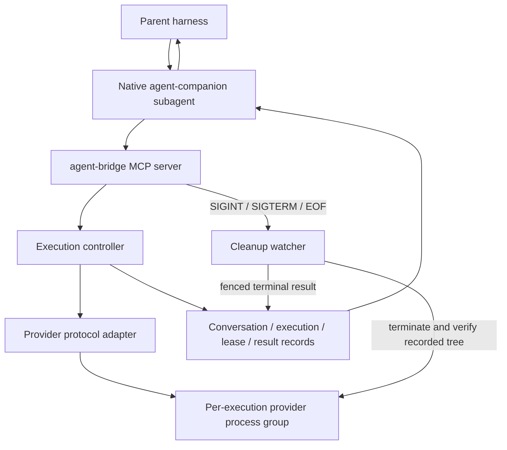

# Agent Companion Architecture

Last updated: 2026-11-05

## Goal

The parent speaks naturally to an `agent-companion` subagent. It supplies the
task, an absolute repo or worktree path and any companion or model preference.
The companion does the work. The subagent supplies context, relays answers and
questions, and can check a specific suspect finding. Failure leaves the task
with the companion and is reported truthfully to the parent.

Claude Code and Codex CLI are the current install surfaces. Both register the
bridge at plugin/session scope so the child can inherit it. The six private
`agent_*` tools connect that child to OpenCode,
Copilot, Codex or Antigravity. The ownerless catalog provides read-only discovery.
Each execution owns a cold provider process. CLI host measurements inform the
controller contract; Codex desktop and operator-only TUI rows remain unqualified.

## Product Vocabulary

| Product term | Current implementation term | Meaning |
| --- | --- | --- |
| Harness | host | Parent coding-agent surface, currently Claude Code or Codex CLI. |
| Companion | target | Downstream agent runtime, currently OpenCode, GitHub Copilot CLI, Codex CLI, or Google Antigravity. |
| Model preference | optional `agent_send` `model` | An explicit choice for this conversation; omission uses the companion's configuration. |
| Catalog | `agent_catalog` | Read-only companion/model configuration, capabilities and readiness. |

The CLI and private tool schema keep `host` and `target`:
`setup.sh --host claude|codex|both` selects harness surfaces, and
`agent_send({ target })` names a companion runtime directly (see Private MCP Surface).

## Flow

One controller owns each execution. The provider exits after every answer.
A later message to the same native child starts a new process and resumes its
saved history. In-flight survival across bridge replacement is deliberately
given up: bridge loss stops owned work and preserves history and results.
No provider process or protocol connection is shared across children.

### MCP registration boundary

Both hosts register `agent-bridge` at plugin/session scope: Claude through
`.claude-plugin/plugin.json`'s inline `mcpServers` map, Codex through
`.codex-plugin/plugin.json`. The parent now sees all six tools. Owner-bound
`agent_send`, `agent_wait`, `agent_reply` and `agent_cancel` fail closed with
`ok: false, status: NATIVE_OWNER_REQUIRED` without a native child owner.
`agent_catalog` is the ownerless read for discovery; `agent_status`, with or
without a job id, is also exempt from the owner gate.

Claude's source template uses `mcpServers: [agent-bridge]`, a name reference,
not an inline transport. `hooks/install-agent.sh` still materializes the agent:
plugin-shipped agent frontmatter is ignored. Claude Code 2.1.318 registers
plugin servers as `plugin:<plugin-name>:<server-key>`, so the installer qualifies
that reference to `[plugin:agent-companion:agent-bridge]` and its tool names to
`mcp__plugin_agent-companion_agent-bridge__*`. The identity hook matches this
namespace as well as the bare `mcp__agent-bridge__*` session name. See the
[plugin MCP naming contract](https://code.claude.com/docs/en/mcp#plugin-provided-mcp-servers).
The Claude plugin server keeps sibling `timeout: 1320000` (milliseconds);
Codex keeps `tool_timeout_sec: 1320`. Both set the owner grace to 120000 ms.
Both manifests select their host explicitly for the shared shell launcher,
which resolves Node and waits for dependency readiness. Settings take effect
on the next session. No root `.mcp.json` is needed.

Claude's PreToolUse hook overwrites `thread` on every owner-bound call with
`agent_id`, or clears it when absent, removing any model-supplied identity.
A failed rewrite denies the call. Codex's owner comes only from
`_meta['x-codex-turn-metadata'].thread_id` when `thread_source === 'subagent'`;
root (`user`) and missing metadata are refused. Codex still inherits MCP
authority from its parent and exposes `mcp__agent_bridge__*` through deferred
tools. Its manifest retains pre-approved tools for headless policy `never`;
user and managed plugin policy may still restrict them.

Stop hooks write advisory `stops/<owner>.json` under the bridge state directory:
`AGENT_COMPANION_HOME` wins, otherwise `lib/host.mjs` supplies
`~/.claude/agent-companion` or `$CODEX_HOME/agent-companion` (default
`~/.codex/agent-companion`). The atomic, private marker shape is
`{owner, source: 'TaskStop'|'SubagentStop', t, session_id}`; `t` is Unix epoch
milliseconds and an unavailable session id is `null`. Claude's parent-side
TaskStop PreToolUse supplies `tool_input.task_id`; SubagentStop supplies
`agent_id`. The 2026-11-05 Codex identity payloads also identify the child
thread as `agent_id` (their `session_id` is the parent). Missing child identity
produces no marker and a diagnostic, never a guessed owner. Markers are evidence
for the controller, not cleanup or lease renewal.

SIGINT, SIGTERM and stdin EOF share one awaited `onBridgeLoss()` hook, guarded
against duplicate or racing loss events before exit. The registered controller calls `bridgeLost()`, hands each recorded tree to
the cleanup watcher and stops its own writers. The watcher terminates and verifies
that tree, writes its immutable result, then exits; it owns no provider protocol.
Uncatchable bridge SIGKILL cannot run this handoff. A new bridge never adopts
a live execution and cannot claim cleanup until absence is verified.

## Private MCP Surface

The parent supplies plain-language requests to the subagent. The six tools are
`agent_catalog`, `agent_send`, `agent_wait`, `agent_status`, `agent_reply` and
`agent_cancel`; their arguments are listed in [README.md](../README.md#internal-mcp-surface).

`agent_catalog` takes no arguments. It reports enabled companions, the default,
per-companion model configuration, reply/resume/cancel/model-selection
capabilities, readiness and the installed version seen at the last check. An
unset model default is labelled as inheriting the companion's configuration.
The call is ownerless and observational: no hydration, ownership change, lease
renewal, ledger/digest write or session creation. If model enumeration needs a
session, it reports "not enumerable without a session". A missing catalog entry
alone does not prove an explicitly requested model invalid.

`agent_send` accepts `task` and an absolute existing `cwd`, with optional `target`,
`model` and `max_wait_sec`. It passes the child's exact message to the companion.
The bridge adds no task instructions or required answer format. Omitted `target`
uses `AGENT_COMPANION_DEFAULT_TARGET`, then the `default-target` file. If neither
exists, the send returns `TARGET_UNCONFIGURED`. An explicit `model` overrides
per-companion configuration; with no override or configured default, the native
configuration is inherited. Codex receives no model key in that case.

Wait, status, reply and cancel retain their existing control semantics. Replies
require that specific job's `reply_available: true`, based on its adapter capabilities
and current live state. Catalog capabilities alone do not establish it: the catalog's
`reply` mirrors the adapter's steer capability (Codex only), and the per-execution
`reply_available` remains authoritative.

## Companion Matrix

All four companions support send, bounded wait, observational status and cancel.
Each answer owns a new process, including the HTTP and ACP providers.

| Companion | Per-answer runtime | Follow-up by cold resume | Reply / steer | Model selection | Native history |
| --- | --- | --- | --- | --- | --- |
| Codex CLI | `codex app-server` over stdio | `thread/resume` | `turn/steer`; accepted and confirmed are separate | Explicit override, otherwise inherited; effective model/effort recorded | Saved thread id and vendor rollouts |
| OpenCode 2.x only | Private `opencode serve` on loopback | Saved session id | Unsupported | `provider/model`, optional variant; resolved model verified | Vendor-persisted session |
| GitHub Copilot CLI | `copilot --acp` | `FOLLOWUP_UNSUPPORTED` until cold load is qualified | Unsupported | Inherited configuration or supported explicit model | Session id retained; cross-process load unqualified |
| Google Antigravity | `agy_acp_server.par` over ACP | `session/load` | Unsupported | Session config option after both new and load | SQLite conversations under `~/.gemini/antigravity-acp/conversations/` |

OpenCode validates the 2.x authenticated `/api` contract and runtime pid. Its
bootstrap password stays only in adapter memory. The OS cwd and `PWD` both match
the canonical requested directory; the historical 2.0.25 tool-runtime cwd issue
is why both are set. Events are filtered by session id; terminal transcript
projection is bounded by this execution's admitted user message and idle outcome.
OpenCode 1.x is dropped. Permissions follow OpenCode's own server configuration.

Codex selects an executable/helper pair before each runtime starts, using
`lib/codex-install.mjs`. The configured `CODEX_BIN` or PATH anchors the version;
the resolver retains invoked and canonical identity and may select a complete,
same-version pair under `$CODEX_HOME/plugins/.plugin-appserver/`. It does not
change Homebrew links or quarantine attributes. `approvalPolicy: never` is fixed;
the default sandbox is `workspace-write` with network enabled. A busy native
history is refused before `turn/start`. The advisory schema probe runs once per
bridge; catalog's Codex entry and status expose `contractStatus` as
`match|drift|unverified`. A version-only change is not schema drift.

ACP pins protocol v1. The descriptor supplies argv, permissions, usage and model
rules; the adapter handles `session/request_permission` itself. Antigravity
reapplies an explicit model after each history load and verifies acknowledgement.
Copilot's advertised load capability alone is insufficient: cold follow-up remains
refused pending account resolution and qualification. ACP does not simulate steer
by cancelling and re-prompting. Usage is absent when the provider reports none.

## Routing Contract

**One native child is one companion conversation.** Claude's hook unconditionally
writes the child's `agent_id` into `thread`, clearing it for a root caller.
Codex requires `thread_source: subagent` and uses its `thread_id`. Send, wait,
reply and cancel without that owner fail with `NATIVE_OWNER_REQUIRED`.
Catalog and status are ownerless reads; neither renews a lease nor changes records.
The parent session id scopes completion delivery, not companion continuity.

The first send requires an absolute existing directory and records its canonical
path, provider, optional model override and native history id. Follow-ups retain
provider and cwd; mismatches are explicit refusals. Omitted model retains an
existing override, otherwise inherits the provider's configuration. A configured
per-companion default is applied to a new conversation. An explicit model can
change on a later, closed execution; the resolved model is recorded separately.

On a busy conversation, identical text and model reattach to the same execution
after provider/cwd validation. Different text or model returns `thread_busy`.
Reattachment returns the existing delivery acknowledgement, not a second prompt;
use bounded `agent_wait` calls for completion. There is no hidden work queue.

Target/model refusals include `TARGET_UNCONFIGURED`, `TARGET_UNSUPPORTED`,
`CAPABILITY_UNAVAILABLE` and `MODEL_NOT_ALLOWED`. The child relays the failure
without substituting a companion/model or completing the delegated work itself.
See historical substitution failure [F5](RELIABILITY_REMEDIATION.md#1-incident-and-exec-evidence).
Missing history fails as `history_unavailable`; unsupported cold follow-up fails
as `FOLLOWUP_UNSUPPORTED`. Ambiguous migrated history is never guessed.
A missing delivery acknowledgement produces `delivery_unknown`, terminates the
runtime and is never automatically resent.

## Companion Adapter Contract

The controller owns processes, leases, records and results. Adapters implement
only the provider protocol; they never write durable execution state or kill
processes. The provider factories create an adapter with this interface:

| Method / property | Contract |
| --- | --- |
| `start({ cwd, env, model, supervisor })` | Spawn via `supervisor.spawn(argv, opts)`; return `{ runtime }`. Startup failure becomes `failed: runtime_unavailable`. |
| `openHistory({ historyId, model })` | Null id creates history; a saved id must load unchanged or throw `HistoryUnavailable`. Apply model rules and return `{ historyId, effectiveModel }`, plus effective effort where reported. |
| `deliver({ text })` | Send verbatim once; return `{ nativeTurnId }` on native acknowledgement. Ambiguous failure throws `DeliveryUnknown`; never retry delivery. |
| `observe({ onProgress })` | Resolve one native outcome (`completed`, `failed`, `interrupted`) with text, usage, native refs and cause. Progress carries last activity, active command, retry state and partial text. Transport loss throws `ProviderLost`. |
| `interrupt()` | Request native turn interruption; never signal a process. |
| `close()` | Close protocol channels; process termination belongs to the supervisor. |
| `capabilities` | `{ followUp, steer, modelSelection, loadsHistory }`; unsupported history load refuses follow-up. |
| `steer({ text })` | Optional when `steer` is true; Codex reports acceptance separately from observed confirmation. |

ACP's prompt response is terminal, so an earlier native session update or
permission request supplies its delivery acknowledgement. Retryable provider
errors remain progress. Usage uses `lib/usage.mjs`'s shared counters and optional
model/cost fields; absent usage is never invented as zero.

Each execution gets its own supervisor: `spawn`, `recordDescendant`, `census`,
`terminate` and `verifyGone`. It records pid/pgid, samples descendants every 2 s,
and includes protocol-reported command pids. Closure attempts native interrupt
and protocol close with bounded waits, then SIGTERM to the group and recorded
pids, SIGKILL to survivors after 2 s, and absence verification by pid plus birth
identity. The cleanup target is at most 5 s on an awake machine after the close
decision; lease detection delay is reported separately. A signal acknowledgement
alone is never proof of exit.

## State

`AGENT_COMPANION_HOME` overrides the state home; otherwise Claude uses
`~/.claude/agent-companion/` and Codex uses `$CODEX_HOME/agent-companion/`
(default `~/.codex/agent-companion/`).

| Path | Meaning |
| --- | --- |
| `default-target`, `default-model`, `default-model-<companion>` | Companion/model defaults; environment defaults take precedence. |
| `target-checks.json` | Last explicit readiness evidence; catalog/status read it without probing. |
| `conversations/<owner>.json` | Provider, canonical cwd, model override, native history, generation and current execution id. |
| `executions/<id>.json` | Request, native references, process identities, progress, lifecycle and writer authority. |
| `leases/<id>.json` | Attached owner requests and remaining grace. |
| `results/<id>.json` | Immutable outcome, text/usage, native refs, selected/effective model, stop cause and cleanup evidence. |
| `locks/<owner>.lock` | Exclusive record mutation lock; crash leftovers fail closed as `RECORD_BUSY`. |
| `stops/<owner>.json` | Advisory TaskStop/SubagentStop marker. Its snapshot at dispatch prevents an old stop from cancelling new work. |
| `completions/<id>.json` | Publication receipt keyed by execution id. |
| `runtime/completions.jsonl` | Hook delivery queue; terminal wait consumes the execution's entries. |
| `runtime/digests/agent-digest-<id>.md` | Controller-published task and final/partial output, status and reported usage. |
| `runtime/agent-bridge.log`, `daemon.log` | Bridge and structured event logs; the latter is a retained filename, not a running service. |

Record writes are atomic and private, with conversation-generation and writer
fences. A native terminal outcome is persisted before cleanup; the final immutable
result includes cleanup evidence. Startup reconciliation reads watcher results
or verifies process absence. It never adopts old live work; until absence is
proven, state stays `unknown` and a new execution is refused. Status does not
reconcile, publish a completion or refresh a digest. The watcher writes only its
fenced result; controller startup or an owner wait can publish it later.

Legacy `profiles.json`, `threads/` and `jobs/` are migration inputs only. The
logged one-shot `phase1-migrated` conversion preserves source configuration,
carries a default model only when none is set, consolidates uniquely mapped
history and writes ambiguity markers for conflicts. Records require the latest
legacy job's provider to match before accepting a bare saved id. Migration must
be performed with legacy work quiescent; it neither rewrites legacy jobs nor
adopts their active processes. There are no shared runtime registries in the
shipped execution path, and no one-hour GC of the new durable records.

## Host budgets

The [Claude 2.1.318 report](../probes/host-qualification/claude/REPORT-2026-11-05.md)
and [Codex 0.166.0 report](../probes/host-qualification/codex/REPORT-2026-11-05.md)
measure a **1320.0 s hard per-call wall on both hosts**, silent or with progress
every 10 s (Claude 132 frames; Codex 131). Claude requested 1980 s and Codex
1800 s. Progress does not extend that wall. The installed settings are Claude
`timeout: 1320000` and Codex `tool_timeout_sec: 1320`; wait defaults to 480 s
and caps at 1200 s, leaving 120 s below the configured wall. Parent messages
reach a busy child between waits. Choose shorter waits when response latency matters.

Owner send/wait/reply/cancel requests hold attachment while pending. When the
last returns, `AGENT_COMPANION_OWNER_GRACE_MS` defaults to 120000 (120 s).
Only a new owner request renews it. The controller uses monotonic awake ticks,
pausing grace across long scheduling gaps rather than treating suspend as owner
loss. A changed stop marker or attributed request cancellation closes the owner
immediately; the lease handles missing signals. The old 40-minute execution
cutoffs and their environment knobs are removed. Protocol startup/delivery
bounds remain separate from total answer duration.

## Negative Results

Things that are **not** true, that a reader of this repo would reasonably assume are.
The measured evidence is in [`RELIABILITY_REMEDIATION.md`](RELIABILITY_REMEDIATION.md)
and the harnesses are in [`probes/`](../probes/README.md). They are listed as negatives
because the cost of re-deriving them is a day each.

The `plan_path`, profile-selection, exec, broker and daemon measurements below
are historical evidence for designs retired on 2026-11-05. They are not current
components or survival guarantees. Implementation-specific entries are labelled;
full measurements remain in [RELIABILITY_REMEDIATION.md](RELIABILITY_REMEDIATION.md).

**Phase 2 host findings (2026-11-05)**

The [Claude report](../probes/host-qualification/claude/REPORT-2026-11-05.md) and
[Codex report](../probes/host-qualification/codex/REPORT-2026-11-05.md) establish:

- A stop during a pending request is attributable; a stop between dispatch and
  wait or between waits gives no cancellation signal. Normal completion gives
  SubagentStop only. Stop markers and the owner lease fill these gaps.
- Neither host terminates provider descendants. Claude graceful exit gives
  SIGINT (~235 ms before exit); Codex gives SIGTERM. Parent SIGKILL gives EOF
  without SessionEnd. A surviving sibling connection remains usable.
- Progress does not extend the 1320 s per-call wall; see [Host budgets](#host-budgets).
- `/clear` on Claude 2.1.318 is not a bridge-loss trigger: session id changed
  after 0.5 s, the servers and pending child continued, and inherited session
  environment became stale. Addressability of the old child was not established.
- A headless Claude parent has no TaskOutput. Background-only work was cut off
  when the parent exited about ten minutes later; foreground children were used
  for long-call measurements.
- Same-child resume after stop works. Claude completed-child resume requires
  session persistence. Busy-child messages are queued until wait returns
  (Claude measured 39.6 s and 40.1 s delays for 40 s waits).
- Healthy Claude attachment gaps were typically 1.5–7 s to first wait and 2–6 s
  between waits, with maxima of 18.5 s and 20 s respectively; 119–126 s gaps
  were deliberately held. Compaction/suspend and remaining TUI cases require
  operator qualification; the unattended `/compact` command was not evidenced.

These passive fixtures establish host signals, not the shipped cleanup implementation.

- **Historical test timing is not current runtime qualification.** The former
  fake-OpenCode-CLI test in `bridge-server/server.test.mjs` had a 5 s poll budget;
  it failed under full-suite concurrency and passed in about 0.6 s alone. The
  CLI runtime has been retired; preserve that observation as test history.

**Transport and process lifetime**

- **Historical (retired design): Exec's resume limit is not a Codex limit.** App-server `thread/resume` rejoins
  a running turn across bridge death. See
  [`RELIABILITY_REMEDIATION.md` §2](RELIABILITY_REMEDIATION.md#running-thread-recovery--measured-2026-08-10).
- **`detached: true` is not what makes a child survive.** File-backed stdout is;
  the measured 2×2 matrix is
  [`RELIABILITY_REMEDIATION.md` S3](RELIABILITY_REMEDIATION.md#0-host-and-process-constraints).
- **Historical (retired design): No signal reaches a codex child when its bridge dies.** It dies at its next
  stdout write, so pid liveness does not prove recoverability. See
  [`RELIABILITY_REMEDIATION.md` F1](RELIABILITY_REMEDIATION.md#1-incident-and-exec-evidence).
- **Historical (retired design): `codex app-server` over stdio buys no survival by itself.** The detached broker
  owns that lifetime. Both durability tiers are measured in
  [`RELIABILITY_REMEDIATION.md` §2](RELIABILITY_REMEDIATION.md#broker-lifetime-and-routing).
- **Historical (retired design): A present socket is not a live broker.** Only a definitive absent verdict
  authorises unlink; an indeterminate probe must refuse. The measured stale-socket
  case and error classes are in
  [`RELIABILITY_REMEDIATION.md` §2](RELIABILITY_REMEDIATION.md#broker-lifetime-and-routing).
- **`thread not found` does not mean the thread is gone.** Resume before steering
  or interrupting a thread this connection did not start; see
  [`RELIABILITY_REMEDIATION.md` Error taxonomy](RELIABILITY_REMEDIATION.md#error-taxonomy).
- **`turn/start` on a busy thread does not reject.** It can double-dispatch work;
  the adapter checks activity first. See
  [`RELIABILITY_REMEDIATION.md` §2](RELIABILITY_REMEDIATION.md#error-taxonomy).
- **Historical (retired design): A thread being loaded does not mean it is active.** Both reapers need positive
  idle/terminal evidence, not list length. See
  [`RELIABILITY_REMEDIATION.md` §2](RELIABILITY_REMEDIATION.md#broker-lifetime-and-routing).
- **Historical (retired design): An alive broker is not necessarily the installed broker.** A detached
  app-server can keep a deleted Homebrew Caskroom image mapped across
  `brew upgrade codex`. Socket readiness therefore proves transport liveness,
  not executable freshness; version, canonical path and stat identity are
  compared separately before a send.
- **`--code-mode-host` is not a local helper-path override.** In Codex 0.152.x it
  selects a remote HTTP(S)/gRPC endpoint ([source](https://github.com/openai/codex/blob/rust-v0.152.0/codex-rs/app-server/src/code_mode_host.rs#L8-L78)).
  No supported key in the [Codex configuration reference](https://developers.openai.com/codex/config-reference)
  or environment variable redirects a local helper. The
  [local resolver](https://github.com/openai/codex/blob/rust-v0.152.0/codex-rs/install-context/src/lib.rs#L172-L202)
  checks packaged
  resources, the canonical package `bin` directory, then the invoked executable
  directory; selecting a colocated complete Codex/helper pair is the supported
  local mechanism.

**Host budgets and observability**

- **An idle budget is not the only limit.** The older measured stdio default
  was 1800 s; the configured per-call wall now controls the 1200 s wait cap.
  See [Host budgets](#host-budgets) for the newer measurements.
- **Historical documentation snapshot: two Claude Code budget variables** (docs read 2026-09-11; both names are
  present in the 2.1.268 binary; neither has been set or measured on this host).
  `CLAUDE_CODE_MCP_TOOL_IDLE_TIMEOUT` (v2.1.187+, stdio servers included from v2.1.203) is
  the idle window above, in ms: default 1,800,000 for stdio, 300,000 for HTTP/SSE/WebSocket,
  `0` disables the check. It is a host-shell variable, read where `claude` is launched; an
  `env:` entry on the server reaches only the bridge child, like `MCP_TOOL_TIMEOUT`. The
  default is the measured value, so nothing sets it. The documented interaction that does
  matter: from v2.1.203 a per-server `timeout` of at least 1000 ms also floors the idle
  window for that server, so the per-server `timeout: 1320000` is now carried by the
  Claude plugin manifest (Codex: `tool_timeout_sec = 1320`). `CLAUDE_CODE_MCP_AUTO_BACKGROUND_MS`
  (v2.1.212+): an MCP call in the **main conversation** still running after 120,000 ms
  becomes a background task and the model receives a task id instead of the result; `0`
  turns it off. The docs exclude subagent calls outright, and every bridge call is made by
  the `agent-companion` subagent, so the blocking `agent_wait` contract stands and the
  bridge sets nothing. The sign that it fired anyway would be a wait answered with a task
  id rather than an envelope — `docs/DIRECTION_ASSESSMENT.md` §7 keeps it on the
  re-verify list.
- **`env: { MCP_TOOL_TIMEOUT }` in agent frontmatter is inert.** The variable reaches the
  bridge child; the host ignores it. The fields that work are a sibling `timeout` (Claude,
  milliseconds) and `tool_timeout_sec` in the Codex plugin manifest (seconds).
- **MCP progress notifications are not a model channel.** The older idle-watchdog measurement showed
  them reaching the spinner; they do not extend the measured per-call wall. The silent/progress control is in
  [`RELIABILITY_REMEDIATION.md` §0](RELIABILITY_REMEDIATION.md#0-host-and-process-constraints).
- **Historical (retired design): A digest is not a salvage artefact on the exec transport.** The answer arrives
  atomically at turn end. App-server `thread/read` salvages messages, not a measured
  tool-activity history. See
  [`RELIABILITY_REMEDIATION.md` F7 and evidence limits](RELIABILITY_REMEDIATION.md#1-incident-and-exec-evidence).
- **Historical (retired design): Protocol completion is not always a task verdict.** Codex can emit
  `turn/completed` after its subordinate command runner failed before any command
  executed. Conversely, many valid conversational turns use zero tools and
  restart recovery has no tool history. The bridge therefore requires a live
  `turn/completed`, zero observed tool calls, and a universal pre-execution
  command blocker; for recovered `thread/read`, it requires an explicit
  named-runner-unavailable message instead. Prose merely quoting such an error
  is not enough.
- **Historical (retired design): `--output-last-message` is not a salvage channel.** Neither it nor the exec
  event stream reliably records an aborted turn; see
  [`RELIABILITY_REMEDIATION.md` F7](RELIABILITY_REMEDIATION.md#1-incident-and-exec-evidence).
- **`setTimeout` counts suspend on macOS, but not Linux.** The measured wake timing
  and libuv clock difference are in
  [`RELIABILITY_REMEDIATION.md` S5 / F9](RELIABILITY_REMEDIATION.md#0-host-and-process-constraints).
- **The host session id does not identify the caller.** It names the *main* session, which
  every subagent in it shares. Companion continuity keyed on it put four reviewers and an
  author, each spawned separately in one Claude session, on a single codex thread; one job
  carried 2.1M input tokens. Measured 2026-10-26:
  - Claude Code 2.1.310 shows the bridge only main's `CLAUDE_CODE_SESSION_ID` in its env, and
    `claudecode/toolUseId` and `progressToken` in `_meta`.
  - The subagent's `agent_id` reaches hooks only. It differs per spawn and is unchanged
    across `SendMessage`. That is why `hooks/name-thread.sh` writes it into `agent_send`'s
    `thread` from `PreToolUse`.
  - On codex-cli 0.164.0, `_meta["x-codex-turn-metadata"].session_id` is also the root
    session for every child. Its `thread_id` is the caller's own, and the bridge names the
    thread from that.

  On both hosts the id comes from the host, so no model has to carry it.

**Blast radius**

- **The bridge runs no git and writes nothing inside a job's cwd.** An index hash
  alone does not identify its mutator; see the incident's git-command and stat-cache
  evidence in [`RELIABILITY_REMEDIATION.md` F4](RELIABILITY_REMEDIATION.md#1-incident-and-exec-evidence).
- **Status is not attachment or recovery.** It reads records without renewing
  the lease, writing a result, publishing a completion or spawning a provider.
  Cleanup signals only recorded process identities for one execution; siblings
  of the same provider have independent process groups and connections.
- **Historical (retired design): "No thread id" does not mean "broadcast".** Read against
  the codex source (rust-v0.150.1, 2026-08-28): codex has three delivery paths, not two — thread
  subscribers, **one connection** (`send_server_notification_to_connection`), and broadcast —
  and five pinned notifications take the middle one: `mcpServer/event/stream/notification`
  (`subscriptionId`), `command/exec/outputDelta` (`processId`), `process/outputDelta` /
  `process/exited` (`processHandle`), `fs/changed` (`watchId`). Through a broker that owns the
  single connection they are addressed to nobody, and "global" would have handed one job's
  process output or hosted-app events to every other job. They have a third routing class,
  `connection`: declined at the handshake via `capabilities.optOutNotificationMethods` (honoured
  per connection; unknown capability fields are ignored — both measured) and dropped with a WARN
  if one arrives anyway. Dormant today — `mcpServer/event/stream/*` is `#[experimental]` and the
  broker never opts in; nothing here calls `command/exec`, `process/*` or `fs/watch` — but the
  owner-key rule is a table (`subscriptionId`, `processId`, `processHandle`, `watchId`), not a
  shape heuristic: `sessionId`, `loginId` and `importId` look identical and codex genuinely
  broadcasts those.
- **Historical (retired design): A superseded broker that never retires is not a reaper bug.** The idle reaper held a
  pre-upgrade broker alive for hours on the machine that ran the test suite, and the cause was
  not in the reaper: `hooks/drain-completions.test.mjs` shelled the hook out with the real
  `$HOME`, so every run of its thirteen tests wrote five fixture-session heartbeats (`sid-A`,
  `sid-B`, `sess_abc_def`, `café-1`, `agent_main_01HX`) into the operator's real
  `runtime/heartbeats/`, and `HOST_LIVENESS_TTL_MS` (30 min) then counted each as a live host.
  Measured 2026-08-28. The suite sandboxes `AGENT_RUNTIME_DIR` at module level, and the
  guard is structural, not a list: `node --test` sets `NODE_TEST_CONTEXT` in every test child
  and everything a test spawns inherits it, so `lib/host.mjs`'s `refuseRealHomeUnderTest` —
  called from `runtimeDir()`, from `state.mjs`'s `BASE_DIR` at import, and mirrored in
  `hooks/drain-completions.sh` — throws on any path under the real account home
  (`os.userInfo()`, not `$HOME`; anything under `os.tmpdir()` passes). A textual guard over test sources missed four cases. That retired lifetime bug is why the real-home guard remains; heartbeats
  are not owner-lease evidence in the current controller.
- **Auto-accepting an approval defeats the sandbox.** The adapter pins `never`;
  the read-only write experiment is in
  [`RELIABILITY_REMEDIATION.md` §2](RELIABILITY_REMEDIATION.md#sandbox-and-configuration).
- **Historical (retired design): Confining `plan_path` to the plans dir is not a boundary.** The path only reaches the
  companion *inside a prompt*, and every shipped companion reads the whole filesystem on its
  own (Copilot runs `--allow-all-paths`; codex `workspace-write` confines writes, not reads;
  OpenCode is unsandboxed) — and the caller is the subagent, which has `Bash` and copies the
  file in anyway. Measured 2026-08-28: the check cost one bounced dispatch per scratchpad plan
  plus a duplicate under `~/.claude/plans` that the harness then edited out of sync with the
  copy the companion reviewed. An explicit `plan_path` is accepted anywhere (still
  absolute, existing, a file, and realpath-canonicalised); the plans dir remains only the
  lookup scope for `plan_path: "latest"`.
- **The agent file must be materialized into `~/.claude/agents/`.** Plugin subagents silently
  lose `mcpServers` / `hooks` / `permissionMode`.
- **A codex version bump is not a wire-contract change.** Measured 2026-08-28:
  0.147.0 → 0.150.1 added nine notifications, widened enums and added one required
  `Thread` field without moving routing. The schema, not the version string,
  identifies what changed; the version is provenance only. The current fixture and
  drift policy are in
  [`RELIABILITY_REMEDIATION.md` §2](RELIABILITY_REMEDIATION.md#transport-and-contract).
- **Config inheritance works — do not pin the model.** Omit the key unless a
  request or configuration selects an override; see
  [`RELIABILITY_REMEDIATION.md` §2](RELIABILITY_REMEDIATION.md#sandbox-and-configuration).
- **An agent's yolo flag is not yolo.** Measured 2026-09-11 on Gemini CLI 0.59.0 under
  `--acp`: "Approval mode
  overridden to \"default\" because the current folder is not trusted", after which
  every edit and shell call arrives as a `session/request_permission` request. A
  client that only passes a flag hangs its agent on the first tool; the ACP adapter
  therefore answers the request itself, from the descriptor's policy, whatever any
  flag said.
- **`notifications/initialized` is not ACP.** It is MCP's post-handshake notification.
  Copilot ignores it, but Gemini's SDK answers `-32601 "Method not found"` on stderr
  (measured 2026-09-11). ACP uses `clientCapabilities`, not `capabilities`.
- **Stream occupancy is not per-turn usage.** Copilot CLI 1.0.83's `usage_update`
  reports context occupancy (`used`/`size`). Its native prompt response on 1.0.94
  supplies turn counters (measured 2026-10-09); the descriptor reads those through
  `usageFromCopilotAcp`, with OTEL `invoke_agent` spans as fallback. Gemini 0.59.0
  reports turn tokens under the response's `_meta.quota.token_count`, not an
  update. Google's agy_acp_server 1.1.1 reports neither: its response is only
  `{stopReason}` and internal usage frames appear on stderr, which the bridge
  does not parse (measured 2026-09-11). Antigravity jobs carry no `usage`.
- **An agent advertising `loadSession: true` does not mean its sessions survive its
  process.** Copilot CLI 1.0.83 advertises it (measured) and its sessions are
  process-local (github/copilot-cli#1767). Which is why `session/load` is a
  descriptor decision (`acp.loadSession`) ANDed with the agent's advertisement, not
  the advertisement alone: Copilot false; the fake agent's descriptor true; Antigravity
  true, and measured to mean it — a fresh `agy_acp_server.par` process loads the id,
  replays twelve updates of history and answers the follow-up from memory.
- **A v2 `initialize` request is answered with `protocolVersion: 1`.** By both agents
  measured (Copilot 1.0.83, Gemini 0.59.0; the spec says an agent answers with the
  latest version it supports), so a client cannot probe for v2 support by asking — and
  the pin can be enforced at the handshake, where refusing costs nothing. Google's
  agy_acp_server 1.1.1 does the opposite: it answers 1 when asked 1 and 2 when asked 2
  (measured 2026-09-11), so a forum report that it "negotiates protocolVersion 2" was
  the client asking for 2. Either way the pin holds at the handshake.
- **Antigravity's CLI and ACP server are different products.** Measured 2026-09-11:
  `agy` has no ACP mode; the registry's `antigravity-acp` launches Google's signed
  `agy_acp_server.par`, which is the second ACP companion. The Gemini CLI comparison
  also depends on distribution and authentication: Homebrew supplied 0.46.0 while
  npm supplied 0.59.0, and consumer “Login with Google” was refused. The distribution,
  authentication and terms evidence belongs in `docs/MVP_TRACKER.md` item 8.
- **A model is not always a spawn flag.** Google's agy_acp_server 1.1.1 takes the model
  as a session config option (`session/set_config_option`, id `model`; `session/set_model`
  answers too) and a `session/load`ed session comes back on the default model (measured
  2026-09-11: set to `gemini-3.8-flash-low`, killed, loaded, `currentValue` back to
  `gemini-3.7-flash-high`). So the descriptor names the request (`acp.setModel`) and the
  adapter sends it after `session/new` and again after `session/load`; an unknown id is
  refused with -32602 naming the available ones and fails the prompt, never a silent
  fallback to the default. Copilot's descriptor has no such hook and its argv is
  unchanged.
- **A codex role file accepting `mcp_servers` does not mean the child gets it.** The Codex
  subagents docs say a custom agent file may declare `mcp_servers`. Read against rust-v0.153.4
  (2026-09-09): the role parser (`codex-rs/agent-roles/src/agent_role_config.rs`) flattens the
  whole `ConfigToml` into the role file, so `[mcp_servers.x]` is accepted without error — and
  `codex-rs/core/src/agent/role.rs`'s `apply_role_to_config_inner` then copies a closed list
  (developer_instructions, model, reasoning effort/summary/verbosity, personality,
  service_tier, features, skills) and drops `mcp_servers` on the floor. A role-local bridge
  registration would be a silent no-op, which is worse than the rejection it replaced. The
  plugin-manifest session-scope registration stays; `templates/agent-companion.toml.test.mjs`
  asserts the role carries no `[mcp_servers]`. Re-check `apply_role_to_config_inner` on every
  codex upgrade — the day it honours the key, the Codex host could use role-local registration; both hosts currently use plugin scope.

## Codex Upgrade Incident Evidence (2026-09-02)

Historical evidence for the retired broker design; remediation claims in this
section describe that implementation, not the current controller. Root-caused
from process/file inspection, persisted jobs and upstream Codex source:

- The detached broker outlived its launching terminal with a deleted 0.151.0
  Caskroom image still mapped. Terminal loaded threads kept it alive. Socket
  readiness alone cannot establish executable freshness or turn activity.
- The affected local 0.152.0 payload had no `codex-code-mode-host`. Codex's
  resolver consequently reached its final invoked-directory candidate,
  `/opt/homebrew/bin/codex-code-mode-host`, which Homebrew had not installed.
  There is no local helper-path setting to inject instead.
- Job `codex-mtjptuj4-89gw` persisted `completed` even though its terminal text
  said every command failed before execution and explicitly withheld a review
  verdict. Protocol completion alone cannot establish that a review ran; the
  runtime-blocker classifier requires the specific evidence described above.

Evidence boundaries retained as inference or unknown:

- The configuration `EPERM` is consistent with macOS Files-and-Folders/TCC's
  [responsible-code model](https://developer.apple.com/forums/thread/125438)
  losing its original process context after a detached broker
  outlives the terminal, but the incident's responsible audit token was not
  recoverable. The bridge treats that exact `thread/start` signature as
  recoverable once; it does not claim the OS mechanism was proven.
- The user's controlled A/B established that removing quarantine from the cask
  parent and restarting stopped the Gatekeeper dialog, while changing the helper
  did not. The exact Gatekeeper responsibility/inheritance mechanism remains an
  inference, so quarantine is detected and surfaced rather than rewritten.
  Homebrew 6.0.22 has no `--no-quarantine` option (Homebrew/brew#20755;
  `HOMEBREW_CASK_OPTS` fails on it), so the attribute returns with every
  cask upgrade and the doctor and inspector warnings name the operator's
  `xattr -d` as the remedy (checked 2026-09-11).
- The inspected [0.152.0](https://github.com/openai/codex/releases/tag/rust-v0.152.0)
  and [0.152.1](https://github.com/openai/codex/releases/tag/rust-v0.152.1)
  package archives both contain the helper and use the same lookup
  implementation. Why the historical local
  0.152.0 payload lacked it is not established; 0.152.1 must not be described as
  an upstream helper-lookup fix.
