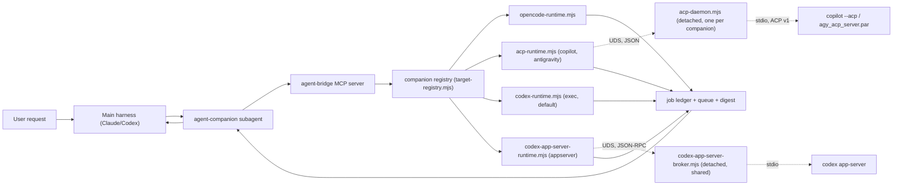

# Agent Companion Architecture

Last updated: 2026-10-26

## Goal

Agent Companion is organized around a harness + companion model:

- **Harnesses outward:** Claude Code and Codex CLI install surfaces today; future
  harnesses should plug in at the host/template/hook/session-routing boundary.
- **MCP middle:** one subagent-oriented MCP server with generic `agent_*` tools.
- **Companion adapters inward:** OpenCode, Copilot, Codex, and Google Antigravity
  behind a small runtime boundary.
- **Strength routing:** installs can expose strengths to the harness while the
  bridge maps each strength to one configured companion profile (see
  `profiles.json` and `resolveRouting`).
- **Harness scope is explicit:** Claude keeps the bridge agent-local. Codex
  registers it at plugin/session scope so its agent role can inherit it; direct
  parent use is unsupported even though main Codex can see the tool schemas.

## Product Vocabulary

| Product term | Current implementation term | Meaning |
| --- | --- | --- |
| Harness | host | Parent coding-agent surface, currently Claude Code or Codex CLI. |
| Companion | target | Downstream agent runtime, currently OpenCode, GitHub Copilot CLI, Codex CLI, or Google Antigravity. |
| Companion profile | `profiles.json` entry | A configured runtime/model instance, such as a Copilot model profile or OpenCode provider/model profile. |
| Strength | `agent_send({ strength })` | A public capability label such as `reviewer`, `web_researcher`, `planner`, or `fast_executor`. |

The public flags and schema use `host` and `target`:
`setup.sh --host claude|codex|both` selects harness surfaces, and
`agent_send({ target })` names a companion runtime directly (see Public MCP Surface).

## Flow

The broker and ACP daemons survive bridge replacement; their clients reconnect.
OpenCode server mode likewise uses a detached `opencode serve`. The job ledger,
queue and digests persist on disk.

### MCP registration boundary

Claude's materialized Markdown agent owns an inline MCP server, so main Claude
does not receive the bridge tools. Codex applies a bounded role overlay and
intentionally rejects `mcp_servers` from a custom agent role: a child may
inherit its parent's authority but may not expand it. The Codex-only plugin
manifest therefore registers `agent-bridge` at session scope, and the
`agent-companion` child inherits it. This makes the schemas visible to main
Codex; the role remains the only supported caller. A root `.mcp.json` is not
used because this repository is also a Claude plugin root. Codex sanitizes the
raw hyphenated server id into the model-visible namespace
`mcp__agent_bridge__*`, exposed as a deferred tool through `functions.exec`;
Claude's agent-local registration retains
`mcp__agent-bridge__*`. The Codex manifest declares the internal tools
pre-approved so an inherited call works under headless approval policy
`never`; user and managed plugin policy may still restrict it.

## Public MCP Surface

The five `agent_*` tools and their invocation contract are documented in
[README.md](../README.md).

`agent_send` accepts an optional `target` (`opencode` | `copilot` | `codex` | `antigravity`).
With no explicit target, profile or strength, resolution starts at the default **profile**
(`AGENT_COMPANION_DEFAULT_PROFILE`, else `profiles.json`'s `defaultProfile`) and
routes to that profile's companion; a default profile that names no configured
profile fails loudly with `PROFILE_UNKNOWN` rather than falling through to a
target. Only when no default profile is configured does resolution fall back to
`AGENT_COMPANION_DEFAULT_TARGET`, then the `default-target` state file. With no
`profiles.json` the bridge synthesizes one profile from `default-target` /
`default-model`. **There is no silent fallback** — if nothing is configured and
no routing input is passed, `agent_send` returns `TARGET_UNCONFIGURED`, pointing
at onboarding.

## Companion Matrix

| Companion | Status | Send | Wait | Status | Cancel | Reply | Restart Resume |
| --- | --- | --- | --- | --- | --- | --- | --- |
| OpenCode (cli) | Implemented CLI adapter (default) | yes | yes | yes | yes | no | no |
| OpenCode (server) | Implemented HTTP server adapter | yes | yes | yes | yes | yes | yes |
| Copilot CLI | Implemented ACP adapter (generic daemon, Copilot descriptor) | yes | yes | yes | yes | yes (cancel + re-prompt) | yes with ACP |
| Codex CLI (exec) | Implemented `codex exec` adapter (default, send-only) | yes | yes | yes | yes | no | no |
| Codex CLI (app-server) | Implemented broker + JSON-RPC adapter | yes | yes | yes | yes | yes | yes |
| Google Antigravity | Implemented ACP adapter (generic daemon, Antigravity descriptor; spawns the registry's `agy_acp_server.par`) | yes | yes | yes | yes | yes (cancel + re-prompt) | yes with ACP and `session/load` |

The ACP transport is one daemon implementation, `scripts/acp-daemon.mjs`, run
as **one detached process per ACP companion per host home**
(`--companion copilot|antigravity`; `scripts/copilot-acp-daemon.mjs` is the
Copilot binding of the same classes, and `test/fake-acp-agent.mjs` carries the
neutral descriptor the suites drive it with). Each daemon owns one agent child
over stdio — `copilot --acp`, or Google's `agy_acp_server.par` launched bare as
the registry launches it; stdio is the only stable ACP transport — and one socket, log and prompt-stream
namespace (`runtime/<companion>-acp.sock`, `<companion>-acp-daemon.log`,
`prompts/<companion>-acp-<promptId>.jsonl`), and is recorded in
`runtime/acp-daemons.json` through `lib/shared-runtime-registry.mjs` with
leases, `lastUsedAt` and the two-phase disposal claim; the bridge's GC tick is
the second reaper beside the daemon's own inactivity timer, as for the broker.
Everything companion-shaped is the descriptor's `acp` block in
`lib/target-registry.mjs` — spawn argv, extra env, files rotated at spawn,
`clientInfo.name`, default model, whether `session/load` is honoured, the
answer to `session/request_permission`, the usage reader, the
`session/update` kinds the agent was measured to emit (an undeclared kind is
logged once as drift and still parsed) and, for an agent that takes its model
per session rather than as a spawn flag, the request that sets it
(`acp.setModel`: Antigravity's `session/set_config_option`, sent after
`session/new` and again after `session/load`, because a loaded session comes
back on the default model — measured). The daemon pins ACP **v1** at
`initialize`; an agent answering any other version is refused — child killed,
prompt failed `ACP_PROTOCOL_MISMATCH`, job settled `unreachable` with
`detail: acp_protocol_mismatch` — never adapted, because the v2 draft renames
`session/load` to `session/resume`. Reply is cancel + re-prompt on the same
session (ACP has no mid-turn steer, and the acknowledgement says so); restart
resume is the daemon outliving the bridge, plus `session/load` for a session
the daemon does not hold when the descriptor declares `acp.loadSession` AND
the agent advertises it (Copilot's declares false: process-local sessions;
Antigravity's declares true: its sessions are SQLite files under
`~/.gemini/antigravity-acp/conversations/` and a loaded one remembers,
measured). The daemon answers `session/request_permission` itself, from the descriptor's
policy, because an unattended client that leaves a permission request pending
has hung the agent.

The OpenCode adapter is selected by `OPENCODE_RUNTIME_ADAPTER` (`cli` default,
`server` opt-in), mirroring how Copilot selects `acp`/`sdk`. The CLI adapter and
onboarding share `lib/opencode-cli.mjs`'s version-specific command builder.
OpenCode 1.x retains `--dir` and its opt-in permission flag; 2.x uses a private
`--standalone` server and `--auto` only when explicitly configured. The child
receives both the requested OS cwd and matching `PWD`: the 2.0.25 legacy-provider
tool runtime otherwise reads from the inherited bridge directory. Readiness
uses v2's native provider-connection metadata; a model omitted from its catalog
stays unverified until a real run. One server adapter supports both HTTP contracts.
It drives a single detached `opencode serve`: 1.x scopes sessions and SSE by
`?directory=`, while 2.x creates sessions with a `location` and filters its global
event stream by session id. The 2.x bootstrap password lives only in the private
lease registry, survives bridge replacement and is omitted from public snapshots.
Native step events feed partial output; the completed projected turn restores
tool steps and usage missed during a bridge outage. Its paginated transcript is
limited to the newest user turn and requires an idle outcome, rather than an
intermediate tool step's completion timestamp. Active-session and transcript
checks close subscription/stream-drop races. Since 2.x has no server-dispose API,
the idle reaper authenticates the native process id and reconfirms its lease
claim immediately before SIGTERM. A
job records the adapter it started with (`opencodeAdapter`), and per-job
`reply_available` / `resume_available` flags on the status response report what
that specific job can do — independent of the current env.

The Codex adapter is selected the same way, by `CODEX_RUNTIME_ADAPTER` (`exec`
default, `appserver` opt-in), and records `codexAdapter` on the job for the same
reason. `appserver` mode talks JSON-RPC over a unix socket to a **detached
broker** — one per host home, shared by every bridge on the machine that
resolves to it — that owns one `codex app-server` over stdio. The broker
provides the survival boundary measured in
[`RELIABILITY_REMEDIATION.md` §2](RELIABILITY_REMEDIATION.md#2-app-server-and-broker-evidence).
Reply is `turn/steer` (real mid-flight injection, no restart), cancel is `turn/interrupt` (the thread stays
live), restart resume is `thread/resume` (which rejoins a *running* thread), and
salvage is `thread/read` over RPC. A follow-up send on a thread whose last job
recorded a thread id also goes through `thread/resume` — every app-server send
on an existing thread, not only `review` — and `thread/start` opens only a
thread with no recorded id; a recorded id that fails to resume on a healthy
broker fails the job explicitly and retires the sid rather than opening fresh.
`approvalPolicy` is pinned to `never`; §2 records the sandbox-escalation measurement.
Two reapers stop the broker
when nothing is using it: its own inactivity timer and the bridge-side lease
reaper in `lib/shared-runtime-registry.mjs`. `thread/loaded/list` supplies the
candidate ids, but is not itself an activity signal: each reaper reads those
threads with turns included and proceeds only when every one is positively idle
or terminal. Active and unrecognised/unreadable states fail safe and keep the
broker alive.

The app-server executable is selected as a pair before spawn. The configured
`CODEX_BIN`/PATH binary anchors the desired version; `lib/codex-install.mjs`
retains its invoked path, canonical path and stat identity, follows Codex's
resource/canonical-bin/invoked-sibling helper order, and may select the
same-version unquarantined pair extracted under
`$CODEX_HOME/plugins/.plugin-appserver/`. It never alters `/opt/homebrew/bin` or
xattrs; a failed xattr read remains an explicit indeterminate verdict rather
than being collapsed to attribute absence. The broker publishes the selected launch identity on `initialize` and
`broker/status`. Before each send the bridge compares that identity with a
fresh selection; a mismatch or deleted running image is replaced only through
the existing client/lease/active-turn disposal guards. A `thread/start`
configuration `EPERM` or dead-broker signature gets the same guarded replacement
and exactly one retry.

Both Codex adapters share the sandbox resolver. The app-server sends mode
and approval policy on start and resume, and network policy on `turn/start`.
The measured default differences and extra-writable-root limitation are in
[`RELIABILITY_REMEDIATION.md` §2](RELIABILITY_REMEDIATION.md#sandbox-and-configuration).

## Routing Contract

**One agent-companion instance is one companion conversation.** The host names
its thread: Claude's `PreToolUse` hook (`hooks/name-thread.sh`) supplies the
subagent's `agent_id`; Codex's `callArgs` reads
`_meta["x-codex-turn-metadata"].thread_id`. A resumed subagent keeps that identity;
a fresh spawn gets a distinct conversation. An MCP send without a thread is
refused. The host session id comes from Claude's inherited env or the same
Codex metadata object's `session_id`; it scopes completion delivery, not
companion continuity.

On a thread with an in-flight job, only a matching retry reattaches: host session,
target, profile, cwd, task, mode, template and template arguments must match.
A different request with the same routing is refused as `thread_busy`, naming
the job and the wait/cancel/reply options. Target, profile and cwd conflicts
have their own mismatch responses.

`agent_send` is routed by the sole routing brain `resolveRouting({target,
profile, strength})` (`bridge-server/server.mjs`). A harness picks **at most one
of** `profile` or `strength`; an explicit `target` may co-exist as a refinement.

1. A harness asks the `agent-companion` subagent to send work, naming a
   **strength** (preferred), a **profile** id, or a bare `target`.
2. `resolveRouting` resolves exactly one profile from `profiles.json`, applies a
   pre-spawn capability gate (model/adapter validity), and returns the backing
   `{companion, model, adapter}`.
3. The resolved adapter owns that job until terminal status.

No silent fallback: a request that is unresolvable, ambiguous, or refused by the
capability gate returns an explicit `ok:false` envelope that names the failure
and, where candidates exist, echoes their ids (`TARGET_UNCONFIGURED`,
`TARGET_UNSUPPORTED`, `STRENGTH_UNCONFIGURED`, `STRENGTH_AMBIGUOUS`,
`PROFILE_UNKNOWN`, `PROFILE_AMBIGUOUS`, `ROUTING_CONFLICT`,
`CAPABILITY_UNAVAILABLE`, `MODEL_NOT_ALLOWED`). The gate refusals
(`TARGET_UNSUPPORTED`, `CAPABILITY_UNAVAILABLE`, `MODEL_NOT_ALLOWED`) have no
candidate list to echo — they name the offending companion in `target` instead,
and `MODEL_NOT_ALLOWED` adds `model` and a `hint`. Every one of them ships in the
`TARGET_UNCONFIGURED` envelope shape, carrying the public `targets` and
`profiles` lists so the harness can see what *is* configured.

The companion subagent must return any routing refusal and stop. It may not
substitute a `target`, `profile`, or `strength` the harness did not supply.
Both template suites assert this; the measured failure is
[`RELIABILITY_REMEDIATION.md` F5](RELIABILITY_REMEDIATION.md#1-incident-and-exec-evidence).

## Strength Router

Users configure multiple companion profiles — including multiple model profiles
from the same runtime — in `$BASE_DIR/profiles.json`, and assign strengths to
those profiles. Harnesses see only the strength names (via `agent_status`); they
never need to know whether a strength is backed by Copilot, OpenCode, another
companion, or a specific model behind one of them.

A profile **inherits** its companion's capabilities (it never re-declares
capability booleans). OpenCode server and Codex app-server profiles can select
models while sharing the runtime. An ACP daemon replaces its agent child when
cwd or model changes, and refuses the switch while a prompt is active.
Multiple profiles may declare the
same strength — the top-level `defaultProfile` breaks the tie **only if it itself
declares that strength**, otherwise the send returns `STRENGTH_AMBIGUOUS`.

Profile authoring and examples belong in [README.md](../README.md); the
single reader is `lib/profile-registry.mjs`. Only ids, model names and strength
labels are persisted — never secrets.

The router is capability-driven: a strength label never implies a capability the
backing profile lacks, and the design avoids assuming every companion supports
reply, resume, parallelism, streaming, or model selection.

## Companion Adapter Contract

The runtime boundary is expressed through job fields and handlers:

- Every adapter puts the turn's token usage, when its transport reports one,
  on the summary it builds, in the one shape `lib/usage.mjs` defines (six
  counters, `source`, optional `model`/`cost`/`cost_unit`, `partial` for a
  watch that did not see the turn from its start). `retainTerminalJob` moves it
  to `job.usage` — the ledger, wait `meta.usage`, the queue event,
  `agent_status` and both digests read it from there; nothing reads
  `summary.usage` after the terminal. Absent, never zeroed, when the transport
  reported nothing.
- A completed `review` job also carries `verdict` (`agree` | `disagree` | `null`)
  and `verdictReason` (`missing` | `malformed` | `conflicting` when the verdict
  is null), read once at `retainTerminalJob` from the message's `VERDICT:` line
  (`classifyReviewVerdict`, beside the template in `bridge-server/validation.mjs`)
  and rendered from the job into wait `meta`, the queue event, the body footer
  and the digest. A null verdict never remaps the status: the turn completed;
  the review did not conclude.
- Every `unreachable` result derives one `failure_class` for job status, wait
  metadata and completion notifications. A live Codex `turn/completed` with
  zero observed tool calls is remapped only when its assistant message reports
  a universal pre-execution command blocker. A recovered `thread/read` history
  has no tool record, so only an explicit named-runner-unavailable message is
  remapped. Both become `codex_code_mode_host_unavailable` /
  `runtime_unavailable`; ordinary zero-tool answers stay completed.
- Adapters should write or refresh a digest before terminal notification when they have transcript/output material.

## State

State defaults to the host-routed companion home `~/.{claude,codex}/agent-companion/`
(`CODEX_HOME` relocates the Codex home; `AGENT_COMPANION_HOME` overrides the state dir):

- `default-model`: Copilot model config.
- `default-target`: configured default target (written by onboarding).
- `profiles.json`: companion profiles, strengths and the default profile.
- `threads/`: logical companion thread names, each holding the companion
  session the last job on that thread recorded — an ACP session id, or a
  codex app-server thread id — namespaced by profile. It is what a follow-up
  send resumes. The exec adapter never reads or writes it.
- `jobs/`: persisted in-flight/recent jobs for restart recovery. OpenCode
  server jobs persist their `ses_` session id (under the target-neutral
  `companionSessionId` key) and the server `baseUrl` so a respawned bridge can
  resume them. A settled job carries `usage` (see the adapter contract) — the
  per-job ledger that routing and cost decisions can be judged against.
- `runtime/`: logs, queue, prompt streams, and digests.
- `runtime/opencode-servers.json`: registry of the shared detached
  `opencode serve` process so a respawned bridge reattaches instead of
  re-spawning.
- `runtime/<companion>-acp.sock`: each ACP daemon's unix socket (copilot
  and antigravity), a fixed short path like the broker's; `runtime/acp-daemons.json`
  records the daemon's pid, leases, `lastUsedAt` and disposal claim per
  companion — bookkeeping, not an address book, for the same reason as the
  broker's file.
- `runtime/codex-app-server.sock`: the codex broker's unix socket. Its path is
  fixed and short on purpose — unix paths truncate silently at `SUN_LEN`
  (~104 bytes on darwin). Startup uses the connect-probe verdict described below.
- `runtime/codex-broker.json`: running launch metadata, leases, `lastUsedAt`
  and the two-phase disposal claim for that broker. Unlike the OpenCode registry
  — which holds the only record of an ephemeral `--port 0` address — this file
  is bookkeeping, not an address book: the socket path above is a constant, so
  a bridge that loses it simply re-adopts the broker by probing.

## Negative Results

Things that are **not** true, that a reader of this repo would reasonably assume are.
The measured evidence is in [`RELIABILITY_REMEDIATION.md`](RELIABILITY_REMEDIATION.md)
and the harnesses are in [`probes/`](../probes/README.md). They are listed as negatives
because the cost of re-deriving them is a day each.

**Transport and process lifetime**

- **Exec's resume limit is not a Codex limit.** App-server `thread/resume` rejoins
  a running turn across bridge death. See
  [`RELIABILITY_REMEDIATION.md` §2](RELIABILITY_REMEDIATION.md#running-thread-recovery--measured-2026-08-10).
- **`detached: true` is not what makes a child survive.** File-backed stdout is;
  the measured 2×2 matrix is
  [`RELIABILITY_REMEDIATION.md` S3](RELIABILITY_REMEDIATION.md#0-host-and-process-constraints).
- **No signal reaches a codex child when its bridge dies.** It dies at its next
  stdout write, so pid liveness does not prove recoverability. See
  [`RELIABILITY_REMEDIATION.md` F1](RELIABILITY_REMEDIATION.md#1-incident-and-exec-evidence).
- **`codex app-server` over stdio buys no survival by itself.** The detached broker
  owns that lifetime. Both durability tiers are measured in
  [`RELIABILITY_REMEDIATION.md` §2](RELIABILITY_REMEDIATION.md#broker-lifetime-and-routing).
- **A present socket is not a live broker.** Only a definitive absent verdict
  authorises unlink; an indeterminate probe must refuse. The measured stale-socket
  case and error classes are in
  [`RELIABILITY_REMEDIATION.md` §2](RELIABILITY_REMEDIATION.md#broker-lifetime-and-routing).
- **`thread not found` does not mean the thread is gone.** Resume before steering
  or interrupting a thread this connection did not start; see
  [`RELIABILITY_REMEDIATION.md` Error taxonomy](RELIABILITY_REMEDIATION.md#error-taxonomy).
- **`turn/start` on a busy thread does not reject.** It can double-dispatch work;
  the adapter checks activity first. See
  [`RELIABILITY_REMEDIATION.md` §2](RELIABILITY_REMEDIATION.md#error-taxonomy).
- **A thread being loaded does not mean it is active.** Both reapers need positive
  idle/terminal evidence, not list length. See
  [`RELIABILITY_REMEDIATION.md` §2](RELIABILITY_REMEDIATION.md#broker-lifetime-and-routing).
- **An alive broker is not necessarily the installed broker.** A detached
  app-server can keep a deleted Homebrew Caskroom image mapped across
  `brew upgrade codex`. Socket readiness therefore proves transport liveness,
  not executable freshness; version, canonical path and stat identity are
  compared separately before a send.
- **`--code-mode-host` is not a local helper-path override.** In Codex 0.152.x it
  selects a remote HTTP(S)/gRPC endpoint ([source](https://github.com/openai/codex/blob/rust-v0.152.0/codex-rs/app-server/src/code_mode_host.rs#L8-L78)).
  No supported key in the [Codex configuration reference](https://developers.openai.com/codex/config-reference)
  or environment variable redirects a local helper. The
  [local resolver](https://github.com/openai/codex/blob/rust-v0.152.0/codex-rs/install-context/src/lib.rs#L172-L202)
  checks packaged
  resources, the canonical package `bin` directory, then the invoked executable
  directory; selecting a colocated complete Codex/helper pair is the supported
  local mechanism.

**Host budgets and observability**

- **A wait is bounded by the host's MCP tool-idle budget.** `clampWaitSec`'s
  1200 s ceiling has 600 s of headroom against the measured stdio default — never
  raise it past 1500 s without a per-server `timeout`. The host measurement is in
  [`RELIABILITY_REMEDIATION.md` §0](RELIABILITY_REMEDIATION.md#0-host-and-process-constraints).
- **The two Claude Code budget variables, pinned** (docs read 2026-09-11; both names are
  present in the 2.1.268 binary; neither has been set or measured on this host).
  `CLAUDE_CODE_MCP_TOOL_IDLE_TIMEOUT` (v2.1.187+, stdio servers included from v2.1.203) is
  the idle window above, in ms: default 1,800,000 for stdio, 300,000 for HTTP/SSE/WebSocket,
  `0` disables the check. It is a host-shell variable, read where `claude` is launched; an
  `env:` entry on the server reaches only the bridge child, like `MCP_TOOL_TIMEOUT`. The
  default is the measured value, so nothing sets it. The documented interaction that does
  matter: from v2.1.203 a per-server `timeout` of at least 1000 ms also floors the idle
  window for that server, so the frontmatter's `timeout: 1320000` is the one knob the
  templates carry (Codex: `tool_timeout_sec = 1320`). `CLAUDE_CODE_MCP_AUTO_BACKGROUND_MS`
  (v2.1.212+): an MCP call in the **main conversation** still running after 120,000 ms
  becomes a background task and the model receives a task id instead of the result; `0`
  turns it off. The docs exclude subagent calls outright, and every bridge call is made by
  the `agent-companion` subagent, so the blocking `agent_wait` contract stands and the
  bridge sets nothing. The sign that it fired anyway would be a wait answered with a task
  id rather than an envelope — `docs/DIRECTION_ASSESSMENT.md` §7 keeps it on the
  re-verify list.
- **`env: { MCP_TOOL_TIMEOUT }` in agent frontmatter is inert.** The variable reaches the
  bridge child; the host ignores it. The fields that work are a sibling `timeout` (Claude,
  milliseconds) and `tool_timeout_sec` in the Codex plugin manifest (seconds).
- **MCP progress notifications are not a model channel.** They reset the idle
  watchdog and reach the spinner. The silent/progress control is in
  [`RELIABILITY_REMEDIATION.md` §0](RELIABILITY_REMEDIATION.md#0-host-and-process-constraints).
- **A digest is not a salvage artefact on the exec transport.** The answer arrives
  atomically at turn end. App-server `thread/read` salvages messages, not a measured
  tool-activity history. See
  [`RELIABILITY_REMEDIATION.md` F7 and evidence limits](RELIABILITY_REMEDIATION.md#1-incident-and-exec-evidence).
- **Protocol completion is not always a task verdict.** Codex can emit
  `turn/completed` after its subordinate command runner failed before any command
  executed. Conversely, many valid conversational turns use zero tools and
  restart recovery has no tool history. The bridge therefore requires a live
  `turn/completed`, zero observed tool calls, and a universal pre-execution
  command blocker; for recovered `thread/read`, it requires an explicit
  named-runner-unavailable message instead. Prose merely quoting such an error
  is not enough.
- **`--output-last-message` is not a salvage channel.** Neither it nor the exec
  event stream reliably records an aborted turn; see
  [`RELIABILITY_REMEDIATION.md` F7](RELIABILITY_REMEDIATION.md#1-incident-and-exec-evidence).
- **`setTimeout` counts suspend on macOS, but not Linux.** The measured wake timing
  and libuv clock difference are in
  [`RELIABILITY_REMEDIATION.md` S5 / F9](RELIABILITY_REMEDIATION.md#0-host-and-process-constraints).
- **The host session id does not identify the caller.** It names the *main* session, which
  every subagent in it shares. Companion continuity keyed on it put four reviewers and an
  author, each spawned separately in one Claude session, on a single codex thread; one job
  carried 2.1M input tokens. Measured 2026-10-26:
  - Claude Code 2.1.310 shows the bridge only main's `CLAUDE_CODE_SESSION_ID` in its env, and
    `claudecode/toolUseId` and `progressToken` in `_meta`.
  - The subagent's `agent_id` reaches hooks only. It differs per spawn and is unchanged
    across `SendMessage`. That is why `hooks/name-thread.sh` writes it into `agent_send`'s
    `thread` from `PreToolUse`.
  - On codex-cli 0.164.0, `_meta["x-codex-turn-metadata"].session_id` is also the root
    session for every child. Its `thread_id` is the caller's own, and the bridge names the
    thread from that.

  On both hosts the id comes from the host, so no model has to carry it.

**Blast radius**

- **The bridge runs no git and writes nothing inside a job's cwd.** An index hash
  alone does not identify its mutator; see the incident's git-command and stat-cache
  evidence in [`RELIABILITY_REMEDIATION.md` F4](RELIABILITY_REMEDIATION.md#1-incident-and-exec-evidence).
- **`handleStatus` performs no lifecycle mutation.** Hydrate and host-sid adoption
  are latched; status on an adopted bridge re-runs neither. Claude's shared inline
  teardown is measured in
  [`RELIABILITY_REMEDIATION.md` S2 / F1](RELIABILITY_REMEDIATION.md#0-host-and-process-constraints).
  Codex's plugin/session-scoped registration has a different lifetime. Detached
  runtimes supply durability on both hosts.
- **"No thread id" does not mean "broadcast".** Read against
  the codex source (rust-v0.150.1, 2026-08-28): codex has three delivery paths, not two — thread
  subscribers, **one connection** (`send_server_notification_to_connection`), and broadcast —
  and five pinned notifications take the middle one: `mcpServer/event/stream/notification`
  (`subscriptionId`), `command/exec/outputDelta` (`processId`), `process/outputDelta` /
  `process/exited` (`processHandle`), `fs/changed` (`watchId`). Through a broker that owns the
  single connection they are addressed to nobody, and "global" would have handed one job's
  process output or hosted-app events to every other job. They have a third routing class,
  `connection`: declined at the handshake via `capabilities.optOutNotificationMethods` (honoured
  per connection; unknown capability fields are ignored — both measured) and dropped with a WARN
  if one arrives anyway. Dormant today — `mcpServer/event/stream/*` is `#[experimental]` and the
  broker never opts in; nothing here calls `command/exec`, `process/*` or `fs/watch` — but the
  owner-key rule is a table (`subscriptionId`, `processId`, `processHandle`, `watchId`), not a
  shape heuristic: `sessionId`, `loginId` and `importId` look identical and codex genuinely
  broadcasts those.
- **A superseded broker that never retires is not a reaper bug.** The idle reaper held a
  pre-upgrade broker alive for hours on the machine that ran the test suite, and the cause was
  not in the reaper: `hooks/drain-completions.test.mjs` shelled the hook out with the real
  `$HOME`, so every run of its thirteen tests wrote five fixture-session heartbeats (`sid-A`,
  `sid-B`, `sess_abc_def`, `café-1`, `agent_main_01HX`) into the operator's real
  `runtime/heartbeats/`, and `HOST_LIVENESS_TTL_MS` (30 min) then counted each as a live host.
  Measured 2026-08-28. The suite sandboxes `AGENT_RUNTIME_DIR` at module level, and the
  guard is structural, not a list: `node --test` sets `NODE_TEST_CONTEXT` in every test child
  and everything a test spawns inherits it, so `lib/host.mjs`'s `refuseRealHomeUnderTest` —
  called from `runtimeDir()`, from `state.mjs`'s `BASE_DIR` at import, and mirrored in
  `hooks/drain-completions.sh` — throws on any path under the real account home
  (`os.userInfo()`, not `$HOME`; anything under `os.tmpdir()` passes). A textual guard over test sources missed four cases. If a daemon looks immortal, list the
  heartbeats dir before suspecting the reaper.
- **Auto-accepting an approval defeats the sandbox.** The adapter pins `never`;
  the read-only write experiment is in
  [`RELIABILITY_REMEDIATION.md` §2](RELIABILITY_REMEDIATION.md#sandbox-and-configuration).
- **Confining `plan_path` to the plans dir is not a boundary.** The path only reaches the
  companion *inside a prompt*, and every shipped companion reads the whole filesystem on its
  own (Copilot runs `--allow-all-paths`; codex `workspace-write` confines writes, not reads;
  OpenCode is unsandboxed) — and the caller is the subagent, which has `Bash` and copies the
  file in anyway. Measured 2026-08-28: the check cost one bounced dispatch per scratchpad plan
  plus a duplicate under `~/.claude/plans` that the harness then edited out of sync with the
  copy the companion reviewed. An explicit `plan_path` is accepted anywhere (still
  absolute, existing, a file, and realpath-canonicalised); the plans dir remains only the
  lookup scope for `plan_path: "latest"`.
- **The agent file must be materialized into `~/.claude/agents/`.** Plugin subagents silently
  lose `mcpServers` / `hooks` / `permissionMode`.
- **A codex version bump is not a wire-contract change.** Measured 2026-08-28:
  0.147.0 → 0.150.1 added nine notifications, widened enums and added one required
  `Thread` field without moving routing. The schema, not the version string,
  identifies what changed; the version is provenance only. The current fixture and
  drift policy are in
  [`RELIABILITY_REMEDIATION.md` §2](RELIABILITY_REMEDIATION.md#transport-and-contract).
- **Config inheritance works — do not pin the model.** Omit the key unless a
  profile selects an override; see
  [`RELIABILITY_REMEDIATION.md` §2](RELIABILITY_REMEDIATION.md#sandbox-and-configuration).
- **An agent's yolo flag is not yolo.** Measured 2026-09-11 on Gemini CLI 0.59.0 under
  `--acp`: "Approval mode
  overridden to \"default\" because the current folder is not trusted", after which
  every edit and shell call arrives as a `session/request_permission` request. A
  client that only passes a flag hangs its agent on the first tool; the generic daemon
  therefore answers the request itself, from the descriptor's policy, whatever any
  flag said.
- **`notifications/initialized` is not ACP.** It is MCP's post-handshake notification.
  Copilot ignores it, but Gemini's SDK answers `-32601 "Method not found"` on stderr
  (measured 2026-09-11). ACP uses `clientCapabilities`, not `capabilities`.
- **Stream occupancy is not per-turn usage.** Copilot CLI 1.0.83's `usage_update`
  reports context occupancy (`used`/`size`). Its native prompt response on 1.0.94
  supplies turn counters (measured 2026-10-09); the descriptor reads those through
  `usageFromCopilotAcp`, with OTEL `invoke_agent` spans as fallback. Gemini 0.59.0
  reports turn tokens under the response's `_meta.quota.token_count`, not an
  update. Google's agy_acp_server 1.1.1 reports neither: its response is only
  `{stopReason}` and internal usage frames appear on stderr, which the bridge
  does not parse (measured 2026-09-11). Antigravity jobs carry no `usage`.
- **An agent advertising `loadSession: true` does not mean its sessions survive its
  process.** Copilot CLI 1.0.83 advertises it (measured) and its sessions are
  process-local (github/copilot-cli#1767). Which is why `session/load` is a
  descriptor decision (`acp.loadSession`) ANDed with the agent's advertisement, not
  the advertisement alone: Copilot false; the fake agent's descriptor true; Antigravity
  true, and measured to mean it — a fresh `agy_acp_server.par` process loads the id,
  replays twelve updates of history and answers the follow-up from memory.
- **A v2 `initialize` request is answered with `protocolVersion: 1`.** By both agents
  measured (Copilot 1.0.83, Gemini 0.59.0; the spec says an agent answers with the
  latest version it supports), so a client cannot probe for v2 support by asking — and
  the pin can be enforced at the handshake, where refusing costs nothing. Google's
  agy_acp_server 1.1.1 does the opposite: it answers 1 when asked 1 and 2 when asked 2
  (measured 2026-09-11), so a forum report that it "negotiates protocolVersion 2" was
  the client asking for 2. Either way the pin holds at the handshake.
- **Antigravity's CLI and ACP server are different products.** Measured 2026-09-11:
  `agy` has no ACP mode; the registry's `antigravity-acp` launches Google's signed
  `agy_acp_server.par`, which is the second ACP companion. The Gemini CLI comparison
  also depends on distribution and authentication: Homebrew supplied 0.46.0 while
  npm supplied 0.59.0, and consumer “Login with Google” was refused. The distribution,
  authentication and terms evidence belongs in `docs/MVP_TRACKER.md` item 8.
- **A model is not always a spawn flag.** Google's agy_acp_server 1.1.1 takes the model
  as a session config option (`session/set_config_option`, id `model`; `session/set_model`
  answers too) and a `session/load`ed session comes back on the default model (measured
  2026-09-11: set to `gemini-3.8-flash-low`, killed, loaded, `currentValue` back to
  `gemini-3.7-flash-high`). So the descriptor names the request (`acp.setModel`) and the
  daemon sends it after `session/new` and again after `session/load`; an unknown id is
  refused with -32602 naming the available ones and fails the prompt, never a silent
  fallback to the default. Copilot's descriptor has no such hook and its argv is
  unchanged.
- **A codex role file accepting `mcp_servers` does not mean the child gets it.** The Codex
  subagents docs say a custom agent file may declare `mcp_servers`. Read against rust-v0.153.4
  (2026-09-09): the role parser (`codex-rs/agent-roles/src/agent_role_config.rs`) flattens the
  whole `ConfigToml` into the role file, so `[mcp_servers.x]` is accepted without error — and
  `codex-rs/core/src/agent/role.rs`'s `apply_role_to_config_inner` then copies a closed list
  (developer_instructions, model, reasoning effort/summary/verbosity, personality,
  service_tier, features, skills) and drops `mcp_servers` on the floor. A role-local bridge
  registration would be a silent no-op, which is worse than the rejection it replaced. The
  plugin-manifest session-scope registration stays; `templates/agent-companion.toml.test.mjs`
  asserts the role carries no `[mcp_servers]`. Re-check `apply_role_to_config_inner` on every
  codex upgrade — the day it honours the key, the Codex host can go agent-local like Claude.

## Codex Upgrade Incident Evidence (2026-09-02)

Root-caused from process/file inspection, persisted jobs and upstream Codex
source:

- The detached broker outlived its launching terminal with a deleted 0.151.0
  Caskroom image still mapped. Terminal loaded threads kept it alive. Socket
  readiness alone cannot establish executable freshness or turn activity.
- The affected local 0.152.0 payload had no `codex-code-mode-host`. Codex's
  resolver consequently reached its final invoked-directory candidate,
  `/opt/homebrew/bin/codex-code-mode-host`, which Homebrew had not installed.
  There is no local helper-path setting to inject instead.
- Job `codex-mtjptuj4-89gw` persisted `completed` even though its terminal text
  said every command failed before execution and explicitly withheld a review
  verdict. Protocol completion alone cannot establish that a review ran; the
  runtime-blocker classifier requires the specific evidence described above.

Evidence boundaries retained as inference or unknown:

- The configuration `EPERM` is consistent with macOS Files-and-Folders/TCC's
  [responsible-code model](https://developer.apple.com/forums/thread/125438)
  losing its original process context after a detached broker
  outlives the terminal, but the incident's responsible audit token was not
  recoverable. The bridge treats that exact `thread/start` signature as
  recoverable once; it does not claim the OS mechanism was proven.
- The user's controlled A/B established that removing quarantine from the cask
  parent and restarting stopped the Gatekeeper dialog, while changing the helper
  did not. The exact Gatekeeper responsibility/inheritance mechanism remains an
  inference, so quarantine is detected and surfaced rather than rewritten.
  Homebrew 6.0.22 has no `--no-quarantine` option (Homebrew/brew#20755;
  `HOMEBREW_CASK_OPTS` fails on it), so the attribute returns with every
  cask upgrade and the doctor and inspector warnings name the operator's
  `xattr -d` as the remedy (checked 2026-09-11).
- The inspected [0.152.0](https://github.com/openai/codex/releases/tag/rust-v0.152.0)
  and [0.152.1](https://github.com/openai/codex/releases/tag/rust-v0.152.1)
  package archives both contain the helper and use the same lookup
  implementation. Why the historical local
  0.152.0 payload lacked it is not established; 0.152.1 must not be described as
  an upstream helper-lookup fix.
